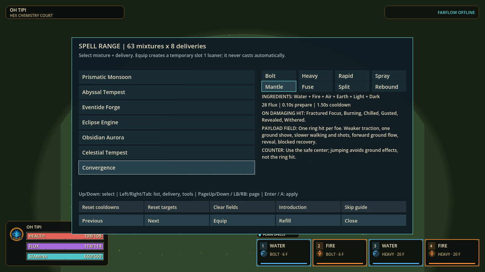

# H.E.X. — Help, Everything eXploded!

Status: **paused at the user's requested stable checkpoint, October 12, 2026.**
Current source and local Windows portable are **p60-1e084a50a029** on
`codex/hex-screen-smoothness-20261011`. The [iteration record](docs/iteration-20261012/README.md)
documents the multi-agent implementation, independent reviews and measurements.
Its [Full run](docs/iteration-20261012/full-final.json) passed **261 suites /
7,543,825 assertions**, zero failures and stderr, plus the 120 Hz boot check.
The matching portable passed archive, terrain and five-case lifecycle checks.

This checkpoint includes faster bounded projectiles, actual-path movement trails,
readability and perk/damage fixes, and staged Element Garden preparation.
The [foreground recording](docs/iteration-20261012/foreground-current-record.json)
passes admission, but warm Garden/Fire/Mantle p95 engine intervals remain
**29.420/49.174/51.784 ms**: steady 60 FPS is not achieved. Preparation staging
reduces measured peak work while increasing total CPU in the paired cases.
Previous working portables and failed evidence remain preserved. The
[single queue](.agent/OVERHAUL-IMPLEMENTATION.md) and [resume](.agent/HEX-RESUME.md)
record remaining work; the next profiling change is reviewed and unapplied.

A movement-led elemental combat sandbox in Godot. Move and aim independently,
build a twelve-slot spell weave, combine finite elemental effects, and learn a
rival's signature by defeating them. Start with a short optional introduction,
then experiment in a Range that can lend every spell. Explore seven Wellspring
districts and use the compact world map to travel between thirteen named places.

[Player guide](docs/PLAYER-GUIDE.md) · [Design goals and implementation state](docs/CORE-GAME-DESIGN.md) ·
[Design contract](SPECIFICATION.md) · [Current checks and remaining work](.agent/OVERHAUL-IMPLEMENTATION.md) ·
[Documentation map](docs/README.md)

## Install or play on Windows

This Git repository contains the game source, required art, tests and qualification
evidence. Exported EXE/PCK/ZIP files and local profiles are excluded from Git;
cloning the repository does not download a prebuilt portable.

The current source is on `codex/hex-screen-smoothness-20261011`. `main` remains at `95ca630`
with the earlier be3 runtime. Use the [development guide](docs/DEVELOPMENT.md)
to select and update the intended branch before launching from source.

To run a checkout, install **PowerShell 7.2 or later** and the pinned
**Godot 4.7.1 stable Windows runtime**. Open PowerShell in the repository and point
the helper at your downloaded executable:

```powershell
$env:FLUX2_GODOT_BIN = 'C:\path\to\Godot_v4.7.1-stable_win64.exe'
.\hex.cmd doctor
.\hex.cmd play --fullbody-art --pixel-cast
```

The helper checks the exact engine identity, `4.7.1.stable.official.a13da4feb`.
The first source launch imports the art and can take several minutes; it shows
progress and reuses the prepared resources on later launches.
For an independent portable, install matching Windows export templates and run
`.\hex.cmd package -PixelCast`. Each run creates a fresh folder under `exports/`.
See [development and verification](docs/DEVELOPMENT.md) for checks and packaging.

The latest qualified local portable is **p60-1e084a50a029**:

- [Launch H.E.X.](exports/hex-iteration-20261012/windows/PLAY-HEX.cmd)
- [Windows x64 ZIP](exports/hex-iteration-20261012/HEX-p60-1e084a50a029-Windows-x64.zip) — **153.7 MiB** (161,159,896 bytes). Extract the ZIP before launching.

The [package receipt](docs/iteration-20261012/package.json) and
[delivery checks](docs/iteration-20261012/delivery-files.json) verify the
export/archive identities. The [terrain check](docs/iteration-20261012/terrain-pack.json)
verified 133 exact images with 2,062 checks. The
[portable lifecycle check](docs/iteration-20261012/portable-lifecycle.json)
passed five cases with normal window closes and empty stderr, retaining the same
isolated preferences and unchanged package. Fire and all-six Mantle each completed
12 accepted paid casts with no refusals. These checks do not establish smooth frame
times, physical input, competitive balance or installer acceptance.

The preceding **p60-be680e20d70e** portable remains available through its
[launcher](exports/hex-smoothness-20261012/windows/PLAY-HEX.cmd) and
[qualification record](docs/smoothness-20261012/README.md).

The qualified comprehensive build **p60-845f85b5253e** remains available through
its [launcher](exports/hex-comprehensive-20261012/windows/PLAY-HEX.cmd) or
[ZIP](exports/hex-comprehensive-20261012/HEX-p60-845f85b5253e-Windows-x64.zip)
(161,146,185 bytes), with its own [qualification record](docs/implementation-20261012/README.md).

The preserved d8 audit portable is a historical fallback at
`exports/hex-audit-overhaul-20261011/windows/PLAY-HEX.cmd`; its ZIP is
`exports/hex-audit-overhaul-20261011/HEX-p60-d8e6ea1cd808-Windows-x64.zip`
(153.6 MiB, **p60-d8e6ea1cd808**). Full passed 251 suites / 7,081,662 assertions;
the actual export passed archive, terrain, startup and normal-close checks.
Heavy casting still falls below 60 FPS in the recorded finite release cases;
see the [measurement limits](docs/audit-implementation-20261011/native-performance.md).

The qualified October 10 portable is preserved at
`exports/hex-smooth-fields-20261010/windows/PLAY-HEX.cmd`; its ZIP is
`exports/hex-smooth-fields-20261010/HEX-p60-be3efd332e1a-Windows-x64.zip`
(153.5 MiB). These are local artifact paths, not GitHub download links. Earlier
d649 performance, October 9 expansion and p59 animation builds remain local
fallbacks with their original evidence.

The portable needs no Git, Godot installation or administrator permission.
Keep `hex.exe` and `hex.pck` together. The launcher enables the reviewed pixel
presentation; opening the EXE directly retains skeleton mode. In the current
candidate, **1280×720** offers the wider spell overview. At **960×540**, supported reading panels
reflow. The October 12 source and portable include a 200% reading size and separate
movement/aim deadzones; those changes are not contained in the preserved d8 portable.

Extract each version into its own folder. Saved controls and personal weaves
use the compatible `Godot/app_userdata/FLUX 2` location. Older elemental weaves
receive a slot-by-slot migration preview; Apply preserves the original-file
backup, while inspection or cancellation does not replace saved data.

## Start with five minutes

1. Choose **Introduction / F5**. Move, release a prepared jump, pay for a cast,
   watch Flux recover, then try a mixture. **Skip guide / F5** ends it at any time.
   Lessons observe your actions; they never move, cast or equip for you.
2. Open **Spell Range / F6**. Start with a single element, then a pair. Read the
   ingredients, cost, timing, on-hit status, field effect and counter. Equip a
   temporary loaner in slot 1 and cast it yourself. Reset/refill tools are explicit.
3. Use **Menu → World map** to reach the Academy, then open **Spell Loom** at its
   door to build your own twelve-position weave.
   Combine ingredient filters. In the wide overview, **More Forms** reveals
   the additional deliveries and cards can be dragged onto slots. The compact
   reading view uses **Options** for form arrows and **Browse** at the smallest
   layout; choose a spell/slot and use **Assign**.
   Read Swap/Replace before confirming.
4. Open **Signature Challenges / Shift+F6**. Read the rival's spell and counter,
   then defeat them through normal combat to learn it. **Esc / controller Back**
   returns; the challenge card keeps the other useful shortcuts visible.
5. Visit **Menu → World map → Element Garden** to walk all 63 ground exhibits.
   The six single-element plots alternate raw matter and matching-source reactions;
   use the Range for full-footprint combat tests. Use **F4 / Compendium** for movement chains and all 63 chemistry outcomes.
   The paid chemistry demos provide a retained result/counter card for a manual retry.



## What is playable

Current source: 30 playable profiles, 504 spells.

| System | Current game |
|---|---|
| Movement | Sprint, carve/brake a slide, gather/release jumps, roll, air-dodge, wallrun and chain paid techniques while aiming independently |
| Characters | 30 profiles, three body sizes, 21 ancestry passives and 30 personal passives through existing controls; flying ancestries use a deliberate second airborne Jump to start finite flight |
| Ingredients | Water with Ice effects, Fire with Charge effects, Air, Earth, Light and Dark |
| Spells | 63 nonempty ingredient sets × eight deliveries = **504 spells**; twelve equipped positions, four buttons across normal/Ctrl/Alt layers |
| Deliveries | Bolt, Heavy, Rapid, Spray, **Mantle** contact/paid trail, **Fuse** delayed area blast, **Split** bounded branches and **Rebound** wall banks |
| Statuses | Fractured Focus, Burning, Chilled, Gusted, Revealed and Withered; finite duration, explicit hit admission and bounded refresh |
| Chemistry | 63 bounded reactions, each named and finite, covering self-pairs and every distinct combination from two through six elements; situational effects and counters |
| Practice and progression | Optional introduction, all-spell Range, 30 earned rival signatures and clearly marked offline Developer tools |
| World | Seven Wellspring districts with **59,466 eligible chemistry cells**; familiar services and practice courts plus Tideglass Quays, Verdant Reaches, Basalt Foundry and Starward Terraces |
| Navigation | One compact Menu, a world overview, current location and thirteen named travel destinations; offline free-exploration travel preserves resources, cooldowns and weave |
| Element Garden | 63 physical plots in Tideglass show six raw materials plus all 63 finite reaction identities; harmless bounded loops with nearby explanations, while player spells remain live |
| Presentation | Slower held poses, tucked non-flying jumps, clear wall contact/protection, screen-wide sight with cover, stable terrain handoffs, faceted spells with grounded shadows, district floor motifs and distinct sound |
| Engine | 120 Hz authoritative simulation; 60 Hz transport snapshots; configured cadence, not measured performance |

All 30 sandbox characters are already available. Thirty particular signature
spells require clean rival victories; the Range can borrow them first. The
original 24 spell identities and saved twelve-slot positions remain stable.

Extra ingredients increase Flux cost and shorten status duration. They do not
multiply direct damage or material. Mixed terminals can form their named field;
a singleton self-reaction needs another matching paid source. Mantle is an
attack, not armor; Fuse's landed warning is harmless until its real detonation.
The Range explains these differences at selection time.

## Default controls

Saved custom bindings take priority. **Controls** shows keyboard/controller
equivalents and supports rebinding, sound, Reduced Effects/Motion and an aim arrow.
**Menu → Display & text size** selects Low/Standard visual detail,
a 60/120/unlimited frame limit and 100/125/150/200% text. Low and 60 FPS are the defaults; movement and
spell simulation remain at 120 Hz. Reduced-motion accessibility is separate.
Compact Gallery/Compendium **Options / O / controller Back** reveals browsing
controls and the focused ingredient; Back returns to reading and B closes.
Separate movement/aim deadzones and optional digital aim bindings live in Controls.

| Action | Keyboard / mouse |
|---|---|
| Move / aim | WASD / mouse |
| Sprint / slide | Shift / C |
| Jump | Space: press to gather, release to launch |
| Evade / technique | B / V; the action depends on grounded/airborne state |
| Spell positions | 1–4, Ctrl+1–4, Alt+1–4 |
| Service interaction | F at the door |
| Menu / world map | Esc / controller Back / click Menu; M opens the map |
| Compendium | F4 or Menu → Compendium; its Map action uses M / L3 |
| Introduction / skip | F5 or its visible menu action |
| Spell Range / Signature Challenges | F6 / Shift+F6 |
| Developer tools | Shift+F5; offline session only |

Saved gameplay bindings retain priority over Esc/M and F5/F6 convenience keys.
Menu shows the relevant activities; in the Range it includes Spell Loom,
Characters, Reset practice court and Return to Wellspring. Selecting a map pin
only highlights it; **Travel / Enter / A** confirms. Travel is unavailable during
rounds, challenges, isolated practice or active combat actions; its reason stays
inside the map. Controller Start keeps its existing emote action. During a
challenge the Menu button hides and Esc retains its exit behavior. Menus consume
navigation input without casting.

Developer mode offers all-spell access, protection, infinite resources,
cooldown resets and rival-input control. Overrides remain visibly marked and
never grant earned progress. Entering Developer mode makes that challenge
attempt ineligible for rewards even if the mode is switched off before victory.
Temporary Range/Developer weaves do not overwrite the player's saved weave.

## Evidence, design and limits

The [October 12 iteration record](docs/iteration-20261012/README.md)
tracks the current code changes, independent reviews, completed checks and remaining
acceptance work.
The [preserved October 11 audit](docs/audit-implementation-20261011/README.md)
retains the qualified d8 source and portable evidence. The
[resume](.agent/HEX-RESUME.md) identifies the exact runtime and local portable.
Complete-suite results, native timing measurements, visual checks and package
checks have separate evidence; none substitutes for player acceptance.

Three specialist agents and the integration owner reviewed one another's work.
The preceding comprehensive work added shared spell comparisons, paid encounter and learning
journeys, readable input routes, rolling save recovery and bounded diagnostics.
Its reading repair keeps the selected spell name visible in wider Loom
layouts, names both comparison sides before their values, and uses a fitting
Aim cue label in enlarged Controls. Its 196-frame native gate and
185,185-assertion final focused UI gate passed; these do not establish physical
input acceptance or smooth frame times.
The preserved October 11 audit also retains a failed native baseline that rendered
1290×730 instead of its requested size; that failure remains diagnostic evidence.
Current profiling validates actual dimensions and window observations throughout
each measured case; the implementation record distinguishes valid measurements
from attempts that fail those conditions.

The [design basis](docs/implementation-20261012/README.md#design-basis-and-acceptance)
connects those choices to established game-development practice. The current
[technical audit](docs/iteration-20261012/technical-audit.md) records the Garden
staging precedent, measured tradeoffs and deferred profiling work. The earlier
[composition and progression decisions](docs/element-expansion-evidence-20261009/integration.md)
and [map decisions](docs/large-wellspring-evidence-20261009/map-overview.md)
retain their original rationale. Magicka/Noita composition, Mega Man signature
learning, movement-shooter controls and readable action presentation are
references to adapt and test, not proof of H.E.X. balance or fun.

- **Balance, movement feel and wayfinding need human play.** Finite budgets and complete definition coverage do not establish equal competitive usefulness or intuitive routes.
- **The simulation is 2D with depth presentation.** Thirty identities have held action keys; complete authored cycles for every action remain unfinished. Native protection/jump fixtures test presentation correctness separately.
- **Steady 60 FPS is not achieved.** The [current foreground record](docs/iteration-20261012/foreground-current-record.json) reports Garden/Fire/Mantle p95 engine intervals of 29.420/49.174/51.784 ms. It is an admitted full-observer source recording, not GPU/present or packaged-performance acceptance. Earlier [measurements](docs/smoothness-20261012/performance.md) retain their original source scope. Retained campus drawing remains opt-in after its moving-Garden comparison regressed.
- **Multiplayer is experimental.** All participants need the same exact build. Eight players is a cap, not dense-capacity certification; physical two-PC and different-home acceptance remain open. No Internet relay is deployed.
- **The portable remains local and unsigned.** Source, tests, documentation and relevant receipts are checkpointed on the presentation branch; exported binaries and personal profiles remain excluded. Original assets and earlier working builds are preserved.

The [earlier presentation checkpoint](docs/presentation-checkpoint-20261011/README.md)
and [October 10 performance report](docs/performance-implementation-20261010.md)
keep their own Full attempts, native measurements and package receipts. Those
historical results do not qualify later changes.

## Development and documentation

The ability catalog retains **542 validated effective records; 504 have runtime wire IDs**.
The other records preserve disabled historical definitions. The champion catalog
has **30 playable entries; 30 identities**; presentation residency does not reduce
the playable roster.

Use the pinned **Godot 4.7.1** runtime from the actual repository root:

```powershell
.\hex.cmd doctor
.\hex.cmd play --fullbody-art --pixel-cast
.\hex.cmd check
.\hex.cmd test -Tier Full
```

[Specification](SPECIFICATION.md) owns current rules, [the player guide](docs/PLAYER-GUIDE.md)
owns teaching, [the resume](.agent/HEX-RESUME.md) owns exact source/package state,
and [the implementation queue](.agent/OVERHAUL-IMPLEMENTATION.md) owns remaining
acceptance work. The [audit record](docs/audit-implementation-20261011/README.md)
links implemented changes, independent reviews and qualification.
[The playtest route](docs/HEX-PLAYTEST.md) covers physical input, movement,
counterplay and experimental host/join use. [All 30 portraits](reference/art/portraits_20261008/index.html)
remain available offline.

The [source-publication record](docs/source-publication-20261011/README.md)
describes the retained source, removed redundant files, exact-byte evidence rules
and checkout validation. Git history identifies the publication commit;
the runtime identity in the resume identifies the game independently of documentation edits.

Superseded element contracts and continuation plans now point to the current
documents and retain exact historical copies. Preserve dirty work, original art,
profiles, failed receipts and working packages. The historical FLUX delivery
pointer below is unchanged and does not select this H.E.X. playtest.

<details>
<summary>Historical delivery-pointer metadata — not the current playable build</summary>

The old pointer is unchanged. Its FLUX p48 payloads are unavailable in this
checkout; recorded paths below are archival text, not working launch links.

```text
<!-- BEGIN CURRENT BUILD SUMMARY: generated by scripts/current-build-summary.ps1 -->
**Pointer-selected delivery metadata ([descriptor](docs/current-checkpoint.json), not fresh availability):** `overnight-p48-20260913`.
Recorded paths (not verified download links): game `exports/windows-overnight-p48-20260913/windows/flux2.exe`; pack `exports/windows-overnight-p48-20260913/windows/flux2.pck`; portable `exports/windows-overnight-p48-20260913/release/FLUX2-Windows-x86_64.zip`. Use the verified playtest link at the top of this README.
Pinned PCK SHA-256: `ddce9451e871096ca02190deb9092cba71db96bd8d732cd2181fd7c5cd452083`
Pinned ZIP SHA-256: `5e49c599f026453917e3eb8201456e86089e9fe0d794efe3b9bcebe1385c041f`
Pointer boundaries: publication `not_published`; human acceptance `pending`; physical two-PC acceptance `pending`; sustained rendered 120 FPS `not_certified`; current installer `not_attempted_prior_policy_block`.
This generated summary validates pointer metadata only; it does not read or hash local payloads or repeat runtime acceptance. For exact local byte and receipt checks, run `pwsh -NoProfile -File scripts/current-checkpoint.ps1 -ReportOnly`.
<!-- END CURRENT BUILD SUMMARY -->
```

</details>
