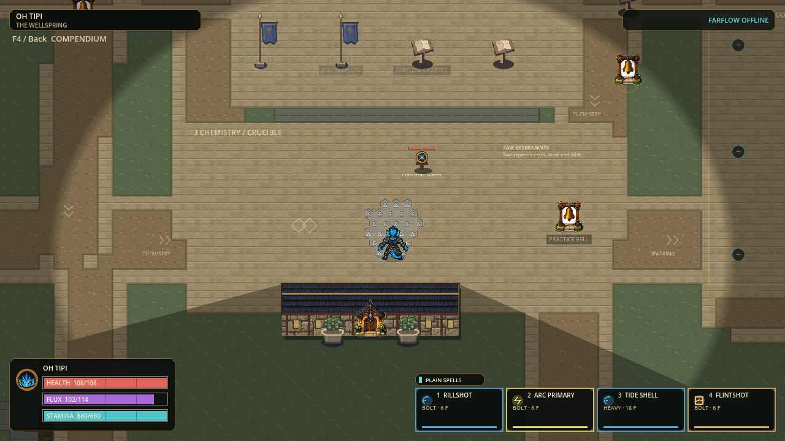
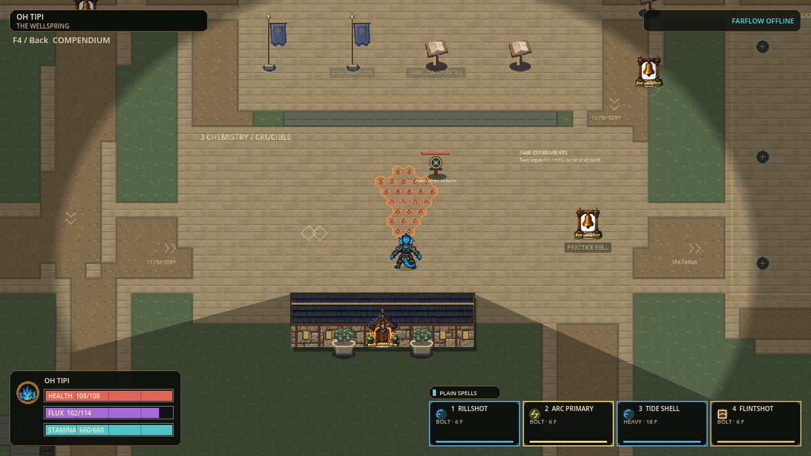

# Compact stationary reactions — September 28 checkpoint

Status: locally validated Windows playtest checkpoint; human acceptance pending.

Request: smaller reaction areas, non-moving for now. This deliberately changes
gameplay coverage; it is not a presentation-only optimization.

## Contract

| Aspect | Current rule |
|---|---|
| All 36 reactions | Radius and length at 75% of the previous authored values, after overrides |
| Steam / Flood / Conflagration | Selection radius 64 px -> 48 px |
| Rampart | Explicit selection radius 34 px -> 25.5 px; same six-face cover rules |
| Magma / Dustfront / Firestorm / Mistcurrent | Compact directional sector stays at its exact formation anchor |
| Freeze / Hailstream | Complete compact lane selected once; no growing or travelling sub-footprint |
| Ion Storm / Shadowdraft | No translation; pulses/visual animation still run |
| Vortex / steering fields | Coverage stays fixed; existing forces on actors still apply |
| Lifecycle / payment | Formation, active, decay, pulse times, damage, quantities and costs unchanged |
| Not changed | Ingredient deposits, projectile reach/speed, movement, character sizes, caps, 24 px grid |

An ideal geometric area is 56.25% of the previous area (75% squared), but actual
hex counts are discrete and depend on impact location and walls. Damage is not
raised to compensate for the smaller footprint. Hailstream now pulses across
its fixed compact lane; this needs human feel review, as its old travelling
sub-area was narrower at a given instant.

`HexRecipePolicy` is the single sizing authority. Host and prediction retain an
inert `move_products` hook; the obsolete dynamic selection loop was removed.
Snapshot motion columns remain compatible. This removes per-tick field motion
queries without approximating exposure or dropping paid events. One-shot linked
paths still form from eligible sources; destruction and expiry can remove cells.

## Verification

Candidate identity: `p56-b12c954709e2`, 2,932 production records.

[Start PLAY-HEX.cmd](../exports/hex-compact-stationary-20260928/windows/PLAY-HEX.cmd)
or extract the complete
[Windows portable ZIP](../exports/hex-compact-stationary-20260928/HEX-p56-b12c954709e2-Windows-x64.zip).
The wrapper enables character art; keep the adjacent EXE and PCK together.

| Check | Fresh evidence |
|---|---|
| Full gate | **166 suites / 1,213,800 assertions**, zero failures and stderr; import and configured 120 Hz boot passed; `.godot/compact-static-full-v3.json` |
| Focused gameplay/UI/snapshot tests | Nine suites passed in `.godot/compact-static-focused-v2.log`; four exposure/collision suites and the compendium suite also passed |
| Stationary contract | All 36 recipes, eight headings, exact off-grid contact; repeated host/prediction hook calls across lifecycle boundaries preserve full product state, paid conservation and visible hexes, with zero selection queries |
| Native pair capture | 23 frames: ten first-four paid pairs in normal/reduced modes plus three UI states; `.godot/unified-wellspring-compact-static-v1/capture-receipt.json` |
| Native movement crossing | Seven frames, two paid casts / 1,200 material; Steam exposure peaked at 34 and decayed to 0 after exit; `.godot/global-hex-compact-static-v2/receipt.json` |
| Dense deterministic profile | 1,892 assertions passed; normal/reversed commands end at identical hash; `.godot/fine-grid-steps-compact-static-v1.json` |
| Windows package | Native export launch, matching source identity, 30 character-art skins and safe close passed; `exports/hex-compact-stationary-20260928/receipt.json` |

Selected receipts/previews are copied to `docs/compact-stationary-evidence/`.
Post-export source identity Check passed for the same 2,932 production records;
export-smoke stderr was empty and all owned engine processes exited.

Reviewed native Steam normal/reduced and Firestorm normal images. Human feel and
all 36 rendered reaction acceptance remain open. The complete rendering output
does not imply every frame received independent visual review.

### Simulation timing — still FAILED 120 Hz

| Same input workload, different intended balance | Median ms (normal/reverse) | p95 ms | Max ms | Ticks above 8.333 ms |
|---|---:|---:|---:|---:|
| Prior retro checkpoint |16.434 /16.289 |38.232 /38.535 |240.741 /240.344 |480 /486 |
| Compact stationary |10.225 /10.255 |27.034 /27.147 |227.940 /227.007 |450 /450 |

Eight real paid casters, 120 warmup + 720 measured ticks each order. The new run has
67 admissions, 29 reactions, 40,200 paid matter, 18 peak flights and 22 peak products.
The previous run had 69 admissions / 30 reactions; this balance change intentionally
changes outcomes and is not a semantics-preserving optimization benchmark.
Normal/reverse hash: `8b2949daae4e9251213532fa7603fe23337dfdf8e80be3422c00b5c4feae7d77`.
Per-tick moving-field selection was eliminated. Remaining step/snapshot/rendered
performance is still an open gate; these samples exclude rendering and sockets.

### Failed attempts retained

- Focused v1: three stale expectations for old Rampart sizing and moving Firestorm.
- Full v1: documentation preflight required a `Status:` line; no suites executed.
- Full v2: one stale compendium Rampart-radius expectation; remaining suites passed.
- Native crossing v1: the old final-exposure-only assertion failed after a complete
  crossing of the smaller field. The revised harness records all 75 movement ticks
  and requires an actual exposure increase; production behavior was not weakened.

## Native previews

Smaller Steam, then stationary Firestorm; these are actual paid gameplay captures.

## Playtest

Compare against the preserved retro candidate. Test Steam exits, compact Magma
sectors, stationary Firestorm, Freeze and Hailstream lanes, Rampart escape and
Frostway/Capacitor traversal. Observe normal and reduced effects. Confirm that
movement remains readable and the smaller fields still feel useful.

No installer, publication, commit/push, checkpoint pointer or friends-ready
promotion is part of this slice. The previous multiplayer failure and remaining
rendered-performance/human acceptance gates remain open.
