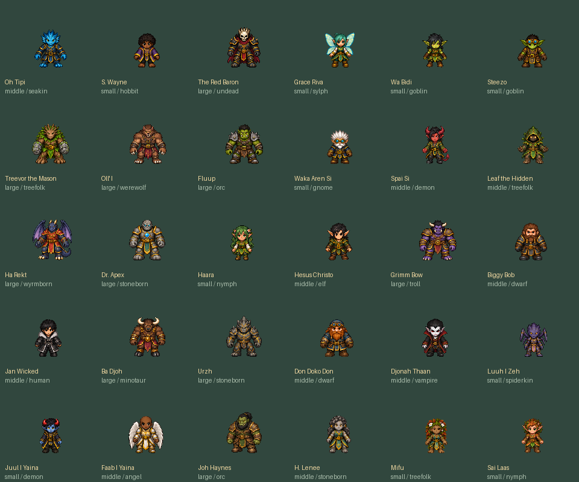

# H.E.X. current cast contract

Status: current source roster, updated October 11, 2026; 30 playable identities with no placeholders.
Both fixed-pixel manifests cover the exact live roster: each identity has its own
ground/cast bank and whole-body jumpsquat, rise, fall and landing keys across
eight stored directions. This is available artwork, not 30 complete animation
sets or final human visual acceptance. [Current play and evidence](../README.md).

In `--pixel-cast`, voluntary non-flying jumps and double jumps use compact
native folded body fragments clipped to a round envelope. Slow held turns follow
the actual rise and descent, rather than unrelated animation time; the second
jump folds more deeply and reverses the turn. A charged rise holds its opening
longer, and terminal descent holds its final pose. Landing restores the grounded
pose immediately without waiting for a rotation. Reduced Motion holds an upright
tuck. The four flying races use their own open airborne artwork only during an
admitted second-press, held, finite flight. Their outer wing keys hold for 200 ms
while the original central face and torso stay fixed. First jump remains ordinary;
release, exhaustion, expiry or landing removes the flight pose immediately.

Walking and sprinting retain distance-based footwork with slower visual caps of
2.0 and 2.5 cycles per second, respectively. Stopped movement holds its pose;
these presentation caps do not delay input or reduce gameplay speed. Spawn
protection keeps an opaque body and shield markers. During the actual timed
dodge protection, the body is translucent with split marks, slashes and remaining
window pips; the first vulnerable recovery frame restores opacity and removes
those cues. Ordinary jumps and flight do not imply immunity, and no cue means
phasing through walls. Reduced profiles preserve the same protection meanings.

These are assemblies of original pixels, not newly painted action cycles.
Casting remains available, but airborne arms are not independently painted.
Other unpainted actions retain registered source poses. Actual hurtboxes,
movement, Stamina and protection windows remain independent of presentation.
The [current aerial review](reference-refinement-evidence-20261009/animation-followup-native-review.md)
records the scoped native pass and its small-scale, fixture and physical-play
limits. The [earlier aerial record](reference-refinement-evidence-20261009/aerial-animation.md)
preserves the rejected versions and preceding accepted checkpoint. Neither
claims a new Full-suite result or package; the [central handoff](../.agent/HEX-RESUME.md)
owns that qualification boundary.
All-cast anatomical continuity, exact-heading quality and complete authored
directional cycles remain open. Historical scope and review limits are recorded
in the [all-cast movement checkpoint](HEX-CAST-MOTION.md) and
[scale/performance checkpoint](HEX-SCALE-PERFORMANCE.md); neither certifies later source.

Ten Small, ten Middle and ten Large profiles remain. The unnamed Angel is retired;
Faab I Yaina is the named playable Angel. Source poster labels are not roster
authority. [October 2 ground/cast checkpoint](HEX-PIXEL-CAST.md) and preserved
[September27 sources](art/character-cast-20260927/HANDOFF.md) remain history and
reference. Size stats and collision geometry are unchanged.

The October 9 source adds one named situational passive to each of the 21
ancestries and one distinct personal passive to each of the 30 characters.
They activate through existing movement, posture and resource state. Gallery
overview shows both; Details and the Compendium explain windows and counters.
See the [implementation and acceptance record](REFERENCE-IDENTITY-REFINEMENT.md)
for live effects, reference-game rationale and the separate balance gate.

## Style and runtime boundary

### Detailed Gallery portraits

All 30 current identities have individual detailed close-ups in the
[offline portrait browser](../reference/art/portraits_20261008/index.html).
The current catalog, not old poster labels, owns race/name/affinity assignments.
Portraits preserve current identity while interpreting tiny-sprite material and
facial detail; they are not new body sheets or animation-completeness evidence.

Joh Haynes and Grimm Bow now select reviewed v2 portraits: Joh has a calmer,
steadier expression, while Grimm has a warmer, curious expression. Their current
Orc/Troll identities and defining features are preserved. The original reference
PNGs remain untouched beside the versioned refinements; actual prompts, hashes
and review limits are recorded in the
[refinement provenance](../reference/art/portraits_20261008/refinement-v2-prompts.json).
This agent review is not human visual acceptance or animation evidence.

The subsequent personality pass refines eleven more portraits: S. Wayne,
Steezo, Wa Bidi, Grace Riva, Haara, H. Lenee, Sai Laas, Spai Si, Juul I Yaina,
Treevor the Mason and Fluup. Nineteen current portraits are retained, including
Joh/Grimm v2. The [all-cast expression matrix](CHARACTER-PERSONALITY.md) connects
art direction to existing playstyles without inventing new abilities.
[Integration and saved prompts](../reference/art/portraits_20261008/personality-integration.json)
preserve original/source hashes. See the [identity checkpoint](CHARACTER-IDENTITY-CHECKPOINT.md)
for exact fresh validation and the still-open anatomical work.

The Gallery shows the selected illustration beside the eight-heading body
preview. Click the illustration, press **P**, or controller **Start** to enlarge;
**Esc / B / Back** returns to the roster before closing the Gallery. Inspection
never equips a character: **Attune** remains explicit. Card/HUD portraits retain
their existing sprite crops. Missing illustrated art falls back to those crops.

Full-resolution originals, actual generation prompts and provenance are retained
under `reference/art/portraits_20261008`; the game uses bounded 512px imports under
`assets/portraits/champions_v1`. The selected-art cache holds at most two textures
and is released on close. These limits are not a measured frame-time claim.

The [preserved full-cast illustration](../reference/art/cast_proportions_v5/flux-current-cast-final.png)
remains a style reference, not a screenshot or proof of animation completeness.

The latest user-selected `styleref1.png` owns the compact, charming fantasy-pixel
target: similar cranial sizes, short necks, readable limbs, primarily volume-based
Small/Middle/Large silhouettes, practical clothing and empty-hand casting.
Neutral body heights remain58/63/68px; illustration proportions never change
gameplay collision. S. Wayne stays dark-skinned; Biggy Bob
brown-haired. Spell effects, auras, shadows and scenery never become body pixels.

The selected portrait package launcher enables `--fullbody-art --pixel-cast`.
The source refinements described here do not imply a new packaged build; the
[current play and evidence](../README.md) identifies the verified package boundary.
The pixel mode uses each identity's bank for Gallery cards/body previews, HUD
head-and-shoulders crops and ground/cast rendering, plus the admitted held action
keys above. The selected Gallery illustration is the separate resource described above.
Direct source/EXE launches without these flags retain the shared skeleton mode;
source play uses `scripts/run.cmd --pixel-cast`, which also enables full-body art.
These are rendering modes, not duplicate playable identities. Both pixel banks
use 128px cells and foot pivot `(64,104)`, fixed registration and nearest sampling.
The Gallery now displays the pixel body cell at native 128px and card head crops
at native 32px within the common logical viewport; the previous 128-to-96 and
32-to-40 resampling is removed. It does not resize source heads or normalize
anatomy across action sheets. All 30 identities have regression coverage for
fixed native registration, with five-pose South/East native comparison sheets.
Ground gait has two contact poses and reused neutral beats; backward/sidestep
footwork, slide/roll/flight cycles and independently painted airborne casting
remain incomplete. Unsupported actions use registered rigid low/air source poses,
or the admitted identity's idle pose if an optional action bank is unavailable;
full pixel cast does not fall back to a deforming mesh.

The separately selectable legacy shared-rig mode retains 96px cells, pivot `(48,84)`, fixed limb
lengths, eight headings and independent travel/aim. Its older 3312-cell bank and
slide_v1 review describe that mode's artwork, not a runtime fallback from full
pixel cast or current pixel-bank completeness.
No pose uses per-frame fitting to change body size. Hurtboxes depend only on
size, not race, skin, aim or animation; all sizes have18px wall clearance.

## Current roster

Affinities spend three points across two or three of the six live elements; these
levels do not automatically multiply damage or grant racial passives. Air keeps
the internal ID `wind`. The Gallery shows all 30 champions together in a 6×5 grid,
ordered Small, Middle, Large, then name; race is descriptive, not a column or page.
This is a presentation-only ordering: canonical IDs and roster/wire order remain
unchanged. Hover/selection previews show source-derived details and eight facing
steps. Arrow/WASD/controller directional input navigates the grid; PgUp/PgDn or
controller LB/RB focuses a size group without hiding any champions.

Every listed identity has the same bounded pixel-bank coverage described above;
the roster does not claim completed movement cycles.

| Champion | Race | Body | Affinity levels |
| --- | --- | --- | --- |
| Oh Tipi | Seakin | Middle | Water 2 · Fire 1 |
| S. Wayne | Hobbit | Small | Dark 2 · Light 1 |
| The Red Baron | Undead | Large | Fire 2 · Water 1 |
| Grace Riva | Sylph | Small | Air 1 · Water 1 · Light 1 |
| Wa Bidi | Goblin | Small | Fire 2 · Air 1 |
| Steezo | Goblin | Small | Fire 2 · Light 1 |
| Treevor the Mason | Treefolk | Large | Earth 1 · Air 1 · Fire 1 |
| Oll' I | Werewolf | Large | Earth 1 · Fire 1 · Light 1 |
| Fluup | Orc | Large | Air 1 · Fire 1 · Water 1 |
| Waka Aren Si | Gnome | Small | Fire 2 · Light 1 |
| Spai Si | Demon | Middle | Air 1 · Earth 1 · Light 1 |
| Leaf the Hidden | Treefolk | Middle | Water 1 · Earth 1 · Light 1 |
| Ha Rekt | Wyrmborn | Large | Water 1 · Air 1 · Fire 1 |
| Dr. Apex | Stoneborn | Large | Earth 1 · Light 1 · Water 1 |
| Haara | Nymph | Small | Light 2 · Air 1 |
| Hesus Christo | Elf | Middle | Earth 2 · Water 1 |
| Grimm Bow | Troll | Large | Earth 2 · Water 1 |
| Biggy Bob | Dwarf | Middle | Earth 1 · Fire 1 · Light 1 |
| Jan Wicked | Human | Middle | Water 1 · Dark 1 · Fire 1 |
| Ba Djoh | Minotaur | Large | Earth 1 · Fire 1 · Water 1 |
| Urzh | Stoneborn | Large | Earth 1 · Fire 2 |
| Don Doko Don | Dwarf | Middle | Earth 1 · Fire 1 · Water 1 |
| Djonah Thaan | Vampire | Middle | Dark 1 · Fire 2 |
| Luuh I Zeh | Spiderkin | Small | Dark 2 · Water 1 |
| Juul I Yaina | Demon | Small | Water 2 · Air 1 |
| Faab I Yaina | Angel | Middle | Fire 2 · Light 1 |
| Joh Haynes | Orc | Large | Earth 2 · Fire 1 |
| H. Lenee | Stoneborn | Middle | Earth 1 · Air 1 · Fire 1 |
| Mifu | Treefolk | Small | Water 1 · Air 1 · Light 1 |
| Sai Laas | Nymph | Small | Air 2 · Fire 1 |

H. Lenee retains `h_le_ne`/wire28 (female Stoneborn,Middle), while Mifu retains
`fimu_yashiha`/wire29 (female Treefolk,Small). Mifu's Fire is replaced by Air and
her starter Spray becomes Squall. H. Lenee already has Air and retains Earth/Air/Fire.
Sai Laas uses `sai_laas`/wire30: Small Nymph,Air2/Fire1,gender unspecified.
Small and the2/1 split are conservative defaults within the existing three-point rule.

Juul I Yaina is a male Demon with curly dark hair; Faab I Yaina is a bald male
Angel; Spai Si is male; Wa Bidi female. Stable technical IDs `grace_reava`,
`nico_lai` and `donnok` retain their current player-facing names.
The old H. Le-ne/Fimu Yashiha portrait labels and removed placeholder are historical
reference content, not current roster authority.

## Size baselines

| Body | Count | Visible height | Hurt radius | Health | Flux | Stamina | Baseline recovery/s | Speed |
| --- | ---: | ---: | ---: | ---: | ---: | ---: | ---: | ---: |
| Small (S. Wayne) | 10 | 58px | 17px | 90 | 123.2 | 620 | 28 | 1.06× |
| Middle (Oh Tipi) | 10 | 63px | 18px | 108 | 114.4 | 660 | 30 | 0.98× |
| Large (Red Baron) | 10 | 68px | 19px | 132 | 105.6 | 700 | 32 | 0.91× |

All members of a size share its stamina maximum and hurt radius. Existing health,
Flux,speed,recovery and finite movement/protection timings are preserved.
Small Grace Riva and Wa Bidi retain their distinct29/32 stamina recovery per second.
Small/Large stamina differs from Middle by approximately6%; hurt radius by5.6%;
visual height by7.9%. These are candidate tuning values,not proof of competitive balance.

## Spells and selection

The live catalog contains 504 spells: all 63 nonempty sets of the six ingredients
across Bolt, Heavy, Rapid, Spray, Mantle, Fuse, Split and Rebound. Twelve positions
are configured at the Spell Loom. Thirty signature combinations are earned from
their corresponding rival; the other choices, including the original 24 spells,
remain available. Valid previously saved/equipped choices are preserved, and the
offline Range temporarily loans every definition. Character selection does not
grant signature progress. See the [player guide](PLAYER-GUIDE.md) and
[configuration boundary](ABILITY-CONFIGURATION.md).

Starter kits retain six Bolts, a dominant-affinity Heavy, and five distinct
experiments across the other ingredients. Disabled historical families are
unavailable in new kits. The [pre-publication roster document](archive/source-publication-20261011/CURRENT-CAST.md)
preserves the former 24-spell description as history.

Host-confirmed character switching preserves resource percentages and restores
that character's saved weave, or its starter kit if uncustomized. Selecting the current character is
a no-op preserving custom spells,cooldowns and accounting. Attunement requires the
Gallery in Wellspring/HEARTH and a living grounded free actor without an active
cast,movement commitment,protection or impact recovery.

## Visual availability and acceptance

Source and manifest inspection establishes coverage, not visual quality or human
acceptance. [Current evidence](../README.md) keeps source, native, package and
human gates separate. Historical art receipts qualify only their named builds.

| Layer | Boundary |
| --- | --- |
| Identity/affinity/size | 30 source-linked profiles; 21 ancestry and 30 personal situational passives; base size stats and affinity rules retained |
| Identity-specific ground/cast art | 30 banks, eight headings, idle/two contacts/cast; neutral beats are reused, not extra painted poses |
| Whole-body action keys | 30 banks, eight headings, jumpsquat/rise/fall/landing; shared keys are not complete cycles or independent airborne arm animation |
| Fallbacks | Full pixel cast uses rigid registered low/air/idle source-pose substitutions, never a deforming mesh; working action coverage is not complete authored animation |
| Open visual gates | Full-roster anatomical continuity, exact-heading quality, authored strafe/backpedal/slide/roll/flight/airborne-cast cycles and human motion/relative-size review |
| Next work | Follow the [single queue](../.agent/OVERHAUL-IMPLEMENTATION.md); preserve working banks while reviewing bounded action corrections |

Earlier construction and named-art history remain in
[character template](CHARACTER-TEMPLATE-V2-CHECKPOINT.md),
[character pages](CHARACTER-PAGES-CHECKPOINT.md) and
[Gallery](CAST-GALLERY-CHECKPOINT.md) checkpoints. Do not promote a portrait or
cutout as a complete animation set. Preserve original source artwork and require
reviewed pose/contact coverage before replacing a working bank. The
[exact pre-consolidation document](archive/CURRENT-CAST-before-doc-consolidation-20261007.md)
preserves superseded visual-status wording without making it current authority.
