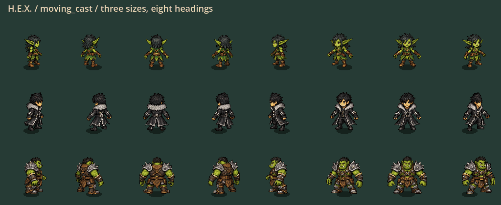

# Continuous casting and field-query refinement

Status: locally validated Windows playtest checkpoint; human feel acceptance pending.

September 28, 2026. Bounded follow-up to the compact stationary reaction
checkpoint. This slice preserves gameplay rules; it is not another balance pass.

| Area | Change | Guardrail |
|---|---|---|
| Cast motion | Continuous startup/recovery instead of eight arm phases and five blend levels | Fixed-length upper/lower arms; legs keep their independent travel gait |
| Acceleration / braking | Continuous stride amplitude from actual velocity | No input smoothing, speed/cost changes, or facing delay |
| Animation memory | Cache only unmodified source poses; stream modified vertices into existing actor buffers | 384 source meshes / 256 live buffers; repeat draws reuse geometry |
| Moving through fields | One exact swept-cell query per actor shared across active products | Height, landing, wallrun, protection and canonical seam rules preserved |
| Short-step queries | Search local hex bounds instead of scanning all occupied cells | Long-path bounded fallback; exact clipping, no radius approximation |
| Exposure | One occupied-cell view per pass rather than one per actor | Local pass cache only; no stale cache between ticks |
| Pillar collisions | Reject strictly disjoint swept bounds before allocating/testing convex planes | Equality/tangency still goes through the unchanged exact solver |

Continuous pose CPU work uses predecoded joint coordinates, packed skin bindings
and a bounded terminal-cast bone cache (384 entries; skin bindings at most one
per admitted character/direction). It does not create meshes or upload textures
every cast tick. The first naive continuous modifier path was rejected after
its eight-actor diagnostic measured 13.707 ms p95. The packed exploratory run
measured 5.932 ms; the final run measured 10.526 ms. This variability and remaining
cost are open performance work, not a passed 120 Hz rendering gate.

Still preserved: 24 px hexes, smaller stationary reactions, all 36 reaction
rules, retro material stamps, no character affinity orbits, camera and controls,
paid resources, character sizes, hurtboxes and common wall clearance. Protocol
56 and snapshot schema 22 remain unchanged. Matching build identity is required
for networking; this slice does not establish multiplayer acceptance.

## Acceptance and evidence

Candidate `p56-89cd9398d967`, 2,932 production records; runtime SHA256
`89cd9398d9677c9425afa0ef49eac90734951bbb2bccdccce074eabc5459afee`.

[Start PLAY-HEX.cmd](../exports/hex-live-motion-20260928/windows/PLAY-HEX.cmd), or
extract the complete [Windows portable ZIP](../exports/hex-live-motion-20260928/HEX-p56-89cd9398d967-Windows-x64.zip).
Keep `hex.exe` and `hex.pck` together. The wrapper enables the detailed character
art; running the bare EXE retains the separate skeleton-preview default.

| Fresh check | Evidence |
|---|---|
| Full | **166 suites / 1,233,417 assertions**, zero failures, zero stderr; import and configured 120 Hz boot passed; `.godot/live-motion-full-20260928.json` |
| Focused | Six suites passed; `.godot/live-motion-final-focused-20260928.log` |
| Native motion | **192 frames**: walk, sprint, wallrun, accelerating/braking moving cast; three sizes x eight headings; `.godot/fluid-motion-live-20260928/` |
| Native gameplay | Seven real paid Water/Fire/Steam and crossing frames; `.godot/global-hex-live-motion-20260928/receipt.json` |
| Deterministic workload | 1,892 assertions; both command orders match the preserved compact-stationary hash and all paid metrics; `.godot/fine-grid-steps-live-motion-final-20260928.json` |
| Windows export | Native matching-identity launch, 30 art skins and safe close passed; `exports/hex-live-motion-20260928/receipt.json`; stderr empty |

PCK SHA256: `5cc01f5fba8fb75af7c0e690bcf77823e8b95c8330dce930c6b0d1ba12e356ef`.
ZIP SHA256: `3a9ffa479284098b77ecda68b73a7d7b205a2f1bd02885618b2b43c8530bb3bf`.
Post-export identity Check passed for the same 2,932 records. ZIP size:
106,603,216 bytes. All owned engine helpers exited; prior builds, user profile,
installer, pinned checkpoint and dirty checkout were preserved. Nothing was
committed, pushed or published.

Reviewed moving-cast frames 12 and 30 and the native Steam normal gameplay frame.
Other captured frames are available for inspection, not individually certified.
Selected receipts, screenshots and a slowed motion-inspection GIF are under
`docs/fluidity-evidence-20260928/` (excluded from runtime resources).

### Timing: improved simulation median, 120 Hz still FAILED

| Simulation-only diagnostic | Median ms, normal / reversed | p95 ms | Max ms | Ticks over 8.333 ms, of 720 |
|---|---:|---:|---:|---:|
| Previous compact-stationary receipt | 10.225 / 10.255 | 27.034 / 27.147 | 227.940 / 227.007 | 450 / 450 |
| Fresh fluidity candidate | 7.634 / 7.371 | 19.655 / 19.609 | 272.194 / 229.231 | 264 / 244 |

Same workload, exact same outcomes: 67 admissions, 29 reactions, 40,200 paid
material, 18 peak flights and 22 peak products. Both orders retain state hash
`8b2949daae4e9251213532fa7603fe23337dfdf8e80be3422c00b5c4feae7d77`.
The prior receipt is historical, not a contemporaneous controlled A/B timing run.
The remaining long ticks are not solved; this is not sustained 120 Hz acceptance.

Eight-actor presentation CPU batches, 240 warmup / 720 measured:
ordinary walk/run p95 **1.660 ms**, moving casts/variable strides **10.526 ms**
(median 5.547 ms). These exclude rendering/GPU, simulation, network and physical
input. The single-player paid capture measured simulation p95 0.727 ms, which
does not establish the crowded-scene budget. Keep pose/simulation/full-frame
measurements separate; do not add their independently sampled percentiles.

Focused v1 caught a new test variable needing an explicit type; gameplay suites
passed. Focused v2/diagnostic caught a 4.8984 px adjacent-tick diagonal arm jump
caused by endpoint blending. Fixed by blending rotations while preserving bone
lengths. Focused v3 passed all four selected suites. Failed receipts remain in
`.godot/fluidity-*.log` for traceability.
One exploratory profile was refused because its output name already existed;
the older receipt was preserved, and subsequent outputs use a fresh dated name.

## Human playtest

1. Walk, sprint, release direction and reverse: steps should shorten naturally
   with braking, without delayed input or a frozen sliding gait.
2. Run diagonally while aiming sideways/backward; cast repeatedly and let the
   arms recover. Feet should continue their movement phase and arms should not
   collapse or snap between blend levels.
3. Chain slide, jump, air dodge and wallrun. Low/air/protection cues and facing
   must react immediately; visual settling is limited to ordinary locomotion.
4. Cross overlapping reaction tiles, jump over them and land at an edge. The
   visible whole hexes are still authoritative; formed areas stay stationary.

## Limits and next bounded work

Art remains a shared-rig candidate: 30 skins, three authored low/air key-pose
sets, not 30 fully authored animation libraries. The diagonal/cast correction
does not invent missing costume or occlusion frames. Pose CPU measurements are
not rendered-frame/GPU evidence. Dense simulation, full-world snapshot and
rendering costs must be measured separately; configured 120 Hz is not a pass.
Preserve the compact-stationary portable as fallback. No commit, push, installer
update or pinned checkpoint promotion is part of this slice. Return for feedback.
