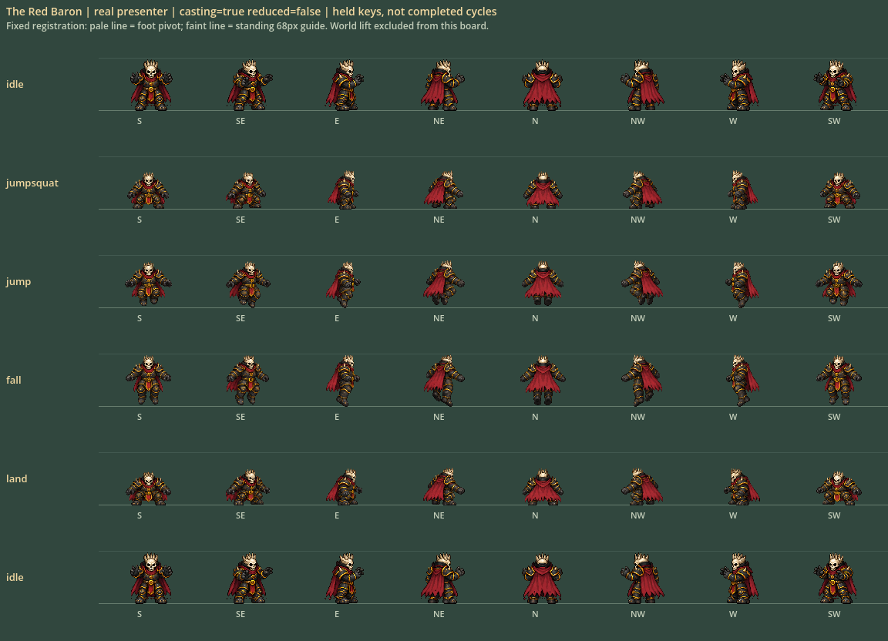
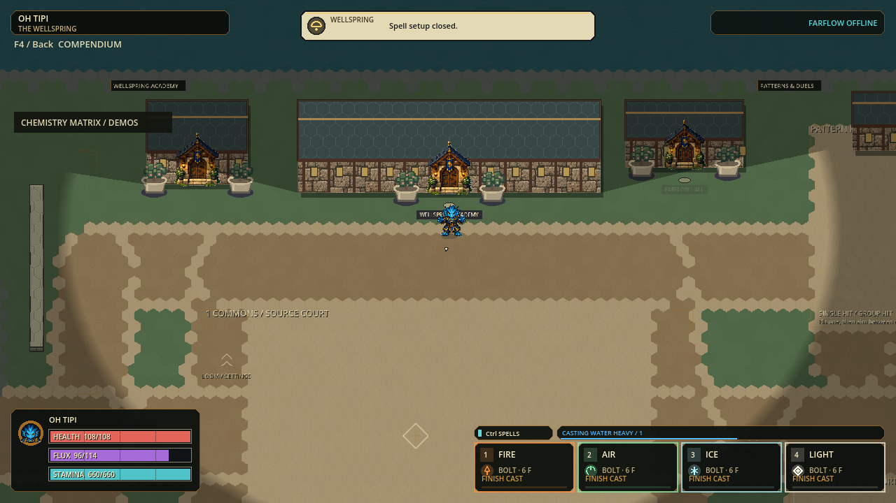

# H.E.X. all-cast fixed-pixel movement checkpoint

Status: October 3 local solo candidate `p56-f41a016ccac4` READY TO PLAYTEST.
Full/native/package gates passed; final art and human feel remain unaccepted.
The [previous craft portable](../exports/hex-craft-20261003/windows/PLAY-HEX.cmd)
is freshly hash-verified as fallback. No public release or installer promotion.

[Start H.E.X.](../exports/hex-cast-motion-20261003/windows/PLAY-HEX.cmd) ·
[110.4 MiB Windows ZIP](../exports/hex-cast-motion-20261003/HEX-p56-f41a016ccac4-Windows-x64.zip) ·
[Five-minute trial](HEX-PLAYTEST.md) · [Receipts](cast-motion-evidence-20261003/README.md).

## Scope and working prompt

Expand readable, reference-led fixed-pixel movement to all 30 current identities,
using one small artist ticket per character and no more than three concurrent
workers. Keep shared integration, imports, tests, capture and export lead-owned.
Preserve every original, current ground/cast bank and protected dirty change.
Prioritize what survives native resolution: silhouette, directional identity,
consistent head/body proportions, distinct phase poses and leg/hand placement.
Do not change paid gameplay, stats, hit geometry or movement timing for artwork.
Return a tested runnable checkpoint, not a claim of complete animation cycles.

| Component | Deliverable | Evidence boundary |
|---|---|---|
| All 30 characters | Four whole-body keys × eight directions per identity: anticipation, rise, descent, landing | 960 stored cells including the preserved 32 S. Wayne cells; held keys, not cycles |
| Three sizes | Existing 58 / 63 / 68-pixel standing envelopes; differences primarily volume | One uniform source scale, no independent fitting of compressed poses; gameplay sizes unchanged |
| Shared assembly | Receipt-gated inputs, strict recipes, binary alpha, stable source hashes and staged all-roster publication | Incomplete/invalid source bank cannot replace the runtime bank |
| Cast clarity | Paid cast name, saved binding and progress remain visible when its hotbar layer is hidden | Pure view of pending authoritative state; no new timer, input rule or cancellation |
| Windows delivery | Pixel candidate launcher, three-size quick starts, same exported asset verification | Solo local test; no installer/updater/publication, remote or dense120Hz acceptance |

## Art and runtime contract

Canonical identity comes from `content/champions/foundation_champions_v1.json`,
not the old names, races, weapons or elements on the style poster. Current
ground/cast PNGs supply each costume and face. New bodies have empty hands;
spell graphics, shadows and world effects remain separate.

The immutable source sheets, exact prompts and author receipts are under
`art_batches/pixel_actions_v1/`. Its [ticket contract](../art_batches/pixel_actions_v1/CHARACTER-TICKET.md)
and [assembly contract](../art_batches/pixel_actions_v1/README.md) are reproducible
handoff instructions. `--available` is review-only. Full publication requires all
30 valid sources, and must run with imports stopped. Windows directory exchanges
are staged with rollback, not a cross-directory power-loss-atomic transaction.

All whole-frame keys use a 128px cell and foot pivot `(64,104)`, nearest sampling,
no runtime mesh deformation or pose rotation, thresholded alpha with zero hidden
RGB, and one source-wide scale. S. Wayne is locked to its previous exact PNG.
Double/wall/slide jumps share the rise key; fast fall shares descent. Casting is
never blocked by artwork, but airborne arms are not independently authored.

## Acceptance ledger

| Gate | Current result |
|---|---|
| Deterministic assembly tests | Fresh: 26 tests passed, including rollback, incomplete inputs, stale/mismatched lead reviews and exact S. Wayne preservation |
| Hidden paid-cast test | Fresh Full: 5,932 assertions, zero failures/stderr, including invalid layers |
| Native ordinary UI | Final v2 PASS: 70 checks / 13 frames, zero failures/stderr; actual paid Heavy remains visible after changing visible layer; Loom assignment/rebind, Attune and disabled offline route tested |
| All-character source / assembled pixel review | 30 sources, 960 cells assembled; lead plus two independent native-pixel board reviews. Runtime/human acceptance separate; directional and continuity limits below |
| Actual Godot action registration | 120 native boards / 5,760 presenter queries, all 30 identities × casting × reduced motion; fixed registration, not timed cycles |
| Actual Wellspring movement v2 | 92 frames over three sizes; 3 paid airborne Spray admissions/releases, 46 fixed-key aircast ticks, 7 planted landing-key ticks; explicit fixed cursor endpoint, not physical input |
| Complete runtime bank and full regression | Fresh PASS: 177 suites / 3,154,808 assertions, zero failures/stderr; imports, source/asset checks, identity and configured 120 Hz boot. Candidate p56-f41a016ccac4 / 3,081 runtime records |
| Exact Windows package and safe close | Native launch/admission/identity/safe-close PASS; all120 new action +30 preserved ground PCK boards match byte-for-byte; new portable and craft fallback PCK/ZIP hashes verified |

The first HUD run was refused by stale runtime identity; after identity refresh,
the next run exposed a misplaced test assertion on visible slots. That assertion
was corrected and the focused gate passed. These failures are preserved under
`.godot/allcast-hidden-hud-focused*.json`; they are not successful receipts.

Full publication additionally requires a per-character `lead-review.json` tied
to the exact source hash, identity and explicit acceptance scope. Agent completion
receipts alone cannot authorize a changed or held source. Reviews are rechecked
before publication; `--available` bypasses this only for non-runtime previews.
All source-size HOLD records are preserved. Lead admission is for a bounded
playtest candidate, not final eight-angle or human motion approval.

Independent code review also caught ordinary motion capture reporting PASS
without requiring movement. Ordinary mode now reports capture-only / NOT_RUN;
only the paid-airborne fixture can pass its admission, release and landing gate.
The final-v1 UI repeat encountered an empty directory-card array and was stopped.
The diagnostic now guards routing/indexing, saves failure-state receipts and
isolates synthetic input from desktop focus/events. Final v2 passed70/13 with
zero focus restorations: focus loss was a code-supported trigger hypothesis,
not proven as the exact prior cause. Production focus safety was not changed.
World v1 omitted an explicit pointer; final v2 requires and records one, preventing
desktop cursor position from silently choosing the spell endpoint.

## Visual review findings to carry into playtesting

| Finding | Current decision / next correction |
|---|---|
| 30 complete, unclipped assembled banks | Admit for native engine review; no missing limbs or duplicated front/back gross failures found by independent reviewers |
| Luuh I Zeh | Fourth source repair restores left-facing SW and real back torso; E/SE and W/SW remain close. Strict exact-heading quality is NOT accepted |
| Sai Laas | Native head envelope is close to existing idle; source artist HOLD and close SE/E remain documented, not called final direction approval |
| Idle-to-action continuity | Oh Tipi, Red Baron, Fluup and Haara most visibly reduce head/face mass; also milder differences on S. Wayne, Oll' I, Waka Aren Si and Dr. Apex. Prioritize this before adding many more frames |
| Phase separation | Grace, Waka and Leaf have subtler rise/fall silhouettes due to wings, beard or cloak; inspect in motion before expanding cycles |
| Hesus Christo | Corrected source has wider planted feet/lowered hips; no per-pose fit or stretching used |

The new 960 cells comprise 928 newly generated cells plus the exact 32 previous
S. Wayne cells. Input sources and rejected variants are preserved. The runtime
bank is assembled with binary alpha and nearest sampling; original partial alpha
remains untouched in source art. All 30 ground/cast PNGs stay unchanged.

## Delivery and cleanup

Build `p56-f41a016ccac4`; runtime SHA256
`f41a016ccac45bcceeb5511f4a6d64e8eb6dc60edf140977d4b9ef57f1d08c17`,
3,081 production records. [Package and fallback hashes](cast-motion-evidence-20261003/package-comparison.json).
Cleanup of eight agent-generated partial review folders was attempted after final
assembly but blocked before execution; no workaround or deletion was attempted.
They remain reproducible duplicate previews. Immutable sources, rejected variants,
complete review, and success/failure receipts remain. Six export
folders remain because previous older-build cleanup was blocked; no workaround.
No commit, push, release, relay deployment or historical checkpoint-pointer change.

## Explicit remaining limits

The existing two-contact walking loop still needs richer dedicated strafe and
backward contacts. These four jump keys do not replace slide, roll, flight or
control-state art; those keep the prior working renderer. Some wings, armor and
capes naturally hide far limbs. Exact pose timing and player preference need
human feedback at normal camera scale. Sound, map topology, paid mechanics and
balance remain unchanged in this bounded slice.

Dense simulation previously measured p95 12.341–13.066 ms against an 8.333 ms
budget: FAILED, not rerun or fixed by this visual change. Remote friend play,
physical controllers, moving rendered frame pacing and human fun remain open.
No unmeasured capacity or performance promise accompanies the new artwork.
