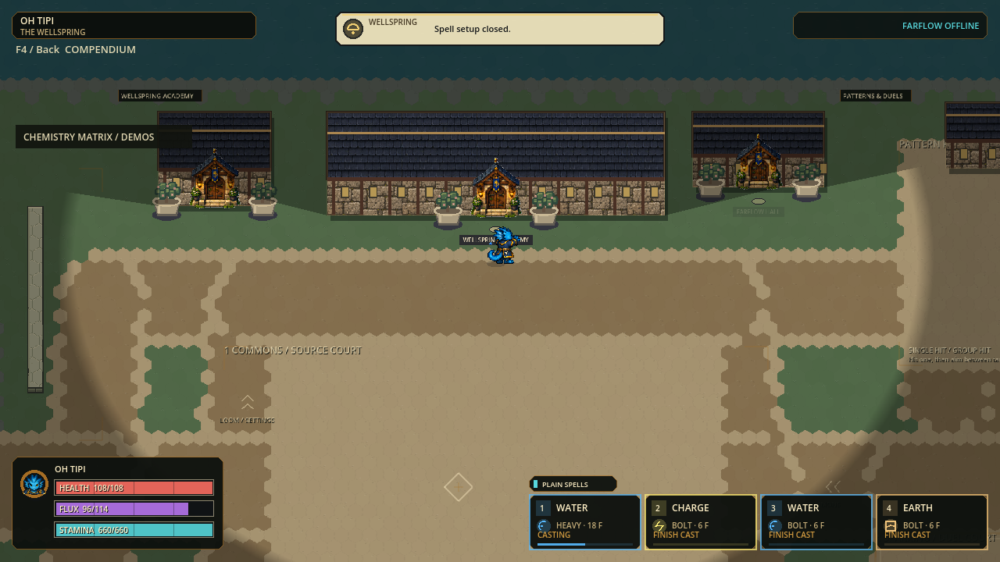

# H.E.X. completion run — October 4

Status: the combined local checkpoint `p56-308f3dc64c41` is ready to test;
the preceding `p56-a85f2e9e7a7e` Windows portable remains the verified fallback.
This checkpoint does not complete the full game's open release criteria.
The [single queue](../.agent/OVERHAUL-IMPLEMENTATION.md) remains authoritative.

[Play the new build](../exports/hex-completion-20261004/windows/PLAY-HEX.cmd) ·
[Windows ZIP, 110.6 MiB](../exports/hex-completion-20261004/HEX-p56-308f3dc64c41-Windows-x64.zip) ·
[Five-minute trial](HEX-PLAYTEST.md).

## Player-visible changes

| Area | Implementation | Acceptance so far |
|---|---|---|
| Character Gallery | Five-second pending-request recovery, session-context invalidation and confirmation from the exact local actor's published state | Five focused UI suites, 3,254 assertions; no local authority mutation, retry, save or fabricated acceptance |
| Chemistry Matrix | Controller B / Back closes the modal with the existing two-frame input quarantine | Actual routed input tests include pressed/released B, Back, A, Escape and mouse; no paid action leaks |
| Red Baron | Neutral-calibrated anticipation, rise, fall and landing in eight headings | Reviewed source/native pixels; four actual Godot boards / 192 queries; held keys, not complete animation cycles |
| Fluup / Joh Haynes | Repair the largest observed idle/action volume discontinuities first | Both integrated after source/native pixel review; all 30 characters pass 120 rendered action boards / 5,760 queries |
| Saved binding labels | Show real mouse/controller-only bindings instead of falsely reporting unbound | Six focused suites / 13,207 assertions; input mappings and device behavior unchanged |
| Wellspring roofs | Eight service buildings reuse the existing native slate shingles | Setup-only cache: 810,688 decoded bytes; 2,133 focused assertions; no layout, door, collision or LOS changes |

The Gallery's existing wire format has no attunement request sequence. Timeout
unlocks the UI but does not cancel a host request. A late published character
change remains authoritative. Same-session refusal packets cannot be attributed
to an exact retry; this limitation is not hidden by the UI fix.

## Runtime work and evidence

E17 reconstructs the concrete producer's freshly packed lanes before compression,
avoiding an immediate inflate/parse cycle. Public/opaque/subclass paths stay
byte-driven. Complete reconstruction, conservation, hashes, actual inner/outer
byte limits and exact output bytes remain enforced. Six focused suites passed
4,244 assertions; paired capture tests passed 2,778.

**No consistent total speedup was measured for E17.** It is not a 120 Hz claim.
Seven alternating old/new pairs gave these complete-capture medians:

| Fixture | Frozen preceding capture | Candidate capture |
|---|---:|---:|
| Empty |22.829 ms|21.760 ms|
| Distributed paid casts |73.275 ms|73.778 ms|
| Dense paid casts |32.261 ms|32.028 ms|
| Active Rampart |30.192 ms|32.549 ms|

The clean reconstruction diagnostic passed 2,560 checks with unchanged source
hashes. Its chemistry-hash medians were 4.139 / 26.215 / 8.224 / 7.385 ms for
the same four fixtures. Producer consumption includes hashing and other work;
these overlapping measurements must not be added or subtracted as exclusive
pipeline stages. They justify investigating canonical-state work before more
compression changes.

E18 writes admitted dynamic-cell JSON rows directly, with a bounded per-call
cache of quoted layer names. Every dynamic value is still read on every call;
signed-int32 boundaries, decimal-lexicographic owner ordering, Unicode quoting,
direct mutation and fallback behavior retain the preceding byte contract.
The nine final focused suites passed 5,369 assertions. E18's independent
pre-E18/pre-E9 paired oracle passed 2,516 assertions with unchanged sources.

| Chemistry hash only, warm median | Frozen E17 | E18 |
|---|---:|---:|
| Empty |4.088 ms|4.125 ms|
| Distributed paid casts |19.176 ms|18.251 ms|
| Dense paid casts |8.654 ms|8.472 ms|
| Active Rampart |7.533 ms|7.539 ms|

The occupied-cast cases improve roughly 5% and 2%; the other cases are essentially
unchanged. This is not a total capture, network, FPS or sustained-load result.
Full regression passed: 199 suites / 3,352,535 assertions, zero failures and
stderr, including import and configured-120-Hz boot, in 623.805 seconds.
Frozen runtime identity: `p56-308f3dc64c41`, 3,089 records, full SHA256
`308f3dc64c416ea4b193b9a11cd18150767737c1abc103d2caaaaead987d73ac`.
Final native UI passed 72 checks / 13 frames. Viewport culling retained exact
RGBA equality in 108 comparisons. The lead reviewed slate roofs in the actual
Wellspring view and all three repaired bodies during real paid airborne casting.
Each repaired character passed admission, release and planted landing across 30
captured frames (90 total); these are fixed-step production-command captures,
not physical-input or frame-rate acceptance. Fluup and Joh Haynes were explicitly
equipped with their valid Charge Spray for this test; no cast, resource or height
state was fabricated.

All 120 action boards passed and match the final package byte-for-byte; all108
source/package viewport PNGs also match. The three repaired sheets are held jump keys, not complete gait,
strafe, roll, slide, flight or independent airborne-cast animation cycles.

## Final delivery and performance gate

| Gate | Fresh result |
|---|---|
| Paid stress correctness |11,340 checks; both cases and command orders exactly preserve preceding paid admissions, inventory totals, traces and final hashes|
| Simulation p95 |**FAILED budget:** 11.873 /12.110 ms distributed; 10.767 /10.195 ms dense; target8.333 ms|
| Owned capture/packetization p95 |182.732 /187.874 ms distributed;111.239 /111.513 ms dense; not publish-cadence acceptance|
| Dense feedback retention |Eight projectile-spawn notices still never enter an envelope; paid action and authoritative-state checks pass|
| Windows package |Native launch, exact runtime identity, safe close; PCK91,657,264 bytes; ZIP115,934,971 bytes|
| Localhost lifecycle |65.738 s under unchanged120 s deadline; host/join, chat, movement, late spectator, reconnect, Hearth return, rematch and host release; three empty error logs|
| Preserved state |Prior current and fallback PCK/ZIP hashes reverified; no owned engine remains; originals and user profiles preserved|
| Documentation |Metadata-only pointer formatter no longer creates launch/download links for unchecked historical payloads;45 source-only regression checks and exact README-block check pass|

[Full receipt](completion-evidence-20261004/full-v1.json),
[paired hash evidence](completion-evidence-20261004/cell-rows-paired-v1.json),
[paid-load evidence](completion-evidence-20261004/paid-load-v1.json),
[package](completion-evidence-20261004/package-v1.json),
[exact comparisons](completion-evidence-20261004/delivery-comparison.json),
[localhost](completion-evidence-20261004/network-v1.json).

PCK SHA256: `0487b3cbf0a0aa869199a8d63d36691085f1daaf7e26835c34ef7e8788fb5c0d`.
ZIP SHA256: `a2a719f571a25889049970330e2b467809df0283a00be77b8e0bdae678f96961`.

## Honest boundaries and preserved evidence

The first UI command used an invalid suite ID and ran no suites. The second
revealed a real offline actor-ID regression; it was fixed, additional missing-
client/connecting/stale-epoch tests were added, and the third focused run passed.
The first reconstruction diagnostic detected a Bootstrap edit during measurement
and correctly failed its source freeze. The second ran unchanged and passed.
The final-focused first attempt also exposed a new test-only Variant-inference
compile error. An explicit WeakRef declaration fixed it; the unchanged production
roof code passed the second run. Failed receipts are retained, not reclassified
as successes. The first Fluup motion setup assigned a woven slot while the
diagnostic still requested legacy active-1 (Heavy). It stopped before capture.
The diagnostic now supports an explicitly selected, validated delayed slot and
also requires the paid wire to match that expected Spray. Corrected Fluup and
Joh Haynes runs passed without changes to production code or starter kits.

No public relay has been deployed. Eight admitted players remain the current
network limit; 16/32/64-player support and dense 120 Hz acceptance remain open.
Public infrastructure, physical internet play, human feel, physical controllers,
audio quality and finished all-character animation cycles are not proven by
headless assertions or image comparison. No commit, push, installer promotion or
historical checkpoint-pointer update is implied by this run.

All prior art originals and working builds remain intact. The new isolated v2
art-authoring folder is excluded from Godot scanning; only reviewed runtime
atlases enter the game. No broad cleanup or protected-directory deletion.
