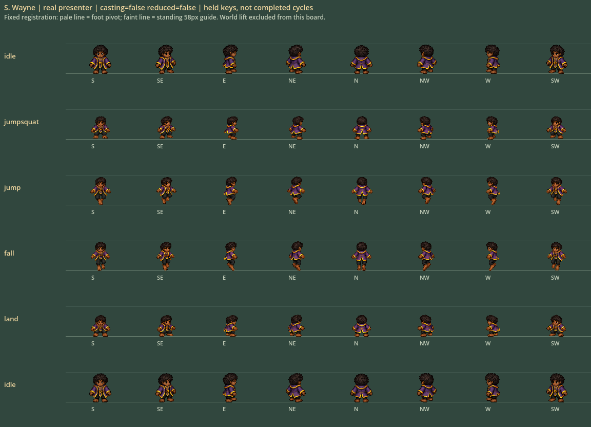
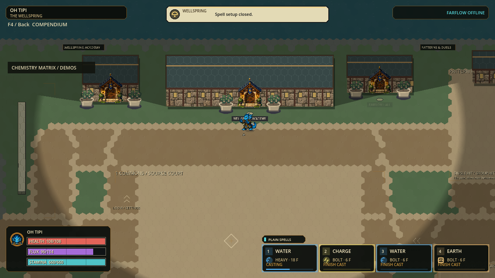

# H.E.X. craft checkpoint — October 3

Historical checkpoint, now the preserved fallback to the
[all-cast movement candidate](HEX-CAST-MOTION.md). Results below describe the
earlier source/build; they are not the current action-coverage claims.

Status: October 3 local solo checkpoint `p56-c7778b631dfd`: Full, native review,
portable launch/safe close and exact packaged-art checks passed. The October 2
portable `p56-ae223a7fae02` remains the verified playable fallback. This is not
complete animation, sustained 120 Hz or internet-play acceptance.

[Start H.E.X.](../exports/hex-craft-20261003/windows/PLAY-HEX.cmd) ·
[Start the S. Wayne motion pilot](../exports/hex-craft-20261003/windows/TEST-S-WAYNE.cmd) ·
[Windows ZIP, 106.9 MiB](../exports/hex-craft-20261003/HEX-p56-c7778b631dfd-Windows-x64.zip) ·
[October 2 fallback](../exports/hex-pixel-cast-20261002/windows/PLAY-HEX.cmd).
Extract the complete ZIP, keep EXE/PCK together and use a CMD launcher to enable
the pixel candidate. Saved bindings remain authoritative; direct EXE launch keeps
the existing skeleton default. [Five-minute trial](HEX-PLAYTEST.md).

## Working prompt and ownership

Improve what a player can perceive and verify, preserving the current design
contract and paid simulation. Give each worker one small deliverable with owned
files; reuse workers sequentially rather than launching an unbounded roster of
agents. Only the lead runs Godot, imports, profiles, captures, tests and exports.
Keep original art, protected dirty work, failed evidence and the working fallback.
Stop at the integrated checkpoint for human feedback; do not publish or deploy.

| Ticket | Owner | Deliverable | Acceptance |
|---|---|---|---|
| S. Wayne jump | One character artist; lead integration | Eight-direction fixed-pixel anticipation, rise, descent and landing keys | Native identity/registration review, no mesh morphing, casting never blocked, explicit unpainted-action fallback |
| Paid-cast feedback | HUD worker | Startup progress in the existing hotbar track | All32 spells, authoritative tick quantization, no false release/readiness |
| Hex impact text | Same worker, subsequent task | Centered, readable, fading combat labels | Actual anchors/visibility/lifetime unchanged; native normal/reduced review |
| Product contact work | Runtime worker | Defer ground-only query until a touched, unprotected actor needs it | Independent prechange oracle, exact paid tick/event trace, measured before/after |
| Integration | Lead | Shared validation and local playable checkpoint | Full regression, native captures, source identity and Windows launch/safe close |

The sound-design audit found an existing bounded sixteen-clip element bank;
no duplicate audio system or ownership-bypassing reaction cue will be added.
Characters other than S. Wayne retain their October 2 banks. One reviewed motion
pilot is required before multiplying a new action workflow across thirty identities.

## Invariants

Three volume-first sizes; current roster/names/affinities; size-owned hurtboxes
and shared wall clearance; aim independent of travel; slide follows travel;
chainable paid movement/casting; stationary24px whole-hex chemistry; no trails,
orbits or flight residue; no unapproved balance/capacity/cadence reduction.

The historical dense120Hz gate and internet friend-play gate remain unresolved.
Startup/art/UI correctness cannot certify frame pacing, physical input, remote
networking or human fun. Record fresh, failed and not-run evidence separately.

## Evidence

| Gate | Fresh result and boundary |
|---|---|
| Full regression | 177 suites / 2,021,908 assertions, zero failures/stderr; source state/asset checks, import, JSON-roundtrip regressions, runtime identity and configured 120 Hz boot passed |
| Earlier focused regression | Five suites / 191,844 assertions, zero failures or stderr; superseded by final Full for complete-source acceptance |
| Native action boards | Four boards, 192 actual Fullbody presenter queries; eight headings, four held action keys plus idle comparisons, casting and Reduced Motion. No gross registration/seam blocker; modest head-width difference and subtle front diagonals remain polish notes |
| Actual Wellspring motion | 31 captured frames; one paid local airborne Spray admission and matching release, 15 fixed-key airborne casting ticks, two planted landing-key ticks. Real simulation commands, not physical input; screenshots include takeoff, fall and landing |
| Ordinary UI journey | 54 checks / 12 native frames; actual Loom assignment, paid Heavy startup track, held Bolt, rebinding, Gallery and disabled session action paths passed |
| Native hex-label boards | Six boards, 32 current-catalog synthetic contacts, three ages, both effects settings; centered text, fade and reduced drift reviewed. Not a paid match or multiplayer visibility acceptance |
| Exact simulation equivalence | 3,243 paired old/new orchestration steps in the unit oracle; paid pressure run and reverse-order replay preserve the full authority/event trace, final state and counters |
| Dense simulation performance | **FAILED**: candidate p95 12.341–13.066 ms across first/repeat runs, above 8.333 ms. Selected actor/product stage mean fell from 1.682/1.707 ms to 1.346/1.379 ms in the first measured pair; workload-specific, not FPS or capacity certification |
| Windows portable | Native 30-bank plus one-action-bank admission, expected identity and safe-close message passed; export/smoke stderr empty; payload and ZIP hashes verified |
| Exact packaged artwork | Four freshly rendered PCK action boards match reviewed October 3 source PNGs; all 30 PCK ground/cast boards match preserved reviewed October 2 PNGs, all by SHA256 |
| Human feel, physical controls, audio, two-PC internet | Not accepted by this checkpoint; relay undeployed and prior same-export networking lifecycle failure remains open |

Receipts and selected images: [craft evidence](craft-evidence-20261003/README.md).
Runtime identity: `p56-c7778b631dfd`; 3,023 runtime records. New package and
preserved October 2 fallback PCK/ZIP hashes were freshly verified. Package hashes,
source SHA256, Full logs and exact-PNG comparisons are in the evidence directory.

## Delivered scope and limits

All 30 characters retain their individual fixed-pixel ground/cast banks. Only
S. Wayne adds four authored whole-body held keys across eight stored directions.
Double/wall/slide jumps reuse the rise key. These 32 cells are not full cycles,
roster-wide advanced-action coverage or independently authored airborne cast arms.
Other identities and unpainted actions retain explicit existing fallbacks. No
runtime body mesh, limb stretching or waist-layer splice is used in the new keys.
The existing airborne world lift remains outside the sprite; it is not a new
collision or spell-height rule. Continued travel can take precedence over the
planted landing key, keeping locomotion responsive.

The independent native review found no obvious clipping, identity change or
detached body part in the sampled world frames. It did flag inherited limits:
bright Light fields compete with feet, airborne hand-to-ground Spray continuity
is not established, and fine hand gestures are subtle at gameplay zoom. A cast
on a nonvisible modifier layer correctly leaves the visible four cards at
FINISH CAST; a compact active-layer cue is a useful future usability slice.
These observations remain open, not silently counted as visual acceptance.

The hotbar now fills the accepted spell's existing startup track from its real
pending timer. Other slots still say FINISH CAST. Readiness never becomes release
before the authority clears startup. Impact text is centered on measured width,
pixel-aligned, and fades with its original lifetime; Reduced Effects removes
optional drift, not information. Existing visibility, 24-cue cap and ownership
gates remain unchanged. Existing bounded audio was audited, not replaced.

The contact optimization defers a ground-only path query until an actually
touched, unprotected actor needs it. Payment, strength, damage, geometry, capacities,
cadence and reaction phases are unchanged. Its independent frozen-old-step oracle
covers all 36 recipes, protection/height/control cases, contact exits and sequential
push/second-product behavior. Paid traces preserve SHA256
`34dfdcd227e1ad57e440d37ee59fabb55855c4905a6bc8f52bacaf0e97bf6e7c`
and final state `7a0e8cb95df6c22327db70c1343b583e09d19bbb5e6162af9abd45603f01c101`.
Peak fixture counts were 29 flights, 32 casts, 29 products and 10 events/tick;
do not extrapolate this to extreme-player capacity.
The repeat profile places projectile contacts at about 2.702/2.708 ms mean and
movement/cast admission at 2.435/2.463 ms, ahead of product effects at
1.340/1.357 ms. Those measured stages guide the next exact optimization.

## Review failures preserved

First profile invocation was blocked by Windows PowerShell script policy; a
subsequent argument-forwarding mistake produced timings without the requested
trace. The bundled runner and explicit argument array fixed both without changing
machine policy; the corrected baseline was recorded before the runtime edit.

Focused attempt 1 selected a suite finish-label rather than its registry ID;
attempt 2 exposed JSON float-versus-integer geometry rejection in the optional
action bank. Exact numeric validation, serialized-manifest regressions and
fail-fast test guards fixed this; invalid optional art cannot erase the working
30-character ground bank. Motion attempt 1 missed a planted landing because the
fixture kept moving, and attempt 3 hit an inferred-Variant parse error in the
capture-only extension; explicit neutral input and bool typing fixed the fixture.
No gameplay state or resources were injected to turn a failure into a pass.
The post-package documentation check also caught CURRENT-CAST's required Status
marker below the first ten lines after its new preface. Moving it back to the
header fixes that documentation-only check; no production/package bytes changed.

## Next bounded decisions

| Priority | Small next deliverable | Gate before expansion |
|---|---|---|
| 1 | Human review of S. Wayne jump keys and contact readability | Compare head scale, anticipation, apex, fall, landing and casting in motion; do not mass-produce rejected proportions |
| 2 | Middle and Large action pilots, one character-owned task each | Same fixed-pixel registration/actual motion checks; keep body volume distinct and common head scale |
| 3 | Correct dedicated travel-relative feet and slide/evade keys | One action/size/character at a time, all eight headings; independent aim/travel and cast availability retained |
| 4 | Measured remaining runtime and snapshot bottlenecks | One exact optimization, frozen behavior oracle, paid dense trace and same-build networking lifecycle; no silent caps or weaker mechanics |
| 5 | Remaining roster action banks | Reuse the approved manifest/registration pipeline, independent per-character review, no unsupported all-actions claim |

This turn does not publish, deploy a relay, build/promote an installer or change
the historical checkpoint pointer. Original art, previous packages and failed
evidence remain recoverable. Older-build cleanup remains blocked; no workaround
or broad destructive cleanup is attempted. Five export directories remain;
the selected playable pair is October 3 craft and October 2 full cast.
