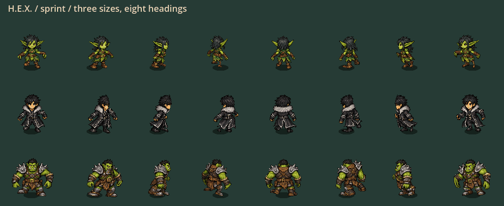
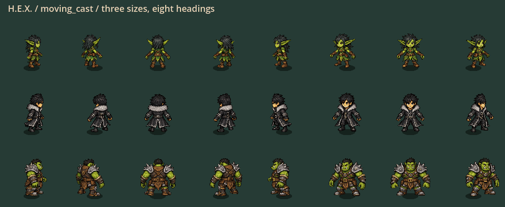

# H.E.X. grounded, lively character motion

Status: full/native/input and Windows export passed; ready for local player feedback.
The decision-clarity build is the retained functional fallback.

Open [PLAY-HEX.cmd](../exports/hex-lively-motion-20260929/windows/PLAY-HEX.cmd)
or extract the complete [portable ZIP](../exports/hex-lively-motion-20260929/HEX-p56-2073879eeeb7-Windows-x64.zip).
Keep EXE/PCK together. Native package identity, 30-skin admission and safe close
passed. Only these newest two accepted exports remain; the older visual export
was removed after verification (299,596,285 bytes), with small receipts retained.

Candidate `p56-2073879eeeb7`: 172 full suites / 1,565,395 assertions, zero
failures/stderr, import and configured 120 Hz boot passed. Advanced input journey:
7,721 checks. Native capture: 336 motion frames plus five all-roster boards;
twelve representative frames individually inspected. See [fresh evidence and
boundaries](lively-motion-evidence-20260929/README.md).

## Bounded design revision

Give movement weight without delaying control. Support feet explain locomotion;
the torso counterbalances; casting hands recover after the upper arm; landing
marks reflect actual impact force. Never animate a blocked body as still running,
or forced displacement as voluntary walking. This pass reuses the current art
and shared rig, not thirty new hand-authored animation sheets.

| Work / owner | Implementation | Required evidence |
|---|---|---|
| Shared rig / animation agent | Alternating upper-body support transfer; rotational cast follow-through; forced-state pose routing | Three sizes, eight directions, fixed bones, rigid skull, free aim/cast, reduced motion |
| Impact cue / feedback agent | Two-tone pixel contacts and force-weighted existing landing dust | Eight actual travel directions, stronger force distinct, no hazard/protection implication |
| Movement review / read-only agent | Identified forced-walk and blocked-wall animation defects; audited integration | Review findings resolved; preserve deliberate momentum and air budgets |
| Integration / lead | Distance-driven wall gait and retained support heading, shared by local/remote/POV drawing | Stopped corner, cursor sweep, resume/reverse, correction/rebase and lifecycle tests |
| Acceptance / lead | Serialized tests, native animation captures, Windows export, two-build retention | Fresh evidence only; no dense-performance or human-feel claim |

### Invariants

- No movement speeds, action costs, inputs, protection or exposure timing change.
- No hitbox, common wall-clearance, head size, atlas rescaling or chemistry change.
- No trails, ghost bodies, orbiting elements, screen shake or full-screen flashes.
- Rig corrections are bounded and presentation-only; casts and movement remain
  independently aimed. Existing corrected special-skin key poses are preserved.
- Wall gait advances only with real interpolated planar travel; correction
  offsets and cursor turns do not create footsteps. Presentation history stays
  bounded to eight admitted champions, with no new wire or authority fields.
- Reduced Effects retains impact-force information and immediate state changes,
  while disabling optional torso/cast secondary motion and contact spreading.

## Player trial

| Try | Look for |
|---|---|
| Walk, sprint, stop and reverse with a small/middle/large character | Alternating feet, restrained chest weight transfer, stable heads and silhouettes |
| Move sideways while casting in another direction | Ground gait continues; arms recover without snapping or collapsing elbows |
| Wallrun into a corner, turn the cursor, then resume along the wall | Feet hold; body doesn't spin with the cursor; real travel resumes the stride |
| Jump/land, then land with retained movement | Short impact accents communicate weight without resembling an attack boundary |
| Receive forced movement and recover | Recoil/charge state differs from voluntary movement; no frozen walking pose |
| Repeat with Reduced Effects | Legibility remains; optional secondary motion is removed |

## Not claimed

The prior dense simulation/snapshot/render timing failures remain unresolved.
Fresh dynamic CPU pose updates for eight detailed actors measured p95 9.846 ms,
already above a full 8.333 ms frame budget before GPU/simulation/network work.
The next efficiency slice should profile and reduce continuous retarget/skinning
work while preserving pose endpoints, same-frame aim and exact authority; do not
add decorative actors/effects until this cost is brought down and remeasured.
Controlled native animation boards are not a physical-device playtest, full
multiplayer lifecycle, animation-authoring completion, or sustained 120 Hz proof.
No installer, public release, commit, push or historical delivery-pointer promotion.
