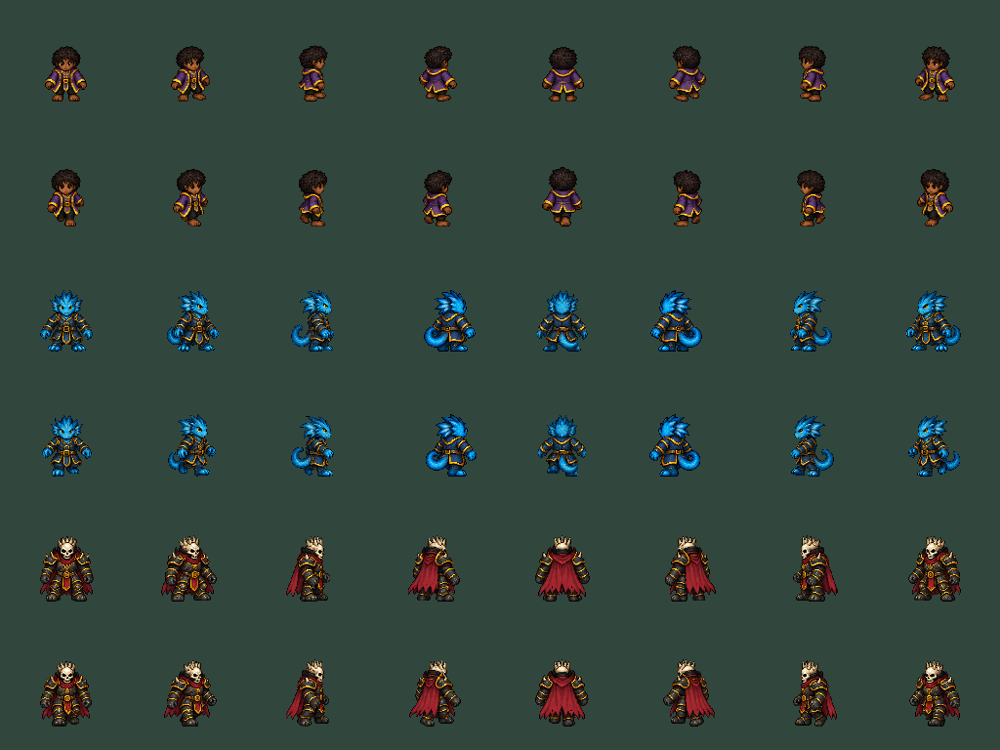

# H.E.X. fixed-pixel body pilot

October 1, 2026. Candidate `p56-5ef27b9ea09e` in the protected H.E.X. checkout.
Status: Full, focused, native and Windows package gates passed; ready for human feedback.
This is a three-character ground/cast checkpoint, not a completed roster overhaul.

[Play the pilot](../exports/hex-pixel-pilot-20261001/windows/PLAY-HEX.cmd) ·
[Portable ZIP](../exports/hex-pixel-pilot-20261001/HEX-p56-5ef27b9ea09e-Windows-x64.zip) ·
[Five-minute test](HEX-PLAYTEST.md).

## What changed

| Area | Implemented | Boundary |
|---|---|---|
| Reference-style bodies | New S. Wayne, Oh Tipi and Red Baron pixel banks, eight headings | 27 other identities retain the previous renderer |
| Sizes | Small/Middle/Large neutral heights 58/63/68 px; registered feet and volume-first silhouettes | Stats, hurtboxes and common wall clearance unchanged |
| Motion | Immutable frame regions, two unscaled texture blits; aim-facing anatomy; reverse gait for backward travel | No mesh deformation in admitted frames; no dedicated sidestep artwork yet |
| Casting | Same-facing authored upper pose with independently selected foot frame | A limited pose bank, not a fully authored cast cycle |
| Preserved actions | Existing slide, roll, jump, flight, wall and control animations remain available | These still use the previous working renderer |
| Spell Loom | Wheel targets the hovered library or slots, with focus fallback and clamped ends | Browsing does not assign a spell or change the destination slot |

The art manifest validates identity, size tier, cell layout, pivot, path, decoded
pixel hashes and atlas dimensions before admitting any bank. Invalid banks fail
closed without a partially active character set. Rendering does not mutate
simulation state or load textures per frame.

The reference image is style guidance, not roster or gameplay authority. No
weapons, magical aura or background are baked into the new body banks. Original
generated sheets are retained under the [art workbench](../art_batches/pixel_body_pilot_v1/README.md).
Approved deterministic assembly performs alpha cleanup, component isolation,
uniform per-sheet nearest-neighbour sizing, fixed registration and packing.

## Fresh evidence

All results below belong to this candidate unless explicitly labelled historical.

| Gate | Result | What it does not establish |
|---|---|---|
| Pixel assembly | One Python structural test passed: hashes, alpha, cells, contacts, registration and import settings | Human visual quality |
| Focused source validation | 3 suites / 390,548 assertions; zero failures or stderr | Full-suite or package acceptance |
| Native presenter | 24 matrices / 1,536 checks; 3 identities x 8 aim x 8 travel x 4 phases x walk/cast | Dedicated travel-specific footwork or advanced-action replacement |
| Independent visual review | All 24 matrices and size board opened; no new disconnected-part or clipping blocker found in v4 | Human feel, complete anatomy or finished gait |
| Native ordinary UI | 51 checks / 11 frames; wheel library navigation, equip/swap/attune and paid-cast journey | Physical controller or remote networking |
| Wellspring motion | 45 actual Bootstrap/map frames: S. Wayne walk, Oh Tipi slide/return, Red Baron jump/landing; production movement commands | Physical keyboard play, timing or performance |
| Animation CPU experiment | Eight actors; p95 shared rig 12.330 ms, fixed pixel 1.873 ms; 6,400 queries, alternating order | Artwork differs; excludes drawing, simulation, networking and end-to-end FPS |
| Full | 174 suites / 1,844,293 assertions; zero failures/stderr; import, identity and configured-120-Hz boot passed | Not dense 120 Hz, rendered performance or remote acceptance |
| Windows package | Native boot, pilot admission, source identity, safe close and payload/ZIP checks passed | New installer/updater, deployment or internet acceptance |
| Exact exported art | 24 native matrices / 1,536 checks from the PCK; all 24 PNGs match reviewed source captures by SHA256 | Human quality or animation feel |

Primary receipts remain under `.godot/pixel-focused-v2-20261001.json`,
`pixel-pilot-native-v4-20261001/receipt.json`, `pixel-pilot-ux-20261001/receipt.json`,
`pixel-pilot-profile-20261001.json` and `pixel-pilot-motion-swayne-20261001/receipt.json`.
Durable selected receipts, logs and images: [evidence index](pixel-body-evidence-20261001/README.md).
These measurements do not override the existing failed dense-120-Hz timing gate.

## Revisions and honest limitations

| Finding | Resolution or next gate |
|---|---|
| Mixed aim/travel waist cuts detached tails and capes in v2 | Rejected. Both halves now keep one aim-facing anatomy; travel changes gait playback |
| Oh Tipi rear diagonals needed clearer rear views | Separate corrective source sheet assembled; original artwork preserved |
| v3 cut through a casting hand | Split moved below the hands; all v4 matrices reviewed |
| Initial cast capture sampled zero-weight startup | Corrected to a reached cast pose; old labelled frames are not cast-pose evidence |
| Godot alpha-border processing changed decoded hashes | Disabled for these three atlases; exact decoded pixels admitted |
| Two contact poses, repeated neutral passing beats | Explicitly incomplete; add proper passing/weight-transfer poses after pilot feedback |
| Red Baron cape hides rear leg anatomy | Foot changes visible, but natural weight transfer not certified |
| S. Wayne rear cast is subtle | Improve silhouette/timing in the next accepted art slice |
| Sidesteps reuse ordinary gait; low/air actions switch renderers | Do not call this full animation replacement; authored corrections remain required |

Failed import/parser receipts and rejected native v2/v3 captures are retained.
No source cleanup deletes original assets, protected dirty work, personal profiles,
failed evidence or the selected working fallback.

## Package and retention

| Identity | SHA256 |
|---|---|
| Production runtime | `5ef27b9ea09e1335644dab173daf8f82d2d7c1570dd6a822f00279221173553f` |
| Exported PCK | `be4c38c66b8c43533f8a56cb59529fb63dd4e9f90bfee2e3368ee3f13a203133` |
| Portable ZIP | `56166203c4208c47f0fc7472d463573cea708cafc5f1d3fc3652d26f91fc4e54` |

The ZIP is 107,374,905 bytes. Pilot and headroom payload/ZIP hashes were freshly
checked by the retention dry run. Cleanup execution was then blocked before it
ran: **no files were deleted**. Three exports remain; simplification is the old
extra copy pending cleanup, not the selected fallback. Original art and failed
evidence remain intact. All owned engine runs ended.

## Next bounded acceptance

First obtain human feedback on in-game scale, direction recognition, running
while aiming/casting, and transitions to existing slide/jump/roll poses. Then
finish real passing and lateral steps, low/air/control poses and cast timing for
these three pilots before reusing the pipeline for the other 27 identities.

Internet friend play is a separate unresolved priority: snapshot capture/restore,
same-build lifecycle, relay/code UX, then a physical different-home test. Neither
this visual checkpoint nor a configured 120 Hz tick rate proves that acceptance.
No new installer, deployment, commit, push or historical pointer promotion.
