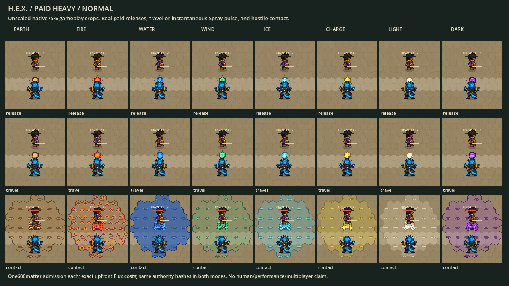
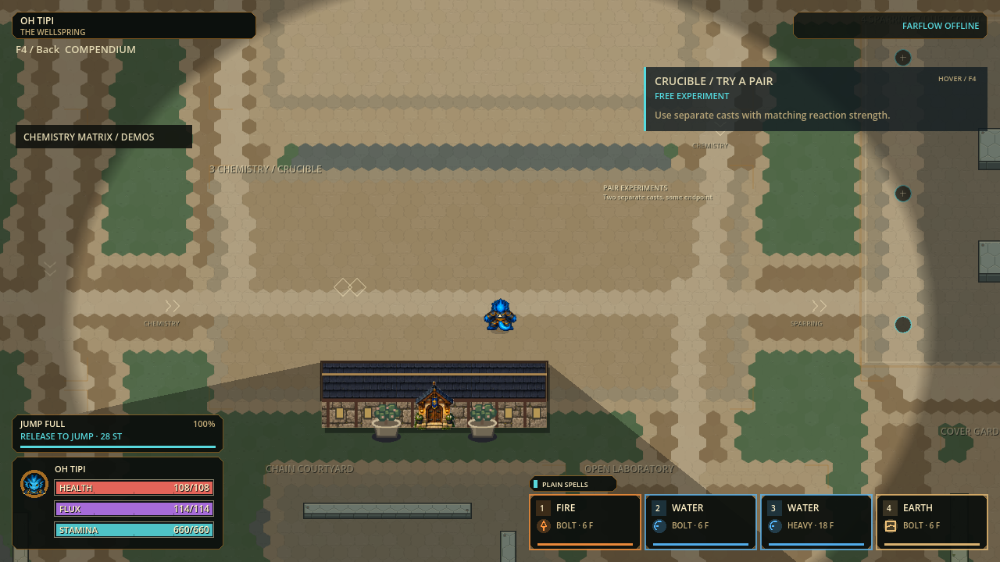
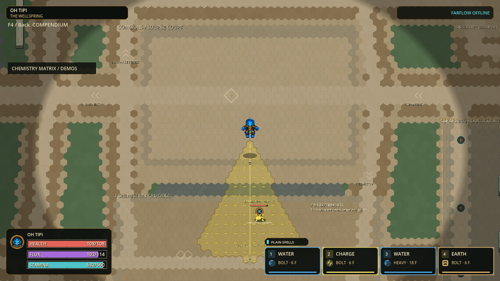
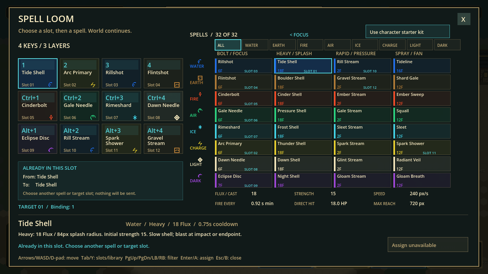
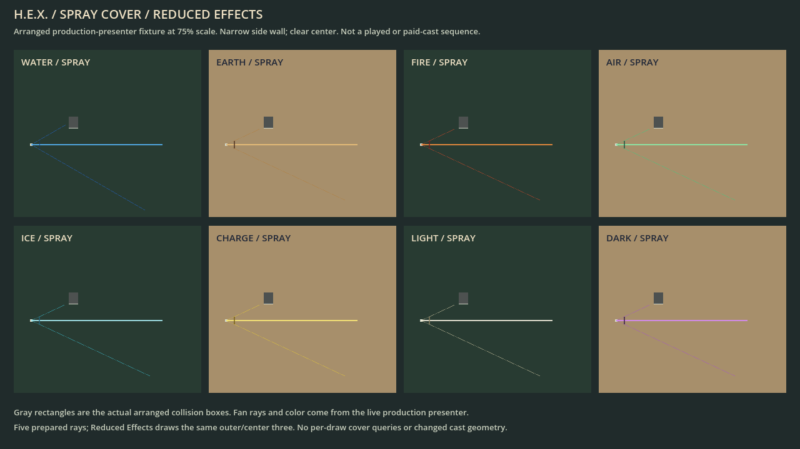
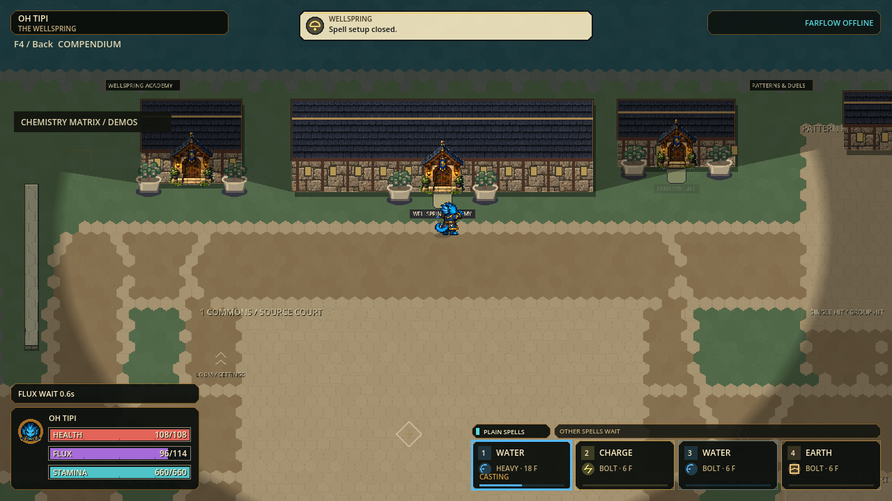
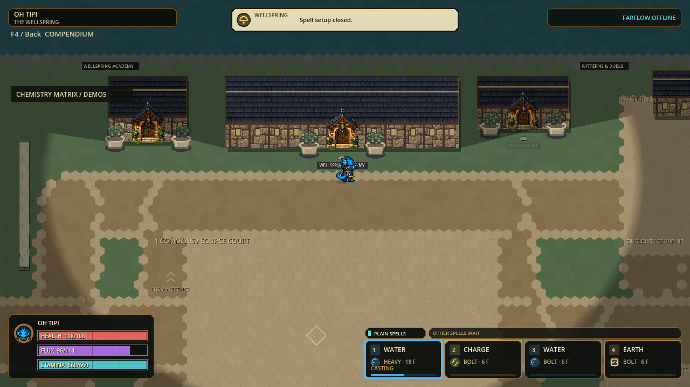

# H.E.X. engagement and Windows setup checkpoint

Status: October 5 build `p56-4ac12ff25baf` is ready for local human testing.

[Install and play, 110.6 MiB](../exports/hex-setup-engagement-20261005/HEX-Setup-p56-4ac12ff25baf.exe) ·
[Portable play](../exports/hex-engagement-20261005/windows/PLAY-HEX.cmd) ·
[Portable ZIP](../exports/hex-engagement-20261005/HEX-p56-4ac12ff25baf-Windows-x64.zip) ·
[Five-minute trial](HEX-PLAYTEST.md) ·
[Preserved refinement fallback](../exports/hex-refinement-20261005/windows/PLAY-HEX.cmd).

| Delivered change | Preserved boundary |
|---|---|
| Paid aerial turn carries through air-dodge recovery | Commitment, payment, duration, invulnerability, walls and one-use aerial budget unchanged |
| Fresh-press / held-repeat spell arbitration | Fresh refusals still own intent; lowest held repeating slot does not silently fall through on cooldown |
| Eight elemental release stamps and inset projectile cuts | Existing atlas, anchor, contact surface, expiry and both effects modes; no new trails, range, damage, particles or field coverage |
| Bundled per-user setup and launcher | Verified immutable versions, offline update and rollback; no admin install, service, security bypass or save migration |

| Fresh gate | Result / evidence |
|---|---|
| Regression-first proof | Old production failed 96 new assertions (88 blocked-repeat, eight lost-turn); [log](engagement-evidence-20261005/regression-first-red.log) |
| Final focused | Six suites / 109,151 assertions, zero failures/stderr; [log](engagement-evidence-20261005/focused.log) |
| Full | 206 suites / 3,613,361 assertions, zero failures/stderr; import, exact identity and configured 120 Hz boot; 600.110 s; [receipt](engagement-evidence-20261005/full-v1.json) |
| Native paid casting | 32 paid casts, 192 paired same-authority phase renders, 18 retained PNGs; all 18 visually reviewed; [capture](engagement-evidence-20261005/native/receipt.json), [review](engagement-evidence-20261005/visual-review.json) |
| Portable | Native startup/safe close and 13 delivery checks; exact archive bytes and previous fallback hashes; [package](engagement-evidence-20261005/package-v1.json), [files](engagement-evidence-20261005/delivery-files-v1.json) |
| Installer mechanisms | 32 native-stub checks plus real-payload verification; update, rollback, repair, corruption, traversal and running-game refusal; [receipt](engagement-evidence-20261005/installer-tests-v2.json) |
| Installed launcher | Exact launcher and rendered game exit 0; 30-identity art admission, expected build, 120 Hz initialization and both safe-close markers; stderr zero; [receipt](engagement-evidence-20261005/installed-smoke-v1.json) |
| Same-export localhost | Full three-process lifecycle, late spectator/return/rematch and host release; 52.957 s under unchanged 120 s deadline, all stderr empty; [receipt](engagement-evidence-20261005/network-v1.json) |

The first integration wrapper stopped at a missing documentation `Status:` field
before running a suite; the field was restored. An initial new empty-slot fixture
was corrected because its kit auto-filled the supposed empty slot. The first real
installer verification installed successfully but its PowerShell reflection check
failed on a PSObject/string conversion; an explicit cast fixed the harness and a
fresh full mechanism+payload rerun passed. Failed evidence remains preserved.

| Artifact | SHA256 |
|---|---|
| Runtime source | `4ac12ff25baf66e1d094d8772fd8aabdddc008edab04957d9efd11fefbf2af81` |
| Game PCK | `c4851d8b9f5c2cecab071b27b28d3d84ba646726fb649cf1354519b06e00d04d` |
| Portable ZIP, 115,964,039 bytes | `8292837b0988b38a76db5776df196a230e8ebeeee3be3147a61099a3a81493df` |
| Setup EXE, 115,994,112 bytes | `046c471dbd600faef052660b73d0ff759c8825d7b48d77f400649acb9a25c1f0` |

Setup is unsigned; Windows may warn or block it. Updates require the newer trusted
setup EXE; **Get updates** only offers the fixed GitHub releases page. There is no
remote update feed or registered uninstall entry. No user-profile installation,
shortcuts, public release, commit/push or historical-pointer promotion occurred
in these tests. [Installer contract and removal instructions](../packaging/hex-windows/README.txt).
The 115,964,039-byte installer staging ZIP was removed only after proving it
byte-identical to the retained portable ZIP; the setup embeds the same payload.
Original assets, useful evidence and previous functional builds remain intact.

Human feel, physical input, clean-machine UI/security acceptance, Internet friend
play and dense 120 Hz remain open. Eight players are configured, not load-certified;
16/32/64 are unsupported. Existing animation fallbacks and recorded dense timing /
event loss remain. Static images do not prove animation timing or performance.

## Previous jump-feedback and controller-aim checkpoint (historical)

Status: October 5 jump-feedback and controller-aim Windows portable is ready for
local testing. The prior throughput portable is preserved as the verified fallback.

[Play H.E.X.](../exports/hex-refinement-20261005/windows/PLAY-HEX.cmd) ·
[Windows ZIP, 110.6 MiB](../exports/hex-refinement-20261005/HEX-p56-98549e4db122-Windows-x64.zip) ·
[Five-minute trial](HEX-PLAYTEST.md) ·
[Preserved throughput fallback](../exports/hex-throughput-20261005/windows/PLAY-HEX.cmd).

Extract the entire ZIP and use `PLAY-HEX.cmd` for pixel characters; direct EXE
launch retains skeleton mode. Keep EXE/PCK together. Saved bindings take priority.
No installer, commit/push, public deployment or historical pointer promotion.

## October 5 movement feedback and controller-aim refinement

Delivered local playtest build: `p56-98549e4db122`.
Full, native review, packaging and same-export localhost gates passed.

| Change | Result |
|---|---|
| Jump preparation | Temporary no-hover cue shows charge, full-charge state, actual chained Stamina cost, or the cooldown/affordability restriction; clears on launch/cancel |
| Controller aiming | Screen-space ray clips to the visible viewport with the complete reticle outline in bounds; draws above nonmodal HUD and is suppressed during input/modal/focus handoffs |
| Preserved behavior | Mouse aim, accepted aim direction, spell range, movement, payment, chemistry, artwork, geometry, protocol, event redundancy and session capacity remain unchanged |
| Runtime experiment | Validation-local aggregate sorting was measured but NOT_PROMOTED: the original production path was restored after the complete-path gate failed to show consistent improvement |

Focused candidate validation passed 9 suites / 53,556 assertions with empty stderr.
Final-source native runs passed 766 jump checks / 16 frames and 290 reticle checks
/ 28 frames. All 44 final PNGs match the earlier captures by SHA256. Root and
delegated reviewers inspected all 16 jump frames and 14 representative reticle
frames; automated exact glyph checks cover all 28 reticle frames.
These are synthetic logical-viewport checks at 1280x720 and 1600x900, not physical
controller, window-resize, DPI or human-usability acceptance. Extreme arranged
boundary poses crop actor art; those poses are not a legal-movement acceptance.
Final Full passed 204 suites / 3,570,193 assertions in 611.185 seconds with no
failures or stderr, including source/asset preflight, import, exact identity and
configured 120 Hz startup. Native package launch/safe close and all 13 delivery
checks passed, including exact ZIP inventory/member bytes and preserved fallback
hashes. Same-export host/join, reconciliation, round, late spectator/return,
rematch and reason-bearing host release passed in 53.209 seconds under the unchanged
120-second deadline; all three stderr logs were empty. These local gates do not
prove physical two-PC/Internet play, dense 120 Hz, human feel or final animation quality.

| Delivered artifact | SHA256 |
|---|---|
| Runtime | `98549e4db12257b8e3a4062de1c688856e5fffbe7c0065e0c09c0bf4715279fb` |
| PCK | `1e30b7cd678364c948473b325b58c7e12de76f2a10745cd4cdbf1045c0f4381f` |
| ZIP, 115,958,648 bytes | `8a5e629aedd7015ef8e9bbc05ec7dc111099793b42026664ce2e2ab86ae373da` |

### Measured runtime candidate: not promoted

The isolated validator was 15–31% faster on the three occupied prepared gameplay
fixtures. That did not translate into a consistent complete-publication benefit.
Four fresh processes alternated original/candidate/candidate/original; only the
validator file differed among 189 recorded dependencies. Each passed 3,230 checks,
with 23 compared semantic fields per case identical, including exact wire bytes,
paid traces, receiver restoration and ownership. Source stayed unchanged per run.

| Complete owned publication, median ms | Original A1 | Candidate B1 | Candidate B2 | Original A2 |
|---|---:|---:|---:|---:|
| Empty control |21.200|17.494|18.891|17.525|
| Distributed paid40 |59.381|60.863|59.405|60.087|
| Dense paid40 |30.787|31.505|32.075|31.648|
| Active Rampart |28.601|28.772|29.284|29.827|

Seven warm samples per case and two processes per arm are not sustained tail
performance or capacity evidence. Empty-control variability is not subtracted.
No consistent nonempty complete-path win was established; dense was slower in
both bracketed comparisons, without establishing a sustained regression.
The original source SHA 3a1bb8f7fe8b3bb05e752caed48dafc2f65cb84b0076da47903817a508602047
is restored. No performance gain from this experiment ships. The archived
candidate and independent oracle/tests remain for reproducibility.

The first focused attempt failed an impossible new test premise: Godot rejects
String(Object), rather than invoking its formatting callback. That fixture and
speculative guard were removed; the original oracle and all accepted behavior
remain. The failed log/error output is retained. No old expectation was weakened.
The event audit also rejected reducing repeat lifetime: preserving four-snapshot
redundancy matters, and successful host send does not establish remote receipt.
The existing dense pre-publication event losses remain open.

[Runtime decision](refinement-evidence-20261005/runtime-decision.json) ·
[Final Full](refinement-evidence-20261005/full-v1.json) ·
[Package](refinement-evidence-20261005/package-v1.json) ·
[Delivery files](refinement-evidence-20261005/delivery-files-v1.json) ·
[Packaged localhost](refinement-evidence-20261005/network-v1.json) ·
[Isolated validator](refinement-evidence-20261005/cast-validation-v1.json) ·
[Final jump capture](refinement-evidence-20261005/jump-native-v2.json) ·
[Final reticle capture](refinement-evidence-20261005/reticle-native-v2.json) ·
[Pixel identity and review coverage](refinement-evidence-20261005/native-reviewed-v2.json) ·
[Focused pass](refinement-evidence-20261005/focused-v2.log) ·
[Rejected fixture failure](refinement-evidence-20261005/focused-v1-failed.err).

## Earlier October 5 throughput and Spell Loom feedback

Tested build `p56-4c82db23d160` removes repeated snapshot work and repairs confusing
Spell Loom outcomes. No combat, movement, collision, art, protocol or capacity
rules changed. The existing dirty checkout and known-working packages remain.

| Change | Player or engineering result |
|---|---|
| Honest assignment feedback | Confirmation and failed-save warnings remain visible when Assign becomes unavailable because the spell is already equipped |
| Starter recovery | Refusal and timeout end stale waiting notices; closing the preview reports only that no new request was sent, without claiming a late host result was undone |
| Native dynamic ordering | Homogeneous integer/coordinate dictionary keys use native lexical ordering with exact legacy fallback; no mutable-state cache |
| Single actor decode | Validated player rows are constructed once, with every strict rejection/canonical check retained and independent mutable results |

### Fresh evidence and limits

| Gate | Result |
|---|---|
| Final focused regression | PASS: 7 suites / 25,873 assertions; zero failures and empty stderr; includes unchanged world-publication-edges expectations |
| Final native Loom review | PASS: 102 checks and 12 frames at 1280x720/1600x900 exactly match the reviewed images; confirmation, injected save failure, refusal, timeout, unsent request and post-timeout cancellation |
| Complete publication diagnostics | PASS before and after: 3,230 checks each; exact independent snapshot/packet oracle, receiver reconstruction and unchanged source state |
| Same-process dynamic ordering | PASS: 2,708 checks; seven alternating pairs per case; all dynamic bytes match the preceding sorter and full canonical state matches the independent oracle |
| First Full run | FAILED: two unsent-preview guidance assertions; the unconditional notice replacement was a production regression. A narrow guard now preserves initial unsent previews; no expectations weakened |
| Final Full | PASS: 204 suites / 3,567,571 assertions, zero failures and empty stderr; source/asset preflight, import, exact identity and configured 120 Hz boot; 568.484 s |
| Final paid-load correctness | PASS: four 720-tick runs, two case/order repetitions; all 24 deterministic contract fields match the historical workload, including costs, traces, reactions, event accounting and cleanup |
| Dense timing | FAILED: simulation p95 9.773–11.010 ms exceeds 8.333 ms; owned publication core p95 99.448–158.183 ms. These are headless measurements, not rendered performance |
| Portable and exact delivery | PASS: native launch/safe close, embedded identity, 30-character pixel/action admission, all 13 delivery checks, unique ZIP inventory and exact member bytes; fallback hashes unchanged |
| Packaged localhost | PASS: 57.866 s under unchanged 120 s deadline; host/join, movement reconciliation, rounds, late spectating, return, rematch and reason-bearing host release; all three stderr logs empty |

| Actual prepared state, eight actors | World capture before / after (ms) | Complete owned publication before / after (ms) |
|---|---:|---:|
| Empty | 17.422 / 16.452 | 17.608 / 17.877 |
| Distributed, 40 paid casts | 60.528 / 54.759 | 60.165 / 55.379 |
| Dense, 40 paid casts | 30.696 / 29.144 | 30.601 / 30.103 |
| Active Rampart | 27.817 / 26.861 | 28.339 / 27.407 |

These are medians of seven samples on frozen sources in separate runs, not a
sustained performance gate. World capture improved 3.4–9.5% in this diagnostic;
occupied publication improved 1.6–8.0%, while the empty case was slightly slower.
Inclusive stages overlap and must not be added. This is host-update work, not
solo FPS, rendering, network fanout or 120 Hz/capacity acceptance.
These performance captures preceded the final unsent-preview notice repair;
checking their 189 recorded dependencies found only the Loom editor changed.
The snapshot, chemistry, session and packet paths measured here remain identical.

The separate same-process dynamic-only comparison measured 7.630 → 5.672 ms for
the distributed state (25.7%); other cases were 0.101 → 0.093, 2.941 → 2.882 and
2.195 → 2.145 ms. This narrower result must not be reported as total game speedup.
Experimental thresholds 4/8/16 were tested but not adopted: the gains were not
consistent enough to justify additional production policy.

Native scenarios use synthetic input and isolated profiles. The save failure
is injected through the coordinator, not a damaged real profile. Timeout/late
authority are arranged fixtures, not proof of physical-network recovery.
All twelve captures were visually checked: the outcome and next-action reason
remain separate, legible and clear of buttons/footer at both window sizes.

[Before publication](throughput-evidence-20261005/publication-before-v1.json) ·
[After publication](throughput-evidence-20261005/publication-after-v1.json) ·
[Dynamic diagnostic](throughput-evidence-20261005/dynamic-sort-v3.json) ·
[Final focused log](throughput-evidence-20261005/focused-v4.log) ·
[Final native receipt](throughput-evidence-20261005/native-v3.json) ·
[Reviewed pixel identity](throughput-evidence-20261005/native-reviewed-v3.json) ·
[Final Full](throughput-evidence-20261005/full-v2.json) ·
[Paid workload](throughput-evidence-20261005/paid-load-v1.json) ·
[Exact paid comparison](throughput-evidence-20261005/paid-load-comparison-v1.json) ·
[Package](throughput-evidence-20261005/package-v1.json) ·
[Delivery files](throughput-evidence-20261005/delivery-files-v1.json) ·
[Packaged localhost](throughput-evidence-20261005/network-v1.json) ·
[Save warning](throughput-evidence-20261005/save-failed-1280x720.png) ·
[Timeout recovery](throughput-evidence-20261005/starter-timeout-closed-1280x720.png).

Failed attempts are retained separately: the first focused run overlapped an
unfinished worker edit; native v1 passed an untyped array to a typed diagnostic
call; dynamic v2 compared JSON numeric arrays to typed arrays incorrectly.
Fresh reruns above pass after fixture repairs. No production validation,
network deadline or acceptance threshold was weakened to clear these failures.
The first Full's genuine unsent-preview regression is retained in
[its receipt](throughput-evidence-20261005/full-v1-failed.json) and
[suite log](throughput-evidence-20261005/full-v1-failed.log).

The final paid workload retains the known dense-case event headroom problem:
eight `projectile_spawned` notifications are trimmed before their first envelope
in each dense repetition. This is not fixed or reclassified as accepted. The
comparison proves unchanged deterministic behavior, not absence of prior defects.
Historical/current load timings are observations from separate runs, not a
controlled speedup comparison. All four runs preserve production source hashes.

| Final artifact | SHA256 |
|---|---|
| Runtime | `4c82db23d16061baee641a4131c277ec39aeb2fd5a69a8c6034dbc2393b8cba3` |
| PCK | `58f327d427ded2a2f535cf98fd6095adf741145a0517f192adca8a5791cd4f8c` |
| ZIP, 115,952,167 bytes | `e58bfe807031b7547768b0b56cf41247ab00ed4cfd842dfb195b5fca483d9238` |

Return for human playtest feedback before another feature slice. The prepared
next options in the [single queue](../.agent/OVERHAUL-IMPLEMENTATION.md) target
measured capture/validation costs, not packet encoding. Full authored animation,
physical controller/audio acceptance and Internet play remain open. Eight-player
configuration is not capacity certification; 16/32/64 remain unsupported.

## Previous material presentation checkpoint

Status: October 5 material Windows portable is ready for local testing.

October 5: Full passes 204 suites / 3,551,482 assertions with zero failures and
empty stderr, including import, exact runtime identity and configured120Hz boot.
The repaired counter measures 195 setup evaluations plus one for 500 equal styles;
runtime code is unchanged. Native package launch/safe close, exact delivery files,
packaged visual replay and the three-process localhost lifecycle all pass.

[Play H.E.X.](../exports/hex-material-polish-20261005/windows/PLAY-HEX.cmd) ·
[Windows ZIP, 110.6 MiB](../exports/hex-material-polish-20261005/HEX-p56-9540983772f9-Windows-x64.zip) ·
[Five-minute trial](HEX-PLAYTEST.md) ·
[Preserved October 4 fallback](../exports/hex-polish3-20261004/windows/PLAY-HEX.cmd).

Use the CMD launcher for pixel characters; direct EXE launch retains skeleton
mode. Extract the complete ZIP and keep EXE/PCK together. No installer, public
release, Git commit/push or historical checkpoint-pointer promotion was made.

## Material readability changes

Build `p56-9540983772f9` is frozen and verified. Continuous world-anchored
pixel fields, quiet court finishes with path ribbons, and finite element-specific
actor-hit punctuation are implemented. This pass does not alter simulation,
combat balance, collision, original artwork or protocol.

| Change | Behavior and limits |
|---|---|
| Connected material fields | Existing authored pixel materials repeat on a world-anchored grid clipped to exact occupied polygons; authoritative fill, boundary, ownership and expiry cues remain |
| Legible exceptions | Steam and Conflagration retain their clearer existing material marks; seven pressure products retain guaranteed forming/decay warnings rather than possibly empty texture samples |
| Court finishes | Quiet Commons, Chemistry, Duel and Chain finishes plus ribbons on wide paths; setup-cached texture, unchanged cells, walls, narrow drills and routes |
| Contact identity | One finite element-specific hit stamp replaces a generic cross; actual reported damage selects one of three bounded sizes, never inventing damage or range |
| Bounded rendering | At most512 resident reusable meshes, exact triangle overflow, setup-only texture bank; no per-frame image construction or mesh eviction while retained draws reference it |
| Easier start | Portable instructions shortened to controls, building services, spell configuration, safe close and honest networking limitations |

### Material pass evidence

| Gate | Current result |
|---|---|
| Independent review | CLEAR: material/resource lifetime, exact geometry, cue ingestion, floor contracts and player instructions; sampled native visuals reviewed |
| October 4 focused suite | PASS:6 suites /427,997 assertions, zero failures, empty stderr |
| October 5 focused rerun | PASS:4 suites /117,442 assertions, zero failures, empty stderr; the repaired counter measures setup separately while retaining exact warm-cache behavior |
| October 4 paid before/after | PASS:10 first-four pairs match the preserved polishIII PCK exactly in world state, phase timing, costs and hex coverage;31 paid airborne-Spray frames retain exact movement/admission metadata |
| October 4 final mesh output | PASS:94 PNGs exactly match the preceding accepted triangle rendering:23 paid-pair/UI frames,31 paid-aircast frames,40 arranged material/hit/stress boards |
| October 4 material coverage | All8 elements and36 products, forming/active/decaying, Normal/Reduced; arranged boards are not played reactions or natural recipe footprints |
| October 4 same-process dense submission |672 Water cells, A/B/B/A per effects mode,240 timed samples; normal median198.176ms vs216.322ms fallback, reduced219.140ms vs221.186ms; no warm clipping or mesh uploads |
| October 4 Full regression | FAILED:204 suites /3,551,479 assertions,1 failure in `hex-shared-presenter`; import/source identity pass, empty stderr;120Hz boot not reached |
| October 5 Full regression | PASS:204 suites /3,551,482 assertions, zero failures, empty stderr;609.193s including preflight/import/identity/configured120Hz boot |
| October 5 portable | PASS: native Windows launch and safe close; exact embedded identity; 13 delivery checks; all ZIP entries match tested payload; previous fallback PCK/ZIP unchanged |
| October 5 packaged paid replay | PASS: all 31 airborne-Spray frames and motion metadata exactly match frozen October 4 source; synthetic input, not human feel acceptance |
| October 5 packaged localhost | PASS: 56.468 s under unchanged 120 s deadline; join/reconciliation, rounds, late spectator, return, rematch and reason-bearing host release; all three stderr logs empty |

### October 5 delivery evidence

[Full receipt](material-polish-evidence-20261005/full-v2.json) ·
[Package receipt](material-polish-evidence-20261005/package-v1.json) ·
[13 delivery checks](material-polish-evidence-20261005/delivery-files-v1.json) ·
[Packaged replay comparison](material-polish-evidence-20261005/packaged-motion-comparison-v1.json) ·
[Localhost lifecycle](material-polish-evidence-20261005/network-v1.json).

| Artifact | SHA256 |
|---|---|
| Runtime | `9540983772f9881168709b43c050b8a6a83915d4e3b7d653c9b32faea3847301` |
| PCK | `379e74b458167faa536239a935d15cacb9bc3cfc74f8486375c4be799a2f58c7` |
| ZIP, 115,954,519 bytes | `65e6fc456ebb335b1d983a9d25166e722f7bd5549518a03e77222ed87f321381` |

These fresh package checks do not prove dense 120 Hz, complete animation cycles,
physical two-PC/Internet play, controllers, audio or human gameplay acceptance.
Eight-player configuration is not capacity certification; 16/32/64 remain
unsupported and the Internet relay remains undeployed.

The October 4 failure counted setup together with drawing. The October 5 focused
run confirms exactly 195 setup evaluations and one additional evaluation for 500
equivalent requests. The corrected test measures the post-configuration delta;
new checks also require a fresh evaluation in a new draw, no extra work for 500
repeats, and a fresh evaluation for changed intensity. Independent review found
no weakening of the cache contract. Production code and build identity did not
change. The previous failed receipt remains part of the evidence.
[Resume instructions](../.agent/HEX-RESUME.md).

[Failed Full receipt](material-polish-evidence-20261004/full-v1-failed.json) ·
[Full suite log](material-polish-evidence-20261004/full-v1-suite.log).

The paired submission diagnostic supports removal of the new renderer's relative
CPU regression, **not120Hz or GPU/FPS acceptance**. Its absolute cost is far over
8.333ms. The first normalized triangle candidate measured29.4% normal and8.7%
reduced median overhead; that result is rejected, not hidden. The earlier absolute
512-entry geometry cache thrashed; exact translated templates and resident meshes
replace it without quantization. Mesh payload is at most1.30MiB plus engine/driver
overhead; authored phase textures are2.58MiB. Floor composition uses under16MiB
of transient stamps, discarded after the existing one-texture ground is built.

[Exact comparisons](material-polish-evidence-20261004/final-comparison-v1.json) ·
[Paid pairs](material-polish-evidence-20261004/paid-pairs-final-v1.json) ·
[Paid motion](material-polish-evidence-20261004/paid-motion-final-v1.json) ·
[All-material gallery](material-polish-evidence-20261004/gallery-final-v1.json) ·
[Paired final measurement](material-polish-evidence-20261004/paired-mesh-v2.json) ·
[Rejected triangle overhead](material-polish-evidence-20261004/rejected-paired-triangles-v1.json) ·
[Focused log](material-polish-evidence-20261004/focused-final-v1.log).

Fixture corrections are separate from runtime fixes: the first baseline motion
capture lost synthetic input on desktop focus loss; its replacement explicitly
owns input inside the fixture. One final pair run omitted pixel-character flags
and is excluded from image equivalence; the corrected run has23 exact matches.
An extra shell exit-code guard falsely rejected a successful final motion probe
because a prior native command left a stale code; the engine receipt and empty
stderr establish the actual result. A first focused run exposed a dependent
override-signature parse error; the signature was corrected and clean reruns
passed. Failed receipts and original captures remain available, not relabelled.

## Previous pass III — p56-c2695a33fd56

Status: ready for local testing; verified portable, not a published release.

The new Windows portable passed embedded-identity, native launch and safe-close
checks. The preceding pass II PCK/ZIP remain freshly hash-verified and untouched.
No build or original asset was removed.

[Play H.E.X.](../exports/hex-polish3-20261004/windows/PLAY-HEX.cmd) ·
[Windows ZIP,110.6MiB](../exports/hex-polish3-20261004/HEX-p56-c2695a33fd56-Windows-x64.zip) ·
[Five-minute trial](HEX-PLAYTEST.md).

| Area | Change | Preserved contract |
|---|---|---|
| Stop/start gait | Count the first real ground displacement after idle and low-speed coasting | Distance-driven phase, cadence cap, three sizes, correction/warp safeguards; no fabricated idle steps, simulation or new artwork |
| Spray cover | Prepare five detached fan endpoints once using the accepted target-ray cover rule; draw only the existing five/three rays in Normal/Reduced Effects | Exact all-clear geometry, authored range/radius, damage, lifetime and field behavior; no per-draw collision query |
| Spell Loom | Explicit Enter/controller A/Assign confirmation ends the old pointer gesture before no-op, refusal or delayed handling | Original selected destination, ordinary drag/drop, authority confirmation, saved weaves and pending-request guards |

The gait change fixes a lost first segment on every restart; it does not add
animation frames or make the existing two-contact walk a complete authored cycle.
Spray uses the same 2px sampled `can_occupy` clearance as accepted target checks,
not the different continuous-projectile cover policy. Prepared visual geometry
belongs to one finite cue and cannot mutate the event or collision world. It
reads currently known cover; historical remote cast origin/cover reconstruction
is not claimed. Five bounded admission traces are added; no measured dense-load
performance improvement is claimed.

### Pass III fresh verification

| Gate | Result |
|---|---|
| Independent review | Three disjoint fixes and their tests reviewed; no concrete blockers |
| Focused regression | PASS:8 suites /103,065 assertions, zero failures, empty stderr |
| Native UI | PASS:88 checks /18 frames; actual mixed pointer/Enter/controller confirmation, ordinary equip/attune and paid casting |
| Native movement | PASS:90 Wellspring frames,30 each for Small S. Wayne, Middle Oh Tipi and Large Red Baron; two resumed gait clocks and stopped pose per character; empty stderr |
| Native Spray board | PASS:8 live element definitions, blocked-side/clear-center checks, Normal/Reduced frames; arranged production-presenter fixture, not played or paid casts |
| Native paid Spray | PASS:31 actual Wellspring frames; Oh Tipi pays for slot11 Charge Spray after takeoff, releases it while airborne through production cue ingestion, then reaches the planted landing key; empty stderr |
| Initial movement fixture | REJECTED: invalid out-of-bounds test aim point emitted a warning despite internal checks passing; corrected invocation rerun without weakening warning policy |
| First Fast preflight | FAILED before engine execution: this updated document lacked an explicit top-level status; added the truthful in-progress status, gate retained |
| Fast | PASS: isolated import, exact post-import runtime identity, canonical class cache and configured120Hz boot;154.003s, empty stderr |
| Windows portable | PASS: exact embedded runtime identity,30pixel identities/action keys, native launch and safe close; ZIP115,939,514bytes |
| Packaged localhost | PASS:63.460s under unchanged120s deadline; host/join, reconciliation, rounds, late spectator/Hearth handoff, exact-actor return, rematch and reason-bearing host release; three empty stderr logs |
| Full regression, dense timing and human/physical two-PC acceptance | NOT_RUN this pass; earlier results remain historical |

[Focused log](polish3-evidence-20261004/focused-v1.log) ·
[Native UI receipt](polish3-evidence-20261004/native-ui-v1.json) ·
[Small](polish3-evidence-20261004/motion-s-wayne.json) /
[Middle](polish3-evidence-20261004/motion-oh-tipi.json) /
[Large movement](polish3-evidence-20261004/motion-baron.json) ·
[Spray receipt](polish3-evidence-20261004/spray-v1.json) ·
[Paid Spray receipt](polish3-evidence-20261004/paid-spray-v1.json) /
[event log](polish3-evidence-20261004/paid-spray-v1.log) ·
[Fast receipt](polish3-evidence-20261004/fast-v2.json) ·
[Package receipt](polish3-evidence-20261004/package-v1.json) ·
[Localhost receipt](polish3-evidence-20261004/network-v1.json) ·
[Rejected documentation preflight](polish3-evidence-20261004/fast-v1-missing-status.json) ·
[Rejected fixture warning](polish3-evidence-20261004/motion-v1-invalid-pointer.err).

Two representative frames per size are retained beside the receipts; all90
original frames remain in their `.godot/pixel-pilot-motion-polish3-*` directories.
The rejected `oh-tipi-v1` invocation is excluded. Native fixed-step captures are
not physical-input, rendered-FPS or human-feel acceptance. No simulation, balance,
new art, collision geometry, protocol, capacity, deployment or installer changes.

Runtime SHA256 `c2695a33fd56a1018d31f24fcdb169fb1aca3f195a70acc9d01ecd642b574d7f`
(3,089 production records). PCK `d47d5a61ea4d8c59bbc8674065a22ef6637667e11d85fbb8019d5b74ccdb2b24`.
ZIP `052de3e8ba00df688370cf8499cfac91a0c92a2b3da4cebd9058c8ca116459f9`.
No commit/push, release publication or historical checkpoint-pointer promotion.

## Previous pass II — historical evidence

Ready for local testing. The preceding `p56-158df55795c7` portable remains
untouched; its PCK and ZIP were freshly hash-verified against the prior receipt.

[Play H.E.X.](../exports/hex-polish2-20261004/windows/PLAY-HEX.cmd) ·
[Windows ZIP,110.6MiB](../exports/hex-polish2-20261004/HEX-p56-1e87703d60cb-Windows-x64.zip) ·
[Five-minute trial](HEX-PLAYTEST.md).

| Area | Change | Preserved contract |
|---|---|---|
| Resources | Names/statuses left at11px; exact current/max amounts right at12px; bottom-only quarter ticks | Whole-unit truncation, fill ratios, stats, input and paid costs |
| Resource inspection | Existing waits/rates and movement drain appear in a bounded hover panel above the bars | No extra permanent combat copy; sealed/finite-flight status remains visible |
| Notices | Measured wrapping with one cached layout; at most3lines and explicit ellipsis for oversized input | Same notice text, event routing and lifetime; narrow layouts clear the top HUD |
| Service approaches | Six-sided36x27 flat paving touches each existing service door | Four service groups/twelve aliases; other four doors unmarked; no walls, map layout, collision or LOS change |
| Landing | Suppress heel contacts/dust while `is_airborne()` is true | Actual grounded landing, impact recovery, roll contacts, Reduced Effects and physical trajectory unchanged |

The landing fix addresses actual planar knockback recovery starting while a
jump is still physically aloft. Presentation no longer mistakes that recovery
timer for a floor contact. It does not cancel, shorten or otherwise alter impact
recovery or jumping. Previous cast-continuity and terrain polish remain intact.

### Fresh verification

| Gate | Result |
|---|---|
| Independent review | All three delegated patches and lead notice patch reviewed; no remaining concrete blockers |
| Initial Fast preflight | FAILED before engine execution: source changes still had the preceding build identity; refreshed after isolated import, original receipt retained |
| Focused regression | PASS:9 suites /37,419 assertions, zero failures/stderr; includes real paid airborne-impact and ground-contact sequences for three body sizes |
| Native presentation/UI | PASS:80 checks /17 frames; ordinary UI assignment, held paid casts, attunement and disabled service routing; no authority mutation during draws |
| Fast gate | PASS: import, exact post-import identity, canonical class cache and configured120Hz boot;160.781s; empty stderr |
| Windows portable | PASS: native launch,30pixel identities/action keys, embedded identity and safe close; ZIP115,936,823bytes |
| Packaged localhost lifecycle | PASS:63.875s under unchanged120s deadline; host/join, chat, reconciliation, rounds, late spectator/Hearth handoff, exact-actor return, rematch and reason-bearing host release; all3stderr empty |
| Full suite, dense timing, physical two-PC and human feel | NOT_RUN this pass; preceding Full200 result and failed dense timings remain historical |

The resource-recovery image follows a real paid Heavy cast. Its logical hover is
injected only into the production HUD draw, without moving the OS pointer. The
[flight detail preview](polish2-evidence-20261004/flight-resource-fixture.png)
is an explicitly arranged HUD-only fixture, not a simulated flight or a claim
that Oh Tipi can fly. Longer notice copy is likewise a display fixture, without
invoking a practice reset. Reviewed [full notice](polish2-evidence-20261004/notice.png)
and [small-window capture](polish2-evidence-20261004/notice-small-window.png).

[Focused log](polish2-evidence-20261004/focused-v1.log) ·
[Fast receipt](polish2-evidence-20261004/fast-v2.json) ·
[Native UI receipt](polish2-evidence-20261004/native-ui-v1.json) ·
[Package receipt](polish2-evidence-20261004/package-v1.json) ·
[Localhost receipt](polish2-evidence-20261004/network-v1.json) ·
[Initial rejected preflight](polish2-evidence-20261004/fast-v1-stale-identity.json).

Runtime SHA256 `1e87703d60cb31c5944342ed1c6b0d4b125e863805b88a6e7c49a34b1a404167`
(3,089 production records). PCK `672abbe39cf7d61add18590aa25d35192fedee75b87b84846a3c9153fa526526`.
ZIP `1654d55237686885e4140c81daf4be03305a37a36969124d6b9bb405098da562`.
No new artwork, body morphing, movement/balance/chemistry, map collision, protocol,
capacity, public deployment, installer promotion, Git commit/push or historical
checkpoint-pointer promotion. Earlier originals, builds and dirty work preserved.

## Previous pass I — historical evidence

Status: `p56-158df55795c7` is ready for local testing. The preceding
`p56-308f3dc64c41` portable remains the freshly hash-verified fallback.
This is a bounded presentation pass, not full-game completion.

[Play H.E.X.](../exports/hex-polish-20261004/windows/PLAY-HEX.cmd) ·
[Windows ZIP, 110.6 MiB](../exports/hex-polish-20261004/HEX-p56-158df55795c7-Windows-x64.zip) ·
[Five-minute trial](HEX-PLAYTEST.md).

## Changes

| Area | Refinement | Preserved contract |
|---|---|---|
| Spell bar | Emphasize the paid casting card; one shared wait cue replaces repeated warnings on every other card; those cards retain their own cooldown, capacity or Flux reason | Actual admission, progress, saved bindings, twelve positions and hidden-layer cast identity |
| Cast animation | Keep the painted upper-body casting pose across a legal recovery-to-startup chain | Fresh startup, interruption, leg phase, aim, paid timers and legacy/airborne fallback |
| Ground | Existing native terrain artwork contributes restrained, deterministic wear to cached hex tiles | Exact hex ownership, quiet centers, unchanged cache size and no new per-frame terrain work |
| Practice copy | Fade distant secondary instructions; retain them near the label and throughout the actual practice area | Area names, floor routes, firing marks, every real firing position and gameplay geometry |

No new art generation, body morphing, balance, input mapping, map layout,
collision, LOS, chemistry, simulation, protocol or lobby-capacity change.

## Verification

| Gate | Result |
|---|---|
| Independent code review | Found and corrected instruction distance being measured only from the label; all authored firing anchors now covered |
| First import | FAILED: two inferred HUD booleans lacked explicit types; corrected without weakening warning checks |
| Intermediate focused run | FAILED: test-only timed renderer still had the old draw signature after adding backdrop detail control; corrected and rerun, original errors preserved |
| Final focused tests | PASS: nine suites / 1,939,413 assertions; zero failures and empty stderr |
| Native presentation / UI | PASS: 72 checks / 13 frames; paid visible/hidden-layer HUD, Loom, Gallery and service refusal reviewed |
| Full regression / configured-120-Hz boot | PASS: 200 suites / 3,503,527 assertions, zero failures/stderr; import and boot passed in 599.608 seconds |
| Windows portable / safe close | PASS: exact runtime identity, all30 pixel identities/action keys, native launch and safe close; ZIP115,933,903 bytes |
| Packaged localhost lifecycle | PASS: 63.932 seconds within unchanged120-second deadline; host/join, chat, movement, late spectator, exact reconnect, Hearth return, rematch and reason-bearing host release; three empty stderr logs |

The native review also caught contextual instructions in the static unseen-world
backdrop. That separate cache now retains navigation but excludes proximity
instructions; its test-only timed renderer forwards the new optional argument.
Final screenshots confirm that the distant second line is gone, while
regressions retain full opacity at every authored firing anchor.

[Focused log](polish-evidence-20261004/focused-v3.log) ·
[Full receipt](polish-evidence-20261004/full-v1.json) ·
[Localhost receipt](polish-evidence-20261004/network-v1.json) ·
[Native UI receipt](polish-evidence-20261004/native-ui-v3.json) ·
[Hidden-layer cast view](polish-evidence-20261004/hidden-cast.png).

Runtime source SHA256: `158df55795c7250f56af79a5073a03a31a4e39dcde50f1e84bcd3185a5c73222`
(3,089 production records). PCK SHA256:
`21bd724f8ccd1d1c2e38e069e0ded32995025731d631834328104d3435f797e7`.
ZIP SHA256: `49353037d577cf69002a7517fb58a493a62eac602756663748344f7c384b5593`.
[Package receipt](polish-evidence-20261004/package-v1.json).

## Playtest focus

| Try | Look for |
|---|---|
| Equip Heavy, start a cast, then hold Ctrl or Alt | One clear paid-cast cue; other visible cards show useful restrictions instead of repeated warnings |
| Chain two available spells while walking and aiming | No brief ordinary upper-body pose between overlapping recovery and startup; legs keep their phase |
| Walk from Academy through Commons to the practice ranges | Subtle material detail without distracting from actors or active effects |
| Use all three Pattern Range firing positions and the Crucible | Instructions remain readable while using the station; distant detail fades without losing route labels |

## Unchanged open gates

The preceding measured dense workload misses the 8.333 ms simulation budget;
this presentation pass does not claim a new timing result. Full authored
animation cycles, human visual/feel acceptance, physical controllers, audio,
physical two-PC internet play and expanded player capacity remain open.
Eight players remain configured, not certified capacity; 16/32/64 are unsupported.
No relay deployment, installer/update promotion, Git push or historical
checkpoint-pointer promotion is included.

The [single implementation queue](../.agent/OVERHAUL-IMPLEMENTATION.md) and
[resume handoff](../.agent/HEX-RESUME.md) define the next engineering slice.
