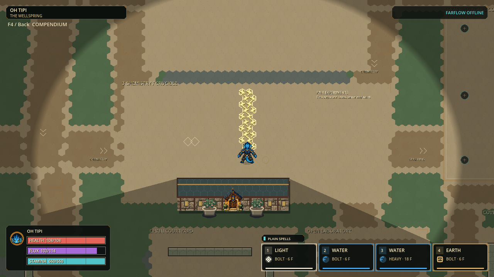

# H.E.X. quality foundation

Preserved historical checkpoint, now the retained fallback. The current build
and launch links are in [practice masonry](HEX-PRACTICE-MASONRY.md). The older
lively-motion binaries mentioned below have been pruned; their evidence remains.

Status: locally validated Windows checkpoint, 2026-09-29; human feedback pending.

Build **p56-0da6c02de87d**. Open
[PLAY-HEX.cmd](../exports/hex-quality-foundation-20260929/windows/PLAY-HEX.cmd), or
extract the [portable ZIP](../exports/hex-quality-foundation-20260929/HEX-p56-0da6c02de87d-Windows-x64.zip)
and open its launcher. Keep EXE/PCK together. Lively-motion is the retained
fallback. [Five-minute trial](HEX-PLAYTEST.md).

## Scope

Make visible work count before adding more systems or decorative detail. This
bounded pass preserves gameplay, authoritatively selected hexes, artwork pixels,
pose timing, hitboxes, payment/chemistry rules, networking and saved controls.
The preceding accepted Windows package remains usable as the fallback.

| Area | Candidate change | Required acceptance |
|---|---|---|
| Character runtime | Compile per-facing visible topology at admission; omit only fully transparent padding quads; precompile immutable binding pivots/axes | All 30 identities, eight headings and shared actions match dense vertex geometry; native motion frames unchanged; fresh paired CPU measurements |
| Map | Quiet interrupted hex joints, deterministic non-striped variants, sparse material-specific shoulder wear and calm tile centres | Exact raster ownership, repeatability and bounded preparation; native gameplay review |
| Material effects | Simpler filled pixel clusters for seven revised reactions; fixed spatial alternates for three asymmetric electrical/fracture motifs | Unique alpha silhouettes, harmless phase grammar, exact affected cells, normal/reduced native review |
| Maintenance | One active queue, one engine owner, owned-file delegation and last-two-build retention | Full suite, source identity, native boot/safe close, tested package before pruning |

The topology optimization does not reduce mesh resolution, animation cadence,
visible detail or independent aim. Palette/radius/damage/lifetime changes are out
of scope. No generated replacement art, orbiting decorations, trail residue or
new emitters are introduced.

## Measured baseline and evidence

Fresh pre-change dynamic pose diagnostic: eight actors / 7,680 pose queries;
CPU batch p50 **5.627 ms**, p95 **6.755 ms**, maximum **9.473 ms**. This is the
same prior build `p56-2073879eeeb7`, not an overall frame-rate measurement.
The earlier 9.846 ms p95 was a separate run; do not use that higher value as
the comparison baseline for a new speedup claim.

Focused validation passed (3 suites / 575,749 assertions). All 336 native motion
frames and five roster boards are SHA256-identical to the previous-build captures.
The eight-actor stream updates 1,014 rather than 2,312 vertices (56.14% fewer).
The 42 fresh paid-reaction frames and three room views completed; 13 representative
changed frames were actually inspected. Final Full: **172 suites / 1,754,524
assertions**, zero failures/stderr; import, post-import source identity and
configured 120 Hz boot passed. Windows export identity, 30-skin admission and
native safe close passed. Runtime source SHA256:
`0da6c02de87d891fac0c5c4e2dfaba73b5a4bc621edec2201589b796d089cad4`.
All six CPU runs, including a slow 10.743 ms p95 post-capture run, remain in
[the evidence](quality-foundation-evidence-20260929/README.md); no sustained speed
claim is made. Failed attempts must remain distinguishable from final passing
receipts. Native captures and numerical
equivalence cannot establish human feel, competitive balance, audio quality,
physical network reliability, accessibility compliance or sustained 120 Hz.

No simulation/balance change, commit, push, installer, publication or historical
checkpoint-pointer promotion. Two scoped implementation agents and an independent
read-only reviewer worked under one integration/engine owner.

## Quality roadmap beyond this bounded pass

| Priority | Player-facing objective | Engineering gate |
|---|---|---|
| Performance foundation | Smooth moving combat before adding visual load | Attribute pose, ground submission, simulation and snapshot budgets separately; then combined native frame pacing |
| Movement and combat feedback | Actions are immediate and understandable under pressure | Real input/opposition trials; preserve timing/plane truth; improve anticipation/contact/recovery only where observed |
| Environment | Memorable readable rooms rather than more empty acreage | Composition and wayfinding trials; shared physical hex footprints before any collider-looking hex scenery |
| Character craft | Consistent lively anatomy and action silhouettes | Reviewed directional/action corrections, especially three special authored sheets; thirty skins are not thirty authored animation sets |
| Spell identity | Recognizable elements, delivery roles and harmless/active phases | Native-scale mixed/dense combat and color-vision review; readable weakened/Rapid projectiles without hiding authoritative threats |
| UX/accessibility | Configure, recover and play without guesswork | Keyboard/controller journeys, device-aware glyphs, scalable text/focus narration and clear failures |
| Audio | Useful material/impact cues without fatigue | Bounded voice budget, mix controls and actual listening acceptance; no silent claim from log checks |
| Multiplayer/delivery | A trustworthy friend test | Same-export lifecycle, physical two-PC play, recovery/safe close, then installer/update promotion |

AAA quality is a long-term standard of cohesion and reliability, not a completion
label for this checkpoint. Increase scope only after the relevant gates pass.
