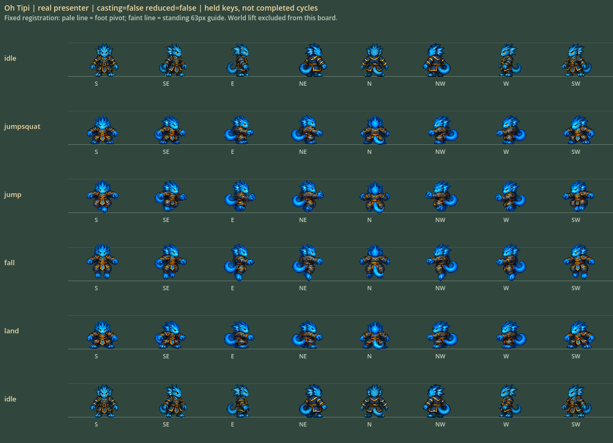
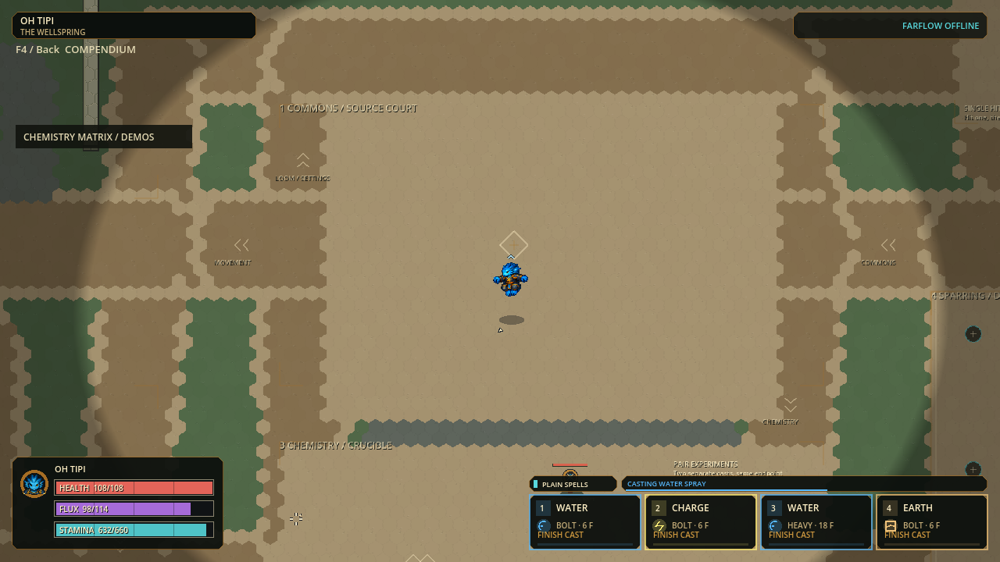

# H.E.X. anatomical scale and measured work reduction

Status: October3 local solo checkpoint `p56-90e292bc8237` READY TO TEST. Full179
suites/3,155,510 assertions, import/120Hz boot, native UI and Windows package
gates pass. Human feel, full-roster anatomical continuity, dense120Hz and
16/32/64-player capacity remain unaccepted.

[Launch](../exports/hex-scale-perf-20261003/windows/PLAY-HEX.cmd) ·
[Oh Tipi test](../exports/hex-scale-perf-20261003/windows/TEST-OH-TIPI.cmd) ·
[110.4MiB portable ZIP](../exports/hex-scale-perf-20261003/HEX-p56-90e292bc8237-Windows-x64.zip) ·
[Verified fallback](../exports/hex-cast-motion-20261003/windows/PLAY-HEX.cmd).

This slice implements the user's scale/performance request without silently
changing gameplay or pretending that the current networking protocol supports
64 players. One lead owns engine runs; three disjoint workers cover anatomical
calibration, conservative render rejection, and contact/capacity diagnostics.

| Work | Scope | Acceptance boundary |
|---|---|---|
| Oh Tipi anatomy | Neutral-calibrated four-action bank, eight stored headings | Static pilot accepted; native and human review separate |
| Reusable art calibration | Neutral row selects one uniform source scale; exact recipe/source review hashes | Other 29 action sheets and all ground banks preserved |
| Remote body culling | Reject only wholly offscreen bounded stateless presentation | No offscreen simulation, essential cue, history or network omission |
| New impact contact scheduling | Prepare only the newly deposited source once per synchronous pass | Complete event ordering/witness/state equivalence required |
| Capacity contract | Explicit 8/16/32/64 diagnostic tiers | 16/32/64 are UNSUPPORTED, not extrapolated measurements |

The [fresh Full receipt](scale-performance-evidence-20261003/full.json) covers
3,083 canonical runtime records, source SHA256
`90e292bc8237a25191dfcf29a5ff8a48975459116519b3a3e8eb01cba17fe28d`.
Full is correctness/import/boot evidence, not rendered or multiplayer capacity.

Native UI:70 checks/13 frames. Package: real Windows admission/identity/safe
close; all120 action plus30 ground presenter images match new/preserved reviewed
pixels exactly. PCK and ZIP hashes of both selected builds were freshly checked.
[Exact package comparison](scale-performance-evidence-20261003/package-comparison.json)
and [UI receipt](scale-performance-evidence-20261003/ui.json).
Seven exports remain because prior older-build cleanup is blocked; no workaround
or deletion was attempted. No commit, push, installer, public release, relay
deployment or historical checkpoint-pointer promotion occurred. Owned engines
closed; immutable sources and success/failure evidence remain.

## Why the scale bug needs authored correction

Equal silhouette heights do not guarantee equal heads, torsos or limbs. The old
action calibration used a posed falling silhouette while idle used standing.
The repaired pipeline includes an unused neutral source row as the ruler and
never independently scales an action. Oh Tipi's manually selected upper-head
width improves from 23px to31px against34px idle. Other identities still need
individual review; this is not an all-character anatomical fix.

[Measurements, source identities and remaining art limits](HEX-SCALE-CALIBRATION.md).
The original sheet and both repair candidates are retained. No runtime morphing,
size stats, hurtboxes, common wall clearance or movement timing was changed.

## Correctness and performance gates

Baseline and candidate use the same paid workload and both input orders. Simulation timings exclude
rendering/snapshots and are not FPS. The paired presentation diagnostic times
CPU frame preparation only; synthetic 64 render objects are not a64-player game.

Fresh gates so far:38 Python assembly/audit tests;702 selected engine assertions;
108 exact native RGBA culling comparisons (314 rejected queries); four Oh Tipi
boards/192 presenter queries and31 actual-world frames with one paid airborne
Spray release,16 fixed-aircast ticks and2 landing-key ticks. Independent native
review accepts this bounded anatomical pilot, not human feel or all8-heading
dynamic motion. The in-world motion fixture uses SW; boards cover all8 headings.

### Paired presentation CPU diagnostic

Final v3 probe:36 complete cases,60 warmup and300 measured pairs each,
816,589 checks. ABBA arm order, real fixed-pixel presenters, unchanged authority
and matching visible frame IDs; exact native pixel equivalence is a separate
108-case fixture. On this Ryzen3 7320U/4-core/8-thread machine, walking rows are:

| Synthetic render objects | Visible | Unconditional median | Culled median | Change |
|---|---:|---:|---:|---:|
|8|100%|1.779ms|1.859ms|+4.5% decision overhead|
|8|50%|1.480ms|0.944ms|-36.2%|
|8|0%|1.461ms|0.275ms|-81.2%|
|64|100%|16.517ms|17.675ms|+7.0% decision overhead|
|64|50%|15.539ms|9.600ms|-38.2%|
|64|0%|15.053ms|2.384ms|-84.2%|

This is CPU pose preparation, not drawing/GPU completion or full-frame FPS.
The first measured culler added20–25% all-visible overhead; the visible-anchor
fast path reduced that cost. The remaining overhead and all-visible64 cost are
explicit constraints, not concealed by quoting only offscreen savings.

### Simulation remains over budget

| Same paid720-tick workload | Forward p95 | Reversed p95 |
|---|---:|---:|
|Fresh baseline|15.906ms|14.104ms|
|Candidate run1|17.534ms|17.033ms|
|Candidate run2|19.181ms|25.258ms|

All six runs have identical final authority hash
`7a0e8cb95df6c22327db70c1343b583e09d19bbb5e6162af9abd45603f01c101`
and identical complete authority/event trace
`34dfdcd227e1ad57e440d37ee59fabb55855c4905a6bc8f52bacaf0e97bf6e7c`.
Every run admits138 paid casts, refuses2160 requests and executes52 reactions.
These separate sequential wall-clock runs do **not** establish an end-to-end
speedup; candidate measurements are slower. Dense120Hz remains FAILED against
8.333ms. A same-process paired contact diagnostic isolates the algorithm's cost
without attributing all desktop timing variation to one function.

### Isolated new-impact scheduler CPU diagnostic

Three complete cases,20 warmup/60 measured ABBA pairs each,2,353 checks. All
paths deliberately cross eight real paid fields; only one newly deposited
source should be queued. Full queue bytes, contact counts and authority remain
equal. This is a worst-overlap synthetic kernel probe, not normal tick timing:

| Prospective paths | Old median | New median | Median reduction |
|---|---:|---:|---:|
|8|63.093ms|7.671ms|87.8%|
|32|285.584ms|37.367ms|86.9%|
|128|1066.489ms|122.442ms|88.5%|

The structural improvement is fewer unnecessary intervals: with eight fields,
the old function computes contacts against all eight for every path and throws
seven away; the new function filters the source first. Field preparation occurs
once per enqueue call, not once per path. These figures do not claim a normal
game spends those durations here or that the overall frame improved by88%.

Raw receipts: [render CPU](scale-performance-evidence-20261003/viewport-cpu.json),
[native pixels](scale-performance-evidence-20261003/viewport-native.json),
[contact CPU](scale-performance-evidence-20261003/new-ground-cpu.json),
[baseline](scale-performance-evidence-20261003/simulation-before.json),
[candidate1](scale-performance-evidence-20261003/simulation-after-1.json),
[candidate2](scale-performance-evidence-20261003/simulation-after-2.json),
[unsupported capacity tiers](scale-performance-evidence-20261003/capacity-tiers.json).

## Reviewed game pixels

These are runtime captures, not concept-art mockups. Fixed-step capture does not
measure physical-input responsiveness or rendered frame pacing. Blue-on-blue
Water contrast and richer landing/NE differentiation remain refinement work.

The new contact test compares complete ordered queues with the frozen preceding
function, including real paid fields, stored-cell boundaries, missing/expired
sources and ended paths. It asserts nonzero expected contacts, preventing an
empty fixture from masquerading as equivalence. The native culling fixture
compares exact rendered pixels in fixed-pixel and legacy modes.

## Failures retained

- Initial identity regeneration omitted the required explicit `-Force`; no
  candidate validation was claimed from that attempt.
- A new scale document initially lacked the required near-top Status line;
  the scope gate rejected it, then it was corrected.
- The first contact test accidentally constructed the legacy court, yielding
  zero rather than eight fields. The focused gate failed; the test now creates
  genuine paid sources in the unified chemistry world and checks real contacts.
- Its second fixture placed Water sources close enough to combine into Flood;
  it correctly failed the eight-live-fields checks. Sources are now separated
  on a valid larger topology. The fresh direct focused run passes204 contact
  assertions and348 viewport assertions; neither failed attempt is a pass.
- Presentation CPU diagnostic v1 aborted inside its helper on a typed-array
  assignment. The engine wrapper rejected its erroneous printed PASS. V2 fixes
  the assignment and requires36 complete cases with300 measured samples each
  before accepting a receipt. V1 is invalid performance evidence.
- Final plain `git diff --check` treated CRLF endings in the protected mixed-EOL
  source as trailing whitespace. A command-local `cr-at-eol`-aware check passed;
  no Git setting or frozen runtime bytes were changed merely to reformat history.
  The final documentation scope check also passed.

All receipts remain in `.godot/scale-perf-*` and `.godot/hex-probe-scale-*`.
Current successful evidence must be distinguished from these failures and from
the previous build's historical Full/native results.

## Next work, not hidden promises

1. Native-size feedback on Oh Tipi, then individual continuity repairs for
   Red Baron, Fluup and Haara; no blind regeneration of all30.
2. An eight-player non-shipping immutable-topology/sparse-dynamic snapshot
   candidate, exact authority/prediction restore and measured encode/decode.
3. Versioned player-ID, masks, limits and session migration, with real admitted
   16/32/64 actors and end-to-end load/network gates before changing capacity.
4. A separate visible-crowd render-preparation slice: the64-visible paired rows
   already exceed a frame budget before drawing. First attribute descriptor,
   geometry and decoration work; evaluate bounded immutable frame descriptors
   keyed by admitted atlas/pose/heading, with per-actor timing/anchors separate.
   Never cache mutable authority or share history-dependent settling between
   actors. Native exact-pixel, reentry, all-state fallback and memory bounds
   must pass; profile real draw/GPU time separately from CPU pose preparation.

[Detailed 64-player dependencies](HEX-CAPACITY-64.md). Dense120Hz, physical
different-home play, final animation cycles and human fun remain separate gates.
