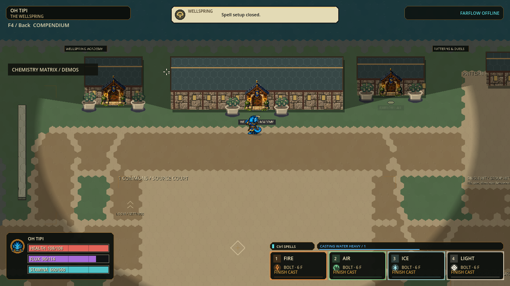
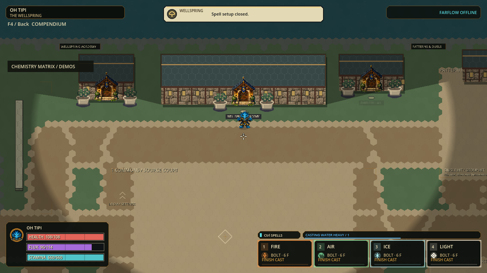

# H.E.X. snapshot pipeline checkpoint

Status: October 4 E14–E16 READY FOR LOCAL TEST; dense timing gate FAILED; E9–E13 fallback preserved.

## Current publication and feedback batch — October 4

Candidate `p56-a85f2e9e7a7e` passes final correctness and delivery gates. The runnable
`p56-57663bc8a613` export is preserved and freshly hash-verified. This is a
bounded engineering follow-up, not new artwork, capacity or internet acceptance.

| Slice | Implemented change | Preserved boundary |
|---|---|---|
| E14 | Capture directly into an owned, synchronous packet preparation operation, removing two redundant post-capture validations | Full strict producer reconstruction and all public/incoming validation; exact envelope/wire bytes; extension and callback ordering; acknowledgement only after caller delivery |
| E15 | Suppress ordinary capacity refusals caused by held auto-repeat | Fresh presses still report refusal; other rejection reasons remain visible; paid admissions, reservation order, costs, cooldowns and queue capacity unchanged |
| E16 | Focused/adversarial, paired, full, paid-load, native, exact Windows and localhost verification | One engine owner; unchanged watchdogs/workloads; failures retained; measured and human acceptance kept separate |

Focused final v3: **28,808 assertions across three suites**, zero failures/stderr.
The preceding clean v2 checks seven publication/network suites (2,481 assertions)
but predates the final cheaper admission gate; it is supporting history, not a
substitute for final-source validation. Feedback-focused v2 passes six suites /
35,252 assertions. Final-source Full and delivery results follow below once run.

### Same-source publication comparison

[Paired v3](publication-evidence-20261004/paired-v3.json) passes **3,230 assertions**,
zero failures/stderr, all receipt guards and unchanged hashes for 186 dependencies.
Seven alternating, case-counterbalanced pairs per state compare the literal
public composition against owned preparation through outgoing encoding.

| Actual eight-champion state | Public median | Owned median | Reduction between medians |
|---|---:|---:|---:|
| Empty |23.712 ms|19.330 ms|18.48%|
| Distributed paid-40 |73.685 ms|66.763 ms|9.39%|
| Dense paid-40 |38.018 ms|32.191 ms|15.33%|
| Active Rampart |35.667 ms|30.842 ms|13.53%|

Exact authority, envelope, packet and encoded bytes, actual receiver reassembly,
restored full-authority hashes and unchanged observed source/input state pass.
The timing includes outer/factory eligibility and encoding, but excludes the
final transport script recheck, empty-packet branch, host/epoch checks, fanout and
socket dispatch. It is not total broadcast time or a frame-rate measurement.
Final-tick metadata has 0/1/0/0 events; queue saturation is measured separately.
Capture remains dominant (19.252–66.561 ms stage medians). Inclusive stages overlap
and must not be added. Neither 60 Hz publication nor dense 120 Hz is established.

### Safety and evidence quality

The full deep chemistry scan remains inside `HexWorldSnapshot.capture`; only
redundant publication admission scans were removed. Successful capture returns
fresh primitive-only authority. Public mutable dictionaries gain no trust flag
or cached acceptance. Initially ineligible source/transport extensions retain the
literal predecessor sequence. A transport script replaced during capture receives
the original result, including `{}` on refusal, without a second capture.

Final tests cover real opaque chemistry mutation/refusal/recovery and actual late
script replacement during rejected capture. Successful late extension delivery
is covered through the literal subclass fallback, not successful opaque capture.
The original HexWorldSnapshot file is unchanged by this batch.

Failed probe/test attempts are retained in [the evidence folder](publication-evidence-20261004/):
an unknown suite invocation, typed-array fixture/fallback errors, and a serialized
receipt comparison that incorrectly compared integer and JSON-float containers.
Receipt verification now normalizes only finite, nonnegative integral values,
checks exact keys and recomputes every statistic; it does not introduce tolerance.
Independent review caught callback-ordering regressions before the final pass.

### Paid load and feedback

[Load v1](publication-evidence-20261004/load-v1.json): **11,340 logged assertions**,
zero failures/stderr. JSON records 11,339 before the final receipt-open assertion.
All 22 recorded dependency hashes remained unchanged and match the frozen source.
The 11,337-cell campus uses eight actual paid champions, 720 measured ticks,
60 Hz attempted publication, and normal/reversed command order for each case.

Against preceding canonical load-v2, both cases/orders preserve exact per-wire
requests/admissions/releases, non-refusal event counts, nontelemetry authority
metrics, all nine inventory totals, seven authority peaks, contact queries,
living-actor work, empty final occupancy and cleanup ticks. Each new case's
normal/reversed runs also match all 23 deterministic fields, including full hashes.
Cross-version hashes intentionally differ because refusal telemetry changed;
this is aggregate preservation, not proof of identical per-actor trajectories.
Focused tests separately cover resource/cooldown/reservation nonmutation.

| Preserved paid result, each repetition | Distributed | Dense |
|---|---:|---:|
| Admissions / releases |65 / 51|58 / 48|
| Matter paid |39,000|34,800|
| Matter consumed / expired |21,200 / 17,800|32,000 / 2,800|
| Clashes / products |23 / 27|30 / 30|
| Living champions / deaths |8 / 0|8 / 0|

| Feedback, old → new | Distributed | Dense |
|---|---:|---:|
| Ordinary refusal events |234 → 12|232 → 3|
| Encoder-admitted events |413 → 191|377 → 148|
| Entered at least one envelope |413 → 191|329 → 140|
| Completed four-snapshot redundancy |413 → 191|135 → 140|
| Trimmed before first inclusion |0 → 0|48 → 8|
| Trimmed after prior inclusion |0 → 0|194 → 0|

The remaining eight dense losses are projectile-spawn notices, IDs68–71/84–87.
All58 startups,30 clashes and3 explicit refusals enter envelopes and retire after
redundancy. Unsupported encoder events remain236 distributed and70 dense,
separately from queue loss. No publication rejection or MTU violation occurred;
maximum datagram size is1,324bytes. Envelope inclusion is not socket delivery.

| Case / command order | Simulation p95 | Host p95 | Owned preparation core p95 | Encompassing capture p95 |
|---|---:|---:|---:|---:|
| Distributed / normal |12.315 ms|192.783 ms|187.293 ms|187.414 ms|
| Distributed / reversed |11.727 ms|194.287 ms|190.632 ms|190.720 ms|
| Dense / normal |10.409 ms|122.243 ms|116.830 ms|116.919 ms|
| Dense / reversed |9.949 ms|120.250 ms|116.770 ms|116.851 ms|

**Timing FAILED** against the8.333ms simulation budget:208/215/119/111 step misses
out of720. The encompassing capture timer also contains diagnostic byte counting
and acknowledgement; the core timer isolates source admission/capture/packing.
Neither includes socket delivery or rendering. These fresh-vs-historical load
figures are not the controlled paired speedup evidence above.

### Full and exact delivery

Full v1 passes **195 suites / 3,350,688 assertions** in 593.581 seconds,
including import and configured 120 Hz boot, zero failures/stderr. Receipt:
[Full v1](publication-evidence-20261004/full-v1.json). Native UI passes70 checks /
13frames, zero stderr;108 native PNGs exactly match the previous checkpoint.
The first combined orchestration command stopped after the passing UI probe
because it incorrectly inspected an unset shell exit-code variable. The engine
probe and receipt passed; character capture then ran separately and passed.
No production change or gate relaxation was made for that runner error.
Exact Windows package launch/safe close passes; all108 source/PCK PNGs match.
Complete same-export localhost lifecycle passes in60.701s under the unchanged120s
deadline, with empty host/guest/late-guest error logs. This includes late spectating,
exact-actor return, Hearth handoff, rematch and reason-bearing host release.
All owned engines are closed; new and preceding PCK/ZIP hashes freshly verified.

[Launch](../exports/hex-publication-20261004/windows/PLAY-HEX.cmd) ·
[110.4 MiB portable ZIP](../exports/hex-publication-20261004/HEX-p56-a85f2e9e7a7e-Windows-x64.zip) ·
[Fallback](../exports/hex-canonical-20261004/windows/PLAY-HEX.cmd) ·
[Package receipt](publication-evidence-20261004/package-v1.json) ·
[Pixel/artifact comparison](publication-evidence-20261004/delivery-comparison.json) ·
[Network receipt](publication-evidence-20261004/network-v1.json).

Runtime SHA256 `a85f2e9e7a7e41e7f2e1ec8a0dde0305cd8558af6112f3d323f3b4836cded040`,
3,087 production records; ZIP115,789,600bytes. No installer, commit, push, public
deployment, historical checkpoint promotion or destructive cleanup. Localhost is
not physical internet or eight-active-player load acceptance. Remaining art,
relay/room, larger-lobby and human-feel gates remain explicit in the single queue.

## Previous E9–E13 engineering batch — history

Implementation is frozen at candidate `p56-57663bc8a613`; Full, native, exact
Windows delivery and complete localhost lifecycle gates pass. Five changes form
one integrated batch; this is not completion of the future art, internet or
64-player roadmap.

| Fresh final-source gate | Result |
|---|---|
| Focused v4 | PASS: 13 suites / 7,046 assertions, zero stderr |
| Paired v3 | PASS: 2,798 assertions; complete strict receipt, exact states and bytes |
| Full v3 | PASS: 194 suites / 3,349,735 assertions; import and configured 120 Hz boot; zero failures/stderr |
| Native UI | PASS: 70 checks / 13 captures; real saved assignment and attunement paths |
| Native character preservation | PASS: 108 exact candidate/reference RGBA comparisons and 108 PNG SHA matches against preceding E7/E8 captures |
| Final paid load | Correctness PASS: 11,339 logged assertions; timing FAILED (see below) |
| Exact Windows package | PASS: native launch/safe close, runtime identity, 108 source/PCK PNG matches, new/fallback artifact hashes |
| Same-export localhost lifecycle | PASS: 69.750 seconds under unchanged 120-second deadline; all three stderr logs empty |

[Start H.E.X.](../exports/hex-canonical-20261004/windows/PLAY-HEX.cmd) ·
[Windows ZIP — 110.4 MiB](../exports/hex-canonical-20261004/HEX-p56-57663bc8a613-Windows-x64.zip) ·
[Verified E7/E8 fallback](../exports/hex-pipeline-20261003/windows/PLAY-HEX.cmd).
Keep EXE/PCK together; the launcher enables the 30-character pixel candidate.
Runtime SHA256 `57663bc8a613dde0301f9be246fd199b561ee4b5cb2fdb2e5b55273047edf026`,
3,087 production records; ZIP 115,784,240 bytes. No installer, commit, push,
deployment or historical checkpoint-pointer promotion. Existing builds and
originals preserved; all owned engine processes closed.

Fresh [Full receipt](canonical-evidence-20261004/full-v3.json),
[focused log](canonical-evidence-20261004/focused-v4.log),
[UI receipt](canonical-evidence-20261004/native-ui-v1.json) and
[actual Spell Loom](canonical-evidence-20261004/loom.png).
Also: [package](canonical-evidence-20261004/package-v1.json),
[pixel and artifact hashes](canonical-evidence-20261004/delivery-comparison.json),
[network lifecycle](canonical-evidence-20261004/network-v1.json).

| Slice | Implemented behavior | Preserved boundary |
|---|---|---|
| E9 | Stream exact canonical bytes using one weakly held immutable topology template | Fresh dynamic values, original length framing/hash, direct-mutation and subclass fallbacks, reentrant-call isolation |
| E10 | Reconstruct final material layers once; native ordered-key sort; reuse already verified prepared hash | Zero coverage, compatibility planes, provenance, conservation, strict malformed refusal and independent mutable state |
| E11 | Reject stale single-packet snapshot/reconciliation headers before expensive decode | Headers only reject; accepted cursors advance after full validation; fragments and public decoders unchanged |
| E12 | Reuse detached metadata in four adjacent synchronization reads after publication and motion callbacks | Original publication and extensible callback ordering; removes three of eight validations, not all validation |
| E13 | Serialize each packet once for concrete recipient fanout | Exact bytes, peer-major/fragment ordering, per-send guards, channel/mode and subclass hooks |

No gameplay, art, map, costs, caps, protocol or cadence changes. Production still
has 11,337 chemistry cells, eight admitted players, configured 120 Hz simulation
and 60 Hz snapshots. Those configured rates are not performance acceptance.

Fresh focused v4: **13 suites / 7,046 assertions PASS**, zero stderr. Failed v1
is preserved: two new E9 test fixtures violated a read-only view or assumed that
a diagnostic subclass qualified for concrete acceleration. Fixtures were fixed;
production admission was not weakened. Independent review also caught a shared
template reentry hazard and metadata reuse across extension callbacks; both were
repaired before this passing run and have dedicated regressions.

Final review additionally repaired an existing outer-capture gap: verified-hash
reuse and omission of a final source comparison now share one callback-free
admission decision. Exact collision/base/obstacle scripts and bounded primitive
authority scans join the existing world/actor/configuration guards. Extensible
fallbacks retain virtual hashing and the final prepared/live-source comparison.
Opaque, deeply nested or cyclic values decline reuse; this does not make them
valid snapshots. The new test covers mutations during actor serialization and
collision cloning, incompatible/pass-through hashes and no-op extensions.
Focused v3 passed assertions but failed shutdown due intentional test observer
reference cycles; teardown was corrected, not production code. Both failed runs
remain in [the evidence folder](canonical-evidence-20261004/). Full v1 stopped
before engines because this ledger needed an explicit status line; it is also
retained, not counted as a completed regression run.
Full v2 stopped after import at the canonical-class-registry gate: the new frozen
test codec declared a global class. It is now test-private; the checker
and production class registry remain strict. No unit suite had run in either
failed Full attempt.

### Paired complete operations

[Final paired v3](canonical-evidence-20261004/paired-v3.json): **2,798 assertions,
zero failures**, complete receipt, unchanged measured source hashes and zero
stderr. Seven alternating pairs per case use the same sealed 11,337-cell source,
eight actual champions, and fresh destination worlds. Ordinary paid distributed,
dense and active-Rampart fixtures preserve exact canonical bytes, snapshot bytes,
full collision structures and 16 identical continuation steps. Receipt guards
also reject incomplete cold stages, corrupt sample/order/statistics data and
missing hashes. This is a bounded CPU diagnostic, not sustained tails or FPS.

Medians in milliseconds, **frozen E8 / current**:

| State | Chemistry hash | Chemistry prepare | Complete capture | Complete public prepare |
|---|---|---|---|---|
| Empty |8.164 / 4.258|8.050 / 4.890|26.597 / 18.789|15.210 / 11.141|
| Distributed paid-40 |24.585 / 19.957|34.919 / 30.882|72.933 / 70.223|41.018 / 36.938|
| Dense paid-40 |13.586 / 8.681|21.848 / 15.942|52.891 / 43.289|27.364 / 21.677|
| Active Rampart |13.029 / 7.835|14.716 / 9.632|38.600 / 30.906|21.657 / 16.862|

Complete capture is 4–29% lower; incoming prepare is 10–27% lower in these cases.
Inclusive stages overlap: do not add them. Frozen E8 preserves its known callback
gap; separate safety tests establish the repaired contract instead of treating
that bug as an equivalence target. The ordinary concrete benchmark remains exact.
The final frozen oracle omits its global class name and resolves its own script
once per producer; paired baseline timing includes that cached resource lookup.
Previous v1/v2 receipts remain available rather than being silently overwritten.
First hash on three newly configured topology identities has median **43.246 ms**,
versus **7.942 ms** for the old whole-byte hash and **4.203 ms** for warm reuse.
This fixed-order setup probe is not a cold-process or tail benchmark.

### Cost and acceptance limits

The immutable byte template is bounded to one map, but first use incurs setup
and alternating independent topologies can evict it. Full canonical hashing
still processes the complete byte sequence; this is not O(active-cells) hashing.
All source, package, native, load, physical-network and human evidence stays
separate. Failed results remain recorded and are never counted as passes.

The [final paid-load diagnostic](canonical-evidence-20261004/load-v2.json) runs
on `p56-57663bc8a613`: eight actual champions, 720 measured ticks and 360 measured
every-other-tick publications per pass, normal/reversed commands, followed by
authored cleanup. Correctness passes, **timing fails**. JSON records 11,338 checks;
stdout adds the final receipt-open assertion for 11,339. Zero failures/stderr.

| Case | Simulation p95 ms | Host including publication p95 ms | Envelope + packing p95 ms | Steps above 8.333 ms |
|---|---|---|---|---|
| Distributed / normal |12.470|212.168|207.384|247 / 720|
| Distributed / reversed |12.084|208.020|205.223|255 / 720|
| Dense / normal |10.923|135.032|129.946|142 / 720|
| Dense / reversed |10.751|133.320|128.598|130 / 720|

All eight champions stay alive; paid matter conserves; effects and pending events
drain; packet-size violations and publication rejections are zero. Full input
traces and sample-end state hashes also match the pre-repair diagnostic. That
older receipt is retained separately, not relabeled as final-source evidence.
These are not paired before/after host measurements and do not establish an
aggregate speedup. No sockets, physical input or rendered frames are measured.

The dense workload still records **48 feedback events evicted before first
envelope inclusion** (25 refusal, 3 startup, 7 clash, 13 projectile-spawn cues).
There are 242 total dense evictions; 194 had already entered an envelope. This
is not authoritative state loss or proof of socket packet loss. Unsupported
encoder events (236 distributed, 70 dense) are a separate nonadmission category.

Next work: measure complete publication stages and diagnostic byte-accounting
overhead separately, then reduce repeated exact validation/allocation through
strict ownership. Source inspection finds one capture per publication, but
three inner inflations/actor decodes and four packed-grammar traversals across
capture, wrapping and transport boundaries. Those counts are not stage timings.
Never replace public validation with a reusable trusted-dictionary flag. Resolve
feedback priority/retention and unsupported-event semantics as a separate contract
before changing queue capacities or wire schema. E11 receive filtering, E12
client metadata and E13 fanout do not run inside this headless host-only timer.

## Previous E7 and E8 engineering results — history

E7 and E8 are implemented and measured on the unchanged 11,337-cell campus.
Current checkpoint `p56-48a87aa89959` is READY FOR LOCAL TEST, frozen at 3,085
production records. Full, native rendering, exact Windows delivery and the
complete unchanged 120-second localhost lifecycle pass. Internet and dense
120 Hz remain unaccepted. Runtime SHA256:
`48a87aa899591dfe214b8a57922527de8e0e6fcfe5f9d45d21b5cb08d24a825a`.
The freshly hash-verified E6 portable `p56-a0258a65082e` below remains preserved
as fallback. Its receipts are historical, separate from the new results.

[Start H.E.X.](../exports/hex-pipeline-20261003/windows/PLAY-HEX.cmd) ·
[Windows ZIP — 110.4 MiB](../exports/hex-pipeline-20261003/HEX-p56-48a87aa89959-Windows-x64.zip) ·
[Five-minute playtest](HEX-PLAYTEST.md).

| Fresh gate | Result |
|---|---|
| Focused | PASS: 9 suites / 7,089 assertions; zero stderr |
| Paired complete operations | PASS: 2,629 assertions, four actual eight-champion states; exact authority/wire/collision results |
| Full | PASS: 188 suites / 3,346,851 assertions; import/configured 120 Hz boot; zero failures/stderr |
| Native UI | PASS: 70 checks / 13 frames; isolated profile; actual 30-character pixel bank |
| Character preservation | PASS: 108 native PNGs exactly match E6; 108 mounted-PCK PNGs exactly match current source |
| Windows portable | PASS: identity, native launch/safe close, new and fallback PCK/ZIP hashes |
| Same-export localhost | PASS: full host/guest/late-guest lifecycle in 74.955 seconds under unchanged 120-second watchdog; all three stderr logs empty |
| Human feel, dense 120 Hz, internet, 16/32/64 players | Not established |

Receipts: [Full](pipeline-evidence-20261003/full-v1.json),
[native UI](pipeline-evidence-20261003/native-ui-v1.json),
[package](pipeline-evidence-20261003/package-v1.json),
[pixel/hash delivery](pipeline-evidence-20261003/delivery-comparison.json),
[network lifecycle and logs](pipeline-evidence-20261003/network-v1.json).
The ZIP is 115,782,561 bytes. No commit, push, installer, relay deployment or
historical checkpoint-pointer promotion. All owned engine processes closed;
originals, previous builds and failed receipts remain preserved.

E7 lets a fresh collision world borrow the concrete authority's immutable cell
order and indices, and constructs faces/components from actual solid cells.
Stable face IDs still use full-map indices; dynamic validation, atomic refusal
and legacy/subclass fallbacks remain. E8 checks and decodes packed chemistry
lanes once instead of discarding a preliminary decode, and removes an identical
second transport check. Incoming shape, size, topology, conservation, relation
and complete authority-hash requirements remain unchanged. Neither slice changes
the map, player/cast/product caps, protocol, cadence, gameplay, balance or art.

Fresh evidence: focused checks PASS **9 suites / 7,089 assertions**; the
[paired diagnostic](pipeline-evidence-20261003/paired-v1.json) PASS
**2,629 assertions**, zero failures, complete receipt and unchanged source hashes.
The four cases use eight real champions and ordinary paid inputs. Distributed
paid-40 has seven admissions / 4,200 paid matter; dense paid-40 has eight / 4,800.
Active Rampart uses an initially equipped legal Earth Bolt, one ordinary press
per champion and 72 lifecycle steps, reaching one active Rampart with eight
admissions / 4,800 paid matter. No products, free matter or geometry are injected.

All medians below are **milliseconds, frozen E6 / current E7 and E8**. Complete
capture and public prepare use the same unchanged sealed source in alternating
pairs. The frozen baseline retains preceding collision setup and packed decoding.
A separate legacy replay twin supplies exact canonical/wire compatibility checks.

| State | Complete capture | Public prepare | First collision admission | Strict packed decode |
|---|---|---|---|---|
| Empty | 85.328 / 28.863 | 77.206 / 15.540 | 64.757 / 0.053 | 0.054 / 0.046 |
| Distributed paid-40 | 134.567 / 74.108 | 103.135 / 42.474 | 57.212 / 0.051 | 0.392 / 0.249 |
| Dense paid-40 | 102.045 / 40.281 | 78.804 / 22.904 | 58.586 / 0.037 | 0.137 / 0.095 |
| Active Rampart | 98.543 / 41.228 | 81.844 / 22.432 | 61.054 / 0.257 | 0.140 / 0.089 |

The fused decoder alone saves only 0.008–0.143 ms in these isolated medians;
it is not the large collision-setup improvement. Complete wire bytes, authority
hashes, full collision structures and the bounded movement/sweep/line-of-sight
query outputs match their reference arms. Each stage/state has only three paired
samples; p95/p99 are sample-limited maxima, not tail or capacity estimates.
Inclusive stages overlap and must not be summed or subtracted as independent
costs. Capture still takes 28.863–74.108 ms here, so neither 120 Hz simulation,
60 Hz envelopes, rendered performance nor internet readiness is established.

The new packaged localhost run completes movement reconciliation, late joining
and spectating, exact-actor disconnect/return, Hearth handoff, second-round
participation, and reason-bearing host release with return revoked. Its 82 host
capture/send observations range from 23.014 to 45.168 ms; they are not isolated
stage timings or proof of target cadence. One successful bounded local lifecycle
does not establish sustained load, physical two-PC play or the undeployed relay.

Next dependency: canonical chemistry hashing and strict reconstruction, then
bounded queue/cadence and broader multiplayer stress acceptance. The current
inclusive stage medians still spend 9.885–25.401 ms in chemistry hash,
9.746–28.365 ms in chemistry encode, and 9.624–34.948 ms in chemistry prepare.
These overlap; do not sum them. Preserve complete authoritative identity and
malformed-state refusal. Warm collision refresh was already cheap and did not
improve uniformly; do not advertise this as an across-the-board speedup.

Three disjoint workers owned collision/unit checks, paired profiling, and decoder
tests/independent review. Root owned snapshot integration and serialized every
engine, capture and export. Final static review found no new blocker; it is not
a substitute for the executed gates above. E7/E8 complete this active batch;
art, relay and 64-player migration remain separate future work.

## Historical E6 checkpoint

The remaining evidence and handoff describe preserved E6, not current E7/E8
delivery. Its proposed fresh-collision follow-up is now implemented above;
its successful solo/package checks and failed network receipt remain historical.

Status: `p56-a0258a65082e` READY FOR LOCAL SOLO TEST. Full, native rendering
and Windows export pass; complete localhost lifecycle still FAILS its unchanged
120-second deadline. New local portable:
`exports/hex-sealed-topology-20261003/windows/PLAY-HEX.cmd`.
Preceding `p56-a15adfd5d74b` is freshly hash-verified and preserved as fallback.
This continuation targets snapshot and prediction overhead, without changing
the eight-player cap, protocol, map, paid combat, balance or artwork.

## Ownership contract

The normal 11,337-cell Wellspring owns one immutable terrain description.
Prepared worlds and prediction copies share it and own separate sparse material
rows. Dry cells remain valid targets and collision geometry. Hashes preserve the
complete legacy byte stream: prejoined static text replaces repeated interpreted
blank-cell traversal, not the terrain's contribution to authoritative identity.

| Boundary | Contract |
|---|---|
| Geometry | Concrete package-owned topology; recursively read-only metadata, orders and indices; detached packed bytes |
| Live state | Each world owns its material dictionaries, cast/product ledgers, history and other mutable authority |
| Compatibility `.cells` | Permanently materializes that world; old writable aliases remain meaningful; shared siblings stay isolated |
| Origin change | Invalidates shared admission even if subsequently changed back |
| Network input | Existing wire shape, all dynamic decoders, conservation, source relations and complete authority hashes still required |
| Prediction and collision | Concrete ownership shortcuts only; extension scripts retain checked legacy paths |
| Presentation | Read-only access does not accidentally materialize the world; existing malformed-row fallback remains |

## Delegation and review

Lead owns storage, canonical hashing, readers, prediction, shared test runner
and every engine process. A codec worker owns the two snapshot files and their
focused suite; another worker owns the paired diagnostic; independent review
owns no edits. Review found and corrected malformed-row render coercion,
subclass collision-handle substitution and virtual prediction-copy aliasing.
Dedicated tests exercise all three boundaries.

## Evidence

| Gate | Current result |
|---|---|
| Focused repair run | PASS: 8 suites, 4,138 assertions, zero stderr; `sealed-focused-v2` |
| Paired production diagnostic | PASS: 2,856 assertions; actual 11,337-cell map, eight real champions, normal/reversed distributed/dense paid inputs; exact canonical bytes, complete wire and 164 paid-step outcomes |
| Full suite | PASS: 186 suites / 3,344,577 assertions, import and configured 120 Hz boot; zero failures/stderr; `sealed-full-v1` |
| Native UI | PASS: 70 checks / 13 native frames, isolated profile and actual pixel bank; `sealed-ui-v1` |
| Native pixel comparison | PASS: 108 exact RGBA cases, 314 safely skipped body queries; all PNGs match the preceding checkpoint |
| Windows portable | PASS: current source identity, 30-character bank, native boot/safe close; 108 mounted-PCK PNGs match source |
| Complete localhost lifecycle | FAILED_TIMEOUT at unchanged 120-second deadline; reconnect/exact-actor return and Hearth spectator handoff now observed, round two/steward sequence unfinished; all three stderr logs empty |
| Dense 120 Hz, rendered FPS, internet and 64 players | Not established |

Development failures remain in `.godot`: the initial guarded invocation rejected
stale runtime identity; the first import created a new UID and correctly failed
its post-import identity check; focused v1 exposed two GDScript inferred-type
parse errors; paired v1 rejected its stale 2,766-cell fixture assertion. These
are failed runs, not acceptance. Later runs use fresh directories/receipts.

The paired diagnostic times the current codec with either sealed or explicitly
materialized legacy storage. Frozen original canonical bytes and preceding
snapshot orchestration validate results outside timers. Three paired samples
per state are diagnostic observations, not reliable p95/p99 capacity estimates.
No narrower geometry, free casts, resource refill, limits or authority are used
to manufacture a speedup.

Build identity covers 3,085 production records, SHA256
`a0258a65082e0c0d73b1fc89d139b98a4e941a5b1c0a4fee488fe31c60478057`.
The ZIP is 115,775,160 bytes (110.4 MiB). Curated receipts:
[Full](sealed-topology-evidence-20261003/full-v1.json),
[paired timings](sealed-topology-evidence-20261003/paired-v2.json),
[native UI](sealed-topology-evidence-20261003/native-ui-v1.json),
[package](sealed-topology-evidence-20261003/package-v1.json),
[exact delivery comparison](sealed-topology-evidence-20261003/delivery-comparison.json).

[Same-export localhost receipt](sealed-topology-evidence-20261003/network-v1.json)
retains the failed result and all three logs. Guest movement, first round, late
spectating, exact-actor disconnect/reconnect, return to Hearth and the next
countdown occur. Round two and the final host-release sequence do not complete
before the deadline. Host capture/send diagnostics span 65.501–187.186 ms
(74 observations); these are not isolated paired timings or network-cadence
acceptance. Wrapper exits after 121.155 seconds including process cleanup.
No engine processes remain. Different-home play and the relay are still NOT_RUN.

### Paired timings

All values below are milliseconds. Capture is the complete production operation,
including its internal strict reconstruction, hashing and compression. Empty,
paid-40 and paid-41 cases each have three alternating samples per arm. The
simulation column uses 41 actual paid steps per case; its p95 is a short-run
observation, not sustained 120 Hz acceptance. Baseline is the current codec's
legacy-storage branch on an independent equivalent world, not a historical
measurement made under different load.

| Workload and order | Empty capture median old/new | Paid-40 capture median old/new | Paid-41 capture median old/new | Step p95 old/new | New worst step |
|---|---|---|---|---|---|
| Distributed, normal | 399.026 / 86.186 | 438.720 / 135.555 | 452.649 / 137.043 | 11.620 / 4.042 | 30.771 |
| Distributed, reversed | 391.445 / 88.843 | 470.158 / 140.150 | 440.726 / 139.288 | 12.127 / 3.860 | 26.700 |
| Dense, normal | 406.538 / 93.179 | 447.586 / 114.672 | 426.505 / 113.906 | 15.790 / 7.556 | 19.305 |
| Dense, reversed | 412.830 / 90.294 | 423.866 / 111.444 | 426.122 / 107.023 | 12.387 / 5.533 | 7.568 |

Snapshot medians improve approximately 68–78%; full-state hash medians decline
from 75.444–92.460 ms to 8.556–27.533 ms. Empty maps and paid maps both remain
represented. Capture still far exceeds a 120 Hz tick budget; the simulation
also has spikes above 8.333 ms. Do not interpret an improved short-run p95 as
whole-game, rendered, networked or capacity acceptance. Setup observations are
single samples; no retained-memory or cold-start claim is made.

## Handoff rules

Next measured dependency is fresh collision-world preparation. Each snapshot
still builds a fresh collision world, which copies/sorts complete geometry,
rebuilds indices and visits every cell when constructing solid faces. First
measure those stages, then reuse owned immutable order/indices and iterate only
actual solids. Preserve stable face IDs from the full topology, atomic dynamic
validation, public configuration semantics, extension-script fallback and exact
sweep/visibility results. Do not add another unbounded cache or loosen network
validation. The older stage/lifetime probes assume 2,766 cells and access mutable
`.cells`; adapt their fixtures before using them to measure this representation.

Keep the preceding verified portable. Do not change protocol or claim friend
readiness from unit tests. Each follow-up freezes source before Full/export,
compares native rendering and reruns the same packaged lifecycle, preserving
failed receipts. This slice changed no art, combat balance, map or movement.
No push, publication, installer promotion, historical pointer change or deletion
was performed. Nine export directories remain because the earlier cleanup block
is unresolved; it was not bypassed. The single queue remains
[OVERHAUL-IMPLEMENTATION](../.agent/OVERHAUL-IMPLEMENTATION.md).
