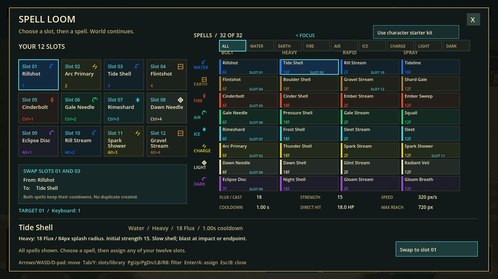
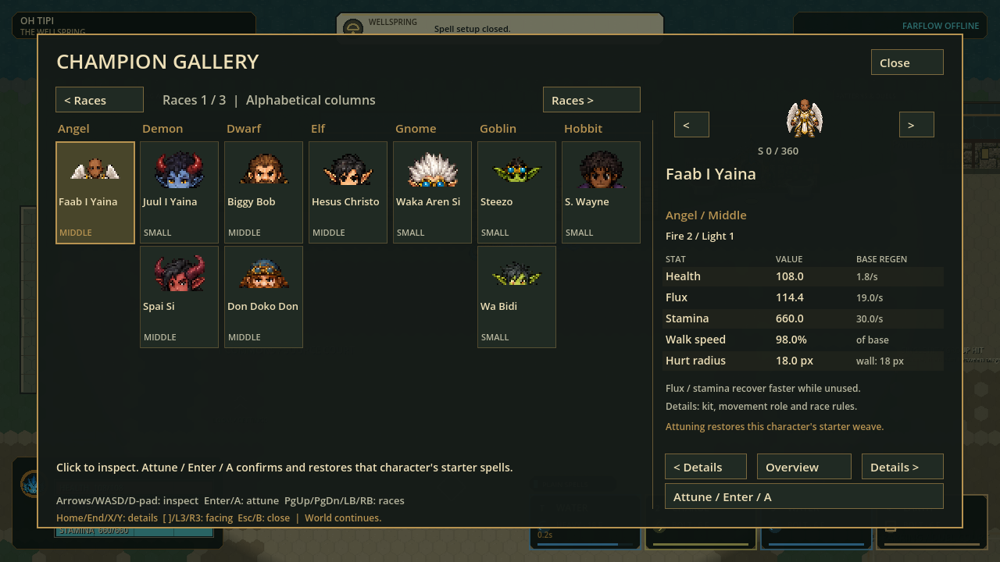

# H.E.X. decision clarity and player setup

Status: locally validated Windows checkpoint, 2026-09-29; ready for human usability feedback. Prior visual-hierarchy export is the retained fallback.

Open [PLAY-HEX.cmd](../exports/hex-ux-clarity-20260929/windows/PLAY-HEX.cmd), or
extract the [portable ZIP](../exports/hex-ux-clarity-20260929/HEX-p56-0b255a686e79-Windows-x64.zip)
and open its launcher. Keep EXE/PCK together. Package identity, 30-skin admission,
native boot and safe close passed. No installer, commit, push or publication.

Final source: `p56-0b255a686e79`, protocol 56/schema 22; 2,944 canonical runtime
records. Full: **172 suites / 1,535,655 assertions**, zero failures/stderr; import,
post-import identity and 120 Hz boot passed. Native: **35 checks / eight frames**,
zero failures/stderr, including paid Heavy casting and real offline Ready refusal.
All eight final frames have visual-review coverage (six exact inspected-image
matches, two newly inspected). See [evidence](ux-decision-evidence-20260929/README.md).

## Bounded design revision

Inspection must be safe; commitments must show consequences. Core combat stays
unchanged: 12 slots, four delivery families, paid casts, cooldown ownership,
authority admission and fixed 120 Hz simulation. This is a player-decision and
navigation pass, not a claim that dense 120 Hz timing has been solved.

| Area | Revision | Acceptance |
|---|---|---|
| Spell grid | Arrows/WASD/D-pad follow actual rows/columns; no diagonal edge wrap | All 32 spells and 12 slots reachable |
| Focus | Tab/Y switches slot/library pane; visible focus heading | Mouse and keyboard focus stay coherent |
| Filters | Page Up/Down or LB/RB cycles All + eight elements | No mouse-only library functionality |
| Assignment | Read-only replacement/swap preview with both affected slot numbers | No hidden changes to a second slot |
| No-op | Already-equipped assignment sends nothing | No false pending state or save/request churn |
| Library | Equipped-slot badges and six live numeric metrics | Values sourced from compiled runtime definitions, not duplicated balance data |
| Gallery | Click/hover inspects; Attune/Enter/A commits | Browsing cannot reset a character's custom weave |
| Character information | Overview stats table, affinity levels and paged detailed rules | Complete information retained; base recovery distinguished from idle ramp |
| Services | Spatial arrows; linear Tab wrap; instant disabled-action explanation | No silent failure or accidental row change |
| HUD | Actual keyboard bindings and modifier labels, unknown/unbound states explicit | Remapping changes visible labels without restarting |
| Boundaries | Clamped drag ghost, world-continues notice, modal input guards retained | No hidden gameplay input or misleading pause claim |

## Research and rationale

- Spatial focus follows the screen, with consistent keyboard/controller paths:
  [Xbox UI navigation](https://learn.microsoft.com/en-us/xbox/accessibility/xbox-accessibility-guidelines/112).
- Preview the action and its consequence before changing context:
  [Xbox UI context](https://learn.microsoft.com/en-us/xbox/accessibility/xbox-accessibility-guidelines/114).
- Prioritize visible state, recognition, user control and error prevention:
  [Nielsen Norman usability heuristics](https://www.nngroup.com/articles/ten-usability-heuristics/).
- A compact decision summary comes before deeper rules, without deleting them:
  [progressive disclosure](https://www.nngroup.com/articles/progressive-disclosure/).
- Preserve the combat importance hierarchy; configuration metrics belong in
  menus, not permanently over the playfield:
  [Riot's clarity principles](https://www.leagueoflegends.com/en-us/news/dev/clarity-in-league/).

These are selectively applied principles, not an accessibility certification.
The custom-drawn menus still lack screen-reader semantics and a complete
user-adjustable text-size path. Controller hardware acceptance remains human-only.

## Further prioritized improvements

| Priority | Next bounded experiment | Stop condition |
|---|---|---|
| 1 | Human task trial: inspect a character, weave a swap, find a spell and explain its tradeoff | Observe confusion before adding more menu mechanics |
| 2 | Dedicated controller/device-aware HUD glyphs; scalable text and focus narration | No ambiguous mouse/keyboard/controller labels; no unsupported accessibility claims |
| 3 | Chemistry micro-trials: one paid action, visible cause/result, resettable comparison | Explain strength, interception and exact hex coverage through doing |
| 4 | Shared physical hex geometry and performance dependencies | Exact authority/replay first; meet separate simulation, packing and rendered budgets |
| 5 | Native moving-shot readability and audio consequence cues | Distinguish element, strength and active danger without adding trails/noise |

No new assets, gameplay buffs, dependency installs, public release, installer or
historical delivery-pointer promotion are part of this pass.
The older performance export was pruned after both retained payloads and ZIPs
verified: 299,595,381 bytes removed; small receipts remain under build-retention.

## Player acceptance trial

| Trial | Expected result |
|---|---|
| Academy > Spell Loom; arrows/WASD/D-pad, then Tab/Y | Focus follows the visible grid and switches between the slot and spell panes |
| Page Up/Down or LB/RB | Filters cycle through All and the eight elements; all four delivery columns remain reachable |
| Select a spell already in another slot | Preview names both slot numbers and says Swap; both cooldowns stay attached to their spells |
| Confirm the already-equipped spell again | No request/save is sent; the menu explains that nothing changes |
| Compare Bolt, Heavy, Rapid and Spray | Cost, strength, speed, reach, direct-hit damage and cooldown reflect live definitions; descriptions explain coverage/trigger behavior |
| Academy > Champions; click another portrait | Overview changes, but the player and weave do not; only Attune/Enter/A commits |
| Inspect Overview, then Details | Five comparable stat rows first; full race, movement, recovery and kit rules remain reachable |
| Change spell bindings in Controls | Corresponding keyboard keycaps and modifier layer labels change in combat |
| Offline Farflow > Ready | The disabled action explains the missing session without activating or waiting for hover |
| Close a child screen, then its building directory | Return to the previous service, then ordinary play; no leaked spell or movement input |

Ask whether players can explain the result **before** committing, not merely
whether they can eventually find the button. Keep the successful compact layout
and revise the specific labels/routes that cause hesitation. Do not expand the
menu surface until this flow is understandable without developer coaching.
