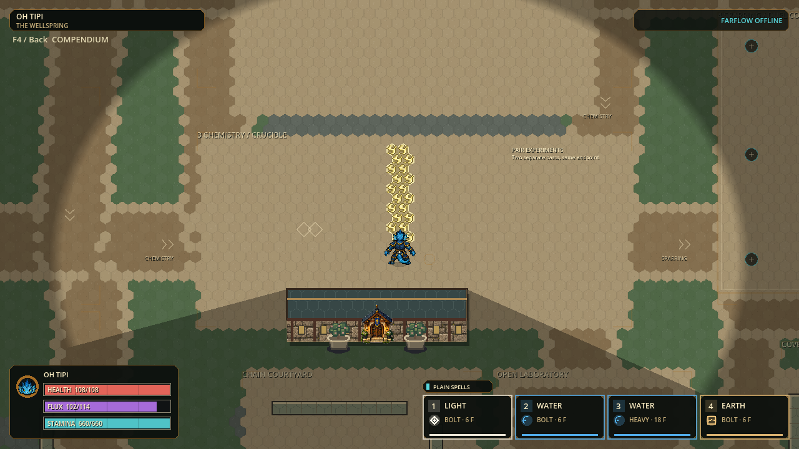

# H.E.X. visual hierarchy and snapshot checkpoint

Status: locally validated Windows playtest checkpoint, 2026-09-29; return for human feedback.

Open [PLAY-HEX.cmd](../exports/hex-visual-hierarchy-20260929/windows/PLAY-HEX.cmd),
or extract the [portable ZIP](../exports/hex-visual-hierarchy-20260929/HEX-p56-5b4885fed375-Windows-x64.zip)
and open its launcher. Keep EXE/PCK together. The launcher enables existing
full-body character art; user settings remain intact. Previous performance
build is the only retained fallback. No installer or delivery pointer promoted.

## Readability contract

The player, incoming attack and active ground danger lead the image; terrain and
wayfinding support them. Use color **and** silhouette, not extra rings or particles.
Existing authored skins and roughly equal heads / volume-first sizes are retained.
No movement, strength, damage, reaction lifetime, hitbox, map collision, camera,
occlusion or footprint policy is changed by this presentation slice.

| Layer | Observed issue | Implemented refinement | Boundary |
|---|---|---|---|
| Ground | Repeated high-contrast hex seams compete with small threats | Quieter seams, restrained material tints and deterministic grass/water/stone pixel clusters | Same 24 px authoritative tiling and one precomposed ground texture; no decorative obstacle masquerading as collision |
| Reaction identity | Several revised reactions read as similar thin stripes or stars | Seven distinct 9 x 9 three-tone retro motifs, clipped to exact selected hex polygons | One bounded texture cache, no particles/trails and no extra effect radius |
| Reaction phases | A colorful new icon could accidentally imply that formation/decay deals damage | Existing small/dark formation and tiny/dim decay scale; only active motifs animate | Normal and Reduced Effects preserve the same static phase distinction |
| Combat hotbar | Long fantasy names clip and key numbers compete with tiny glyphs | Separate keycap, larger explicit element name, type + Flux price and separate readiness lane | Four visible slots, normal/CTRL/ALT layers unchanged; full names remain in Loom/compendium |
| Resources | Pale values over bright filled bars lose contrast | One-pixel dark underprint | Same quantities, colors and screen coverage; no decorative plate hiding capacity |
| Wayfinding | Thin pale floor instructions disappear into paving | Shadowed floor lettering and larger practice captions | Existing purpose/location only; no new signs, menus or interaction bindings |

## Seven reaction silhouettes

| Material | Silhouette | Cadence, 120 Hz ticks | Phase information |
|---|---|---:|---|
| Thermal Shock | Split fractured core | 24 | Small/dark warning; full fracture active; tiny static remnant |
| Plasma Arc | Heavy bent lightning branch | 10 | Same phase grammar; linking policy unchanged |
| Solar Flare | Compact sunburst | 24 | Warm core and separated rays, not a range circle |
| Superconduct | Crystalline conductive junction | 18 | Distinct from ordinary Ice snowflake and Charge bolt |
| Arcflash | Forked bolt with separated sparks | 10 | Separated silhouette from Plasma Arc |
| Radiance | Tall cross-shaped lantern/star | 30 | Formation/decay use dim base too, never bright inactive fill |
| Penumbra | Paired crescents with divided center | 32 | Dual silhouette, no rotating orbit or moving boundary |

Animation changes are small palette-highlight steps inside static selected cells;
no flash, orbit or moving threat edge. Reduced Effects freezes decorative motion.
These are presentation identifiers, not seven new gameplay mechanics.

## Verification and limits

Build: `p56-5b4885fed375`, 2,942 production records, protocol 56 / schema 22.

| Gate | Fresh result |
|---|---|
| Focused visual regressions | Four suites / 110,182 assertions; zero failures/stderr |
| Final Full | 172 suites / 1,535,002 assertions; zero failures/stderr; import, post-import identity and 120 Hz boot pass |
| Native paid casts | 42 captured frames / 14 casts; seven pairs in formation/active/decay and normal/reduced settings |
| Agent visual inspection | 12 specified native frames: all seven active types plus representative harmless phases; no HUD overlaps; player remains visible |
| Native drawing diagnostic | 2,096 assertions; four cases x 32 frozen draws; exact original/timer-disabled/timer-enabled pixel controls |
| Windows package and retention | Final source identity, 30-skin art admission and native safe-close pass; both retained payload/ZIP hashes verified; older phase-clarity export removed (299,578,614 bytes) |

Evidence: [receipts and reviewed frames](visual-hierarchy-evidence-20260929/README.md).
Native-scale example (actual gameplay, not concept art):

A failed initial test launch
was correctly blocked by a missing `Status:` line in the new snapshot report;
the document was corrected before any engine tests ran.

### Native CPU submission, not FPS

| Frozen fixture | Normal p50 / p95, ms | Reduced p50 / p95, ms |
|---|---:|---:|
| Distributed | 59.478 / 64.024 | 58.856 / 62.207 |
| Dense crucible | 23.054 / 31.001 | 22.645 / 24.821 |

These remain too slow. Earlier medians were about 58 / 22.5 ms; this is not a
render-speedup claim, and the dense-normal p95 rose in this diagnostic run.
Campus medians are 1.794-2.106 ms and HUD 1.609-1.680 ms; hex-ground submission
still dominates the distributed scene. Timing instrumentation/scheduling and
frozen poses limit interpretation; no GPU, live-input or sustained-cadence pass.
Batching visible material geometry and removing unnecessary empty-cell work are
higher-value follow-ups than reducing readable threat information.

The separately validated [snapshot reuse](HEX-SNAPSHOT-REUSE.md) is included.
It preserves canonical bytes and reduces warm capture costs, but neither that
work nor this visual pass proves 120 Hz, multiplayer readiness or human acceptance.

## Next small acceptance slices

| Order | Work | Completion evidence |
|---|---|---|
| 1 | Human native-scale reaction/hotbar review during movement and overlap | Identify each active material, distinguish harmless phases, read cost/key without pausing |
| 2 | Profile static ground/chemistry submission and moving character poses independently | Before/after CPU + GPU traces; exact authority, truthful harm boundaries and no visual degradation |
| 3 | Rapid/weakened projectile readability at actual gameplay zoom | Moving native captures with an unambiguous travel nose and strength cue; no changed physical radius |
| 4 | Door directories and character Gallery density | Small-screen mouse/controller playtest, working choices only, hover detail without covering selection |
| 5 | Reviewed special-pose corrections to shared character rigs | Eight facing/travel directions, feet planted and stable skull/volume for Small/Middle/Large |

Thirty identity skins do not mean thirty independently painted animation sets.
Do not add filler assets or rewrite working movement/camera systems to claim a
complete visual overhaul. Keep one engine owner and the latest two verified exports.
