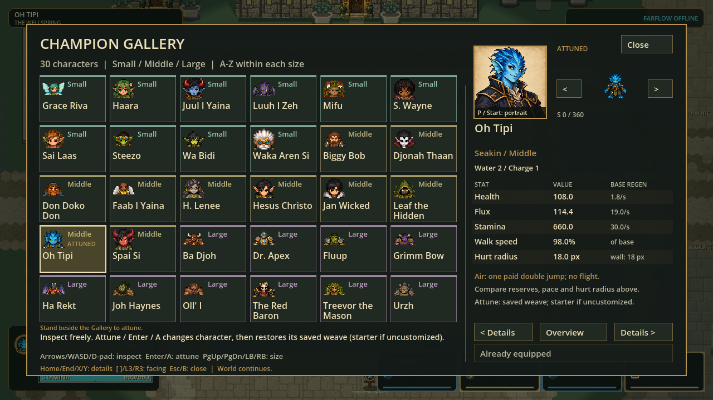

# Momentum, roster and presentation checkpoint

Status: locally verified source and Windows portable; ready for human playtest.

October 8, 2026. Build **`p57-6a4557e6cace`** is frozen and packaged. The previous
portrait installer is preserved and does not contain these source changes.

## Play this checkpoint

- [Play the extracted Windows build](../exports/hex-momentum-roster-20261008/windows/PLAY-HEX.cmd).
- [Portable ZIP, 121.7 MiB](../exports/hex-momentum-roster-20261008/HEX-p57-6a4557e6cace-Windows-x64.zip): extract everything, then run **PLAY-HEX.cmd**.

Keep `hex.exe` and `hex.pck` together. The wrapper enables the full pixel cast;
direct EXE launch uses the shared-skeleton path. No Git, Godot installation or
administrator permission is needed for the portable. Both peers must use this
exact build: movement compatibility changed. No new installer, automatic update
feed, signing or public release was produced in this batch.

## Player-visible changes

| Area | Change | Boundary |
|---|---|---|
| Jump preparation | Carry incoming travel while gathering; natural 600 units/s² drag, then release carries the remaining velocity | No free held-input acceleration, cost refund, new protection or changed air budget |
| Roster | All 30 champions visible in one 6×5 grid, Small → Middle → Large then name | Canonical IDs, races, affinities, saved weaves and explicit Attune unchanged |
| Animation | Full pixel-cast mode never switches to the deforming legacy body rig for advanced actions | Low/air whole-body fallback poses are not complete authored slide/roll/flight/stagger/defeat cycles |
| Wellspring | Purpose-first building labels and four clearly named practice courts; narrowed non-service Crucible Workshop opens an experiment passage | Same world bounds, actors, service doors, arena, practice targets and commands |
| Portraits | Joh Haynes has a steadier expression; Grimm Bow has warmer, more curious features | Two refinements, not a new roster; all original illustrations preserved |

Held jump preparation deliberately trades speed for jump charge. At 120 Hz,
500 units/s becomes 495 on the first held tick and 315 after 37 ticks on ordinary
ground. Neutral release neither restores the lost speed nor adds a burst.
Surface/control modifiers and wall collision still apply. A full tap retains
the existing immediate-release behavior. Slide brake remains an explicit stop.

The art correction addresses a concrete visual discontinuity: authored fixed
pixels used to fall back to independently deforming body parts for unsupported
actions. Reused rigid low/air poses preserve registration and silhouette. They
are marked incomplete and need dedicated drawn cycles in a later art slice.
Ground moving casts and authored jump keys are unchanged.

## Five-minute test

Use **1280×720 or larger**. Saved bindings override these defaults.

| Try | Expected result |
|---|---|
| WASD + Shift, then hold Space briefly and release | Speed eases down while gathering instead of instantly stopping; release carries remaining momentum |
| Sprint → C Slide → hold/release Space after commitment | The slide lane carries through gathering; paid slide/jump rules still apply |
| Repeat while aiming sideways, and in all eight travel headings | Aim does not snap the travel lane; slide/roll/dodge poses face actual travel |
| Approach Academy; F → Champions | All 30 visible without race pages; mouse, arrows and controller navigate the same layout |
| Inspect Joh Haynes and Grimm Bow; click portrait or P | Refined portraits; inspection never equips. Esc closes enlargement; Attune is deliberate |
| Walk from the chemistry court south, east of the Crucible Workshop | A new clear passage and two floor arrows lead toward the FREE EXPERIMENT COURT |
| Compare normal/reduced effects, low resources and a wall | Mechanics remain the same; no cost or collision bypass from the visual changes |

Source launch from the repository:

```powershell
.\scripts\run.cmd --pixel-cast
```

## Evidence and limits

| Gate | Fresh result |
|---|---|
| Full source validation | 222 suites / 4,491,646 assertions; zero failures or stderr; import, identity and configured 120 Hz boot passed |
| Native capture | 16 images: all-30 Gallery, two refined portraits, service/route views, three sizes × eight direction/action samples and three actual paid movement timelines |
| Independent visual review | Every image opened and hash-checked: 4 PASS / 12 LIMITED / 0 FAIL; static scope only |
| Windows portable | Real export, compiled-class cache, isolated packed runtime identity and native packaged startup/safe close passed |
| Identity | Source `6a4557e6caceb97302fd252a253a4b732de8f4f185e35f30ca4f49705418102c`; 3,176 production records; protocol 57 / snapshot 23 |

Evidence and full hashes: [checkpoint receipts](momentum-roster-evidence-20261008/README.md).
Failed first-pass receipts are retained. Workers did not run engines; root
serialized imports, tests and native capture with isolated test profiles.
Source, package, installation, human feel and physical Internet acceptance are
separate gates. Dense sustained 120 Hz remains historically FAILED, not cleared
by these correctness tests. This slice does not change the player cap or promise
universal competitive balance.

Known presentation limits: Farflow's distant label is faint; at 960×540 helper
text is small and some world labels sit under the fixed HUD. The Lodge's nearby
quick-action panel partly masks its doorway. Direction sheets and sampled
timelines do not establish smooth continuous animation: especially review the
aim-facing → travel-facing → aim-facing transitions and reused low/air poses.
Those are the next bounded visual acceptance targets, not hidden completed work.



The approach follows the reference games' useful principles rather than copying
their control values: preserve earned motion while retaining readable limits;
make practice/choice navigation fast; remove inconsistent body rendering.
[Respawn's discussion of momentum constraints](https://www.ea.com/able/news/evolution-collection-event)
and [STRAFTAT's official short-round/map description](https://store.steampowered.com/app/2386720/STRAFTAT/)
informed this bounded interpretation; no exact Melee physics-equivalence is claimed.

Portraits were refined with the built-in image-generation tool. Full prompts,
original/new hashes and provenance: [refinement-v2-prompts.json](../reference/art/portraits_20261008/refinement-v2-prompts.json).
Full-resolution sources: [Joh Haynes](../reference/art/portraits_20261008/joh_haynes-v2.png)
and [Grimm Bow](../reference/art/portraits_20261008/grimm_bow-v2.png).
