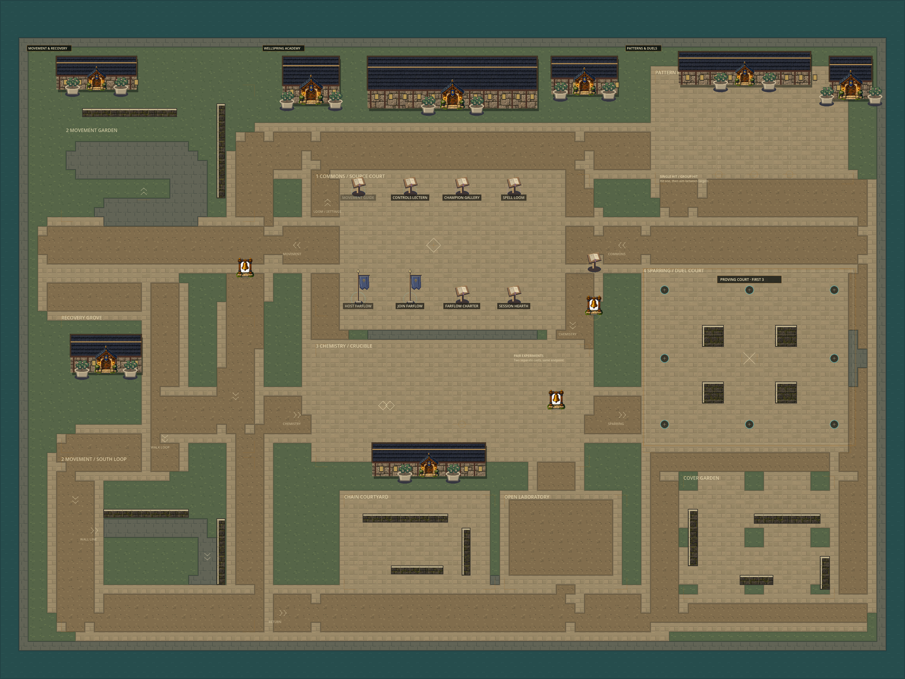
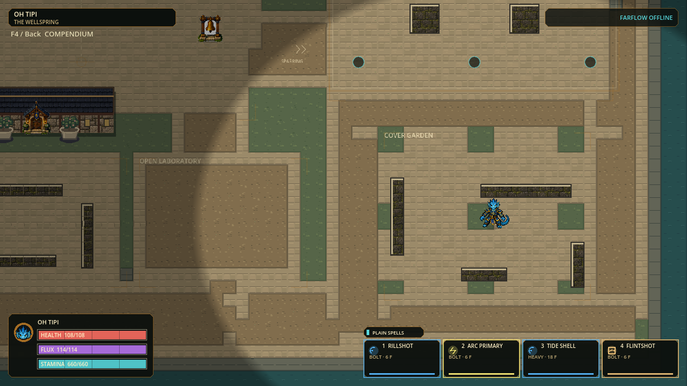
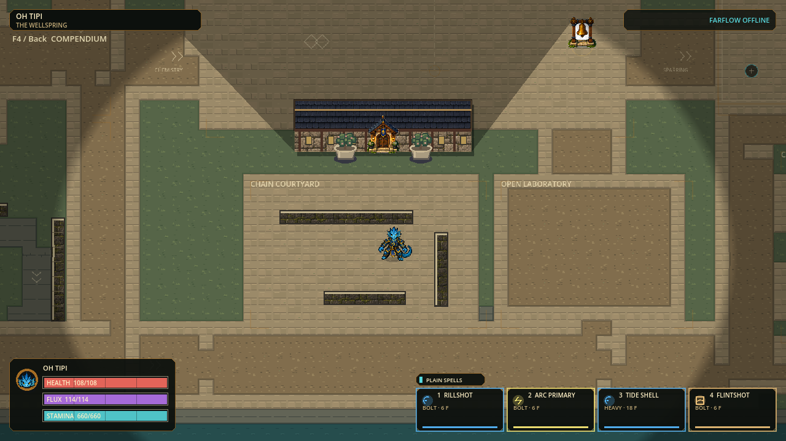

# Wellspring playground and trail-free play

Status: local Windows playtest candidate verified, awaiting human feedback, 2026-09-28.

Start [PLAY-HEX.cmd](../exports/hex-playground-20260928/windows/PLAY-HEX.cmd).
Keep `hex.exe` and `hex.pck` together; the wrapper enables detailed character art.
Portable: [complete Windows ZIP](../exports/hex-playground-20260928/HEX-p56-d75bac3687a7-Windows-x64.zip).

## Bounded changes

| Area | What changed | Playtest |
|---|---|---|
| Chain Courtyard | Three real, low worldbone walls; a turning route with a clear outside return | Run along a wall, release into a jump, redirect and land beside the next wall |
| Cover Garden | Four asymmetric cover pieces, grass insets, a weaving line and a wide outer loop | Break projectile sightlines, approach from either side, retreat without a forced technique |
| Open Laboratory | Contrasting open earth practice floor beside the new courtyard | Place separate impacts and compare stationary element reactions without target clutter |
| Southern circulation | East-to-west connection completes the southern return | Travel from the original south loop through the new spaces and back to the duel court |
| Trails | No live flight-residue allocation, movement streaks, ghost bodies, slide wakes or projectile tails | Bolt/Heavy/Rapid reach impact without leaving reactive residue along their path |

The 3072x2304 world boundary, 24px hexes, spawn, stations, four targets, arena,
body sizes, shared wall clearance, movement timings and compact stationary
reaction geometry are preserved. This expands usable activity space inside the
existing world, not the canvas. Seven new walls reduce eligible hex count; no
simulation or snapshot caps were raised. New terrain is compiled once with the
existing reusable autotiles. Visible walls are authoritative collision, not
walk-through decoration. Continuous locomotion and casting animation remain.

Trail removal preserves the remaining paid payload for impact instead of
diverting up to 150/600 units along the flight. That intentionally changes the
distribution of matter, not the amount paid, projectile damage, spell cost or
reaction-strength matching. No invisible trail simulation remains in live play.
Historical emitter/ledger helpers and snapshot fields remain for compatibility
and regression coverage; their retained tests do not imply trails are enabled.
Impact material, stationary reactions, landing/takeoff/wall-contact cues,
protection and height indicators remain enabled.

## Acceptance record

Candidate identity: `p56-d75bac3687a7`, 2,932 production records.
Map identity: `03b9986fe9241bf2ceefd84ab37d0453906a75825487b8df9344c9fbb730b7a1`.
Eligible topology: 11,337 hexes, down from 11,633, with the same 16,384 cap.

| Fresh check | Result / receipt |
|---|---|
| Focused regressions | Four suites passed: map, illustrated kit, fullbody art, finite trail ledger; `.godot/playground-focused-3-20260928.log` |
| Route integrity | Every new marked route sampled every 4px against shared wall clearance; ordinary bypasses additionally enforce their full declared width |
| Paid no-trail casts | Actual Bolt/Heavy/Rapid inputs reach terminal impact, spend zero trail matter and conserve their paid ledger |
| Map overview | Native normal/reduced 3072x2304 map renders; `.godot/campus-playground-20260928/` |
| Normal gameplay views | Three production Bootstrap views after ordinary movement; `.godot/playground-native-final-20260928/receipt.json` |
| Impact chemistry | Seven native paid Water/Fire/Steam/crossing frames; `.godot/global-hex-playground-20260928/receipt.json` |
| Dense simulation correctness | 1,888 checks, normal/reverse command ordering produces identical final hash and paid metrics; `.godot/fine-grid-steps-playground-20260928.json` |
| Dense simulation timing | **FAILED 120Hz**: median 7.095/7.021ms, p95 19.463/19.016ms, max 241.699/243.785ms; 228/232 of 720 measured ticks exceed 8.333ms |
| Full regression | **166 suites / 1,309,268 assertions**, zero failures and stderr; import and configured 120Hz boot passed; `.godot/playground-full-accepted-20260928.json` |
| Windows portable | Native detailed-art boot, matching source identity and safe close passed; `exports/hex-playground-20260928/receipt.json` |

Post-export source identity Check also passed for all 2,932 production records.
Selected receipts and the full suite log are retained in
`docs/playground-evidence-20260928/`. Owned engines exited. Cleanup of the isolated
`.godot/playground-profile-20260928` test profile and empty failed-capture folder
was blocked by execution policy, so both are retained; no alternative deletion
was attempted. Original profiles, reference art, captures, logs and older builds
remain untouched.

The dense fixture admits 66 casts, pays 39,600 matter, forms 28 reactions, and
peaks at 19 flights / 23 products. No-trail rules intentionally change its
outcomes relative to older receipts; these timings are **not** a controlled
same-semantics speedup claim. Rendered/GPU timing, human feel and physical remote
play remain unaccepted. Earlier local multiplayer lifecycle failure remains open.

Initial route probes caught a too-narrow connection and corner clearances; the
final layout corrects them. The first custom capture harness had a typed-array
error; the corrected native run passed. Failed probe logs remain separate from
the final receipts. The first Full run (`.godot/playground-full-20260928.json`)
completed with 17 obsolete trail-expectation failures and empty engine stderr;
those assertions now explicitly require no trails while retaining impact,
strength, conservation and payment checks. A second Full run
(`.godot/playground-full-final-20260928.json`) left one text assertion comparing
the other guide panel's wording; the test now checks the actual compendium copy.
Neither correction changed runtime behavior. Previous fluidity portable remains intact as fallback:
`exports/hex-live-motion-20260928/windows/PLAY-HEX.cmd`.

## Native previews

## Human playtest

1. Walk south from the starting Commons, pass the Crucible workshop and enter
   Chain Courtyard; try both wall directions, jumps, slides and reversals.
2. Follow the southern path east to Cover Garden. Compare the weaving interior
   with the broad outer return; shoot around corners and use cover to disengage.
3. Use Open Laboratory for impacts and same-strength pairs. Check that no
   residue appears along the flight and that the stationary impact fields remain.
4. Return to the original Spell Loom / Gallery / Practice Bell. Check that saved
   bindings, normal/reduced effects and all three body sizes remain comfortable.

No installer, pinned delivery pointer, commit, push or publication is part of
this slice. Multiplayer remains experimental. Prior 120Hz dense-load failure is
not cleared by map or visual inspection.
