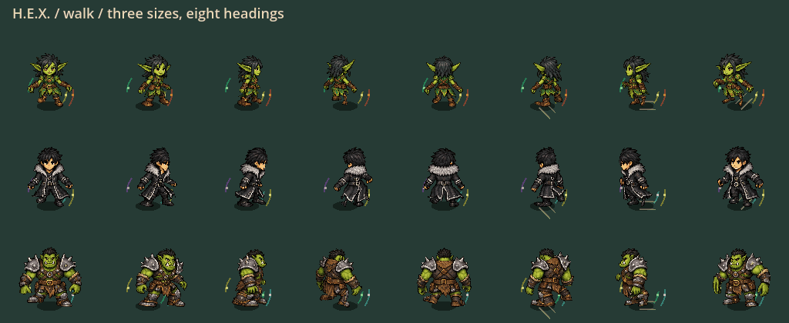

# Continuous motion and local-query checkpoint

September 28, 2026. Bounded request: make gameplay and animation more fluid,
dynamic and natural. Preserve the detailed 30-character candidate, 24 px chemistry,
120 Hz simulation contract, paid resource rules and older playable exports.

## Changes

| Area | Implementation | Safety boundary |
|---|---|---|
| Continuous character poses | Interpolate the geometry of adjacent 24-phase samples; reuse one dynamic vertex buffer per actor/identity/heading | Original crisp texture, no alpha ghosting, no extra pose textures, bounded 256 buffers / 384 source meshes |
| Walk/run/idle changes | Bounded 5 px pose correction settles over 70 ms | Only ordinary locomotion; low/air/control/death poses and direction changes do not wait |
| Shared body redraws | World, afterimage and post-fog body reuse the current mesh | Repeat requests do not advance a clock or read back GPU memory |
| Product contact | Endpoint/canonical-owner early exit, local center bounds, original exact boundary clip | No lost crossed cells, no approximate radius collision or expanded effects |
| Radial selection | Enumerate circle bounds once instead of rebuilding swept-path halos | Original closed hex predicate, stable order and zero-radius ownership |
| Wall queries | Reuse existing mutation-aware spatial index | Same continuous collision, stable ties, world bounds and conservative fallback |
| Sector arithmetic | Cancel common direction factors and prove int64 bounds before multiplication | Exact natural-number fallback for large/irregular inputs; no floating-point replacement |

This is not new authored art. Three identities retain their supplied discrete
low/air key poses; 27 identities still use shared-rig corrections. Those authored
key-pose transitions and costume occlusion need further targeted art work.
No movement balance, input timing, protection, hitbox, paid-cast or capacity changes.

The small dynamic-buffer path uses Godot's documented
[ArrayMesh vertex-region updates](https://docs.godotengine.org/en/4.7/classes/class_arraymesh.html#class-arraymesh-method-surface-update-vertex-region).
CPU-side source vertices are retained with bounded pose caches; normal frame
updates do not call `surface_get_arrays` or recreate mesh surfaces.

## Native motion preview

Actual production-renderer frames, not generated concept art. Three sizes and
eight directions; 48 samples per clip. Inspection GIFs run slower than gameplay
and are not a rendered frame-rate or human-feel acceptance test.

[Sprint](continuous-motion-evidence/sprint-inspection.gif) ·
[Wallrun](continuous-motion-evidence/wallrun-inspection.gif)

## Validation ledger

Frozen runtime: **p56-4205e5be2616**, 2,930 production records, protocol 56 /
snapshot 22. Source SHA256:
`4205e5be26166d5be939631dae6de7221157a19c721c726704f7f265dcb93d3e`.

| Fresh check | Result / scope |
|---|---|
| Full automated suite | PASS: 166 suites, 1,182,235 assertions, zero failures/stderr; import and configured 120 Hz boot passed |
| Native motion | PASS: 144 production-renderer frames, three sizes / eight directions; representative walk, sprint and wallrun frames visually inspected |
| Pose-update CPU diagnostic | Eight actors: median 1.679 ms, p95 3.180 ms, max 17.729 ms; 7,680 queries, eight streaming buffers, bounded 384 source meshes; not GPU/rendered-frame timing |
| Final paid eight-caster replay | Both command orders preserve exact baseline hash and paid/reaction totals; 69 admissions, 30 reactions, peak 19 flights / 22 products |
| Dense simulation timing | **FAILED 8.333 ms target**: median 23.735 / 25.929 ms; p95 49.781 / 110.296 ms; no reliable overall-performance improvement claimed |
| Native gameplay | PASS: four bootstrap cases × 64 frames; representative frames reviewed. Seven further frames exercise paid Water/Fire → Steam and movement through it; normal/reduced effects reviewed |
| Windows portable | PASS: original-source detail art admission, matching build/PCK identity and safe close in isolated user data; no installer or checkpoint promotion |

The second timed run had a substantially worse tail despite identical state.
Retain both results rather than selecting the faster run. This checkpoint
improves pose continuity and replaces redundant work; it does **not** establish
sustained 120 Hz gameplay under dense effects. Presentation, simulation, snapshot
and GPU costs must be measured together before making that claim.

Receipts: [Full](continuous-motion-evidence/full-receipt.json),
[pose CPU](continuous-motion-evidence/pose-cpu-receipt.json),
[paid simulation](continuous-motion-evidence/paid-simulation-receipt.json),
[paid native scene](continuous-motion-evidence/paid-native-receipt.json),
[Windows export](continuous-motion-evidence/package-receipt.json).

**Launch:** `exports/hex-continuous-motion-20260928/windows/PLAY-HEX.cmd`.
Use the wrapper to enable the detailed character-art mode; the bare EXE retains
the existing default renderer. **Portable ZIP:**
`exports/hex-continuous-motion-20260928/HEX-p56-4205e5be2616-Windows-x64.zip`.
Extract all files together. ZIP SHA256:
`cf089d8f8b30b16ec6846d606d17ec0baa8fbacefb585292d3e6cdd9c1e7628a`.

Preserved comparison build:
`exports/hex-detail-fine-grid-20260928/windows/PLAY-HEX.cmd`.
No source was committed/pushed and `docs/current-checkpoint.json` was not promoted.
Post-export source-identity Check passed. Owned engine/capture/export helpers
were closed; original art, previous builds and useful failure evidence remain.

Fresh diagnostics so far:

- Five focused suites: 150,637 assertions, no failures or stderr.
- Hex contact compares against the prior exhaustive traversal, including sparse
  sets, negative coordinates, reversed paths, high-speed crossings and shared
  vertices; sector signs compare against unreduced exact natural products.
- Swept wall queries compare against an intentionally unindexed 120-wall world.
- All three size/eight-heading meshes have distinct exact intermediate poses;
  per-actor buffers remain separate; locomotion settling cancels immediately on
  low exposure. Rendering does not mutate authoritative player state.
- Intermediate failures are retained: v1 caught signed-ceiling rounding plus a
  test setup mismatch; geometry-v1 caught a test-only inferred-type error. These
  are corrected in `fluidity-final-diagnostic.log`, not hidden or marked passed.

## Human feel test

1. Use Wa Bidi, Jan Wicked and Fluup: start walking, sprint, release and reverse;
   compare alternating feet and whether walk/run transitions feel less abrupt.
2. Strafe while aiming elsewhere and casting. Facing should remain immediate,
   with no transparent duplicate limbs or animation lock on gameplay actions.
3. Chain slide, release-to-jump, double jump/flight, wallrun and air dodge. Low/air
   protection must still be visible immediately rather than blending late.
4. Populate the Crucible with fields. Report pauses separately from animation
   artifacts, with character/action/heading and normal or reduced effects.

Dense-scene 120 Hz, physical remote multiplayer and human visual acceptance remain open
unless explicitly recorded below. No installer, publication, push or checkpoint
pointer promotion is implied by a local portable candidate.
