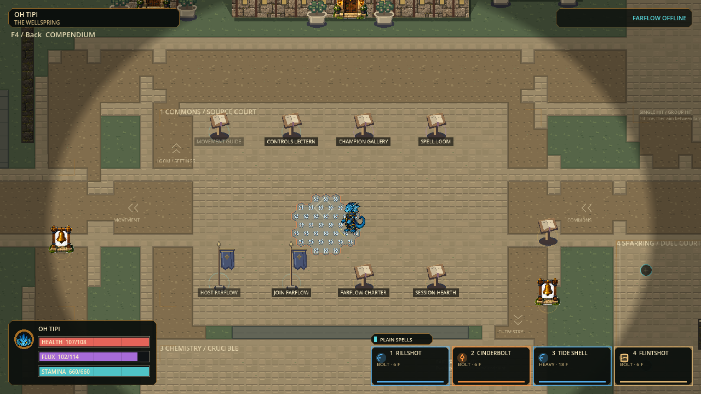
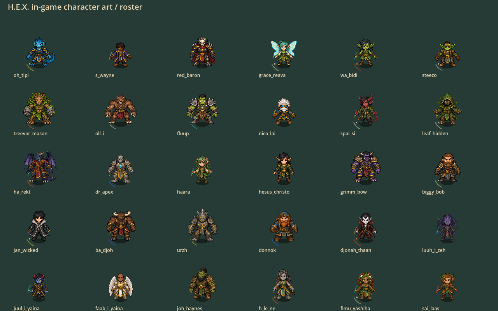

# Source detail, symbol-sized hexes and sparse work — September28 candidate

Status: **source validation passed; local playtest candidate, not a promoted checkpoint**.
Keep the `hex-fluid-motion-20260927` portable unchanged as the playable fallback.

| Area | Candidate contract | Deliberately unchanged |
|---|---|---|
| Character detail |30 original-source RGBA pages,2048x256, eight views;2 texels per world pixel |128px world canvas, registration, common skull proportions, hitboxes, stats |
| Motion | Existing fixed-length shared skeleton and corrected gait; higher-detail textures | Input/authority timing;3 authored key-pose sets, not30 complete authored cycles |
| Grid |24px face-to-face, half previous width;11,633 eligible Wellspring cells | Worldbone,18px common wall clearance, actor scale, world-space spell radius |
| Material storage | Only three metadata fields on empty cells; allocate material dictionaries on deposit, release on final removal |44 registered materials, exact ownership, conservation and wire semantics |
| Cast updates | Erase/rebuild only a source's previous footprint and new footprint | Exhaustive repair path retained for diagnostics |
| Rendering | Iterate present layers; preserve canonical output and malformed-record fallback | Actual coverage, element ordering and phase semantics |
| Hashing | Cache sorted cell keys with full membership revalidation; always read current values | Exact existing canonical bytes; same-size replacement and direct mutation remain visible |
| Point queries | Exact scalar half-plane membership; four possible owners, retaining the lexicographic closed winner without allocating/sorting an owner list | Shared edge/vertex ownership, signed coordinates and strict one-unit distinctions |
| Distance queries | Native int64 products only after explicit overflow bounds; exact natural-number fallback otherwise | Tangency and high-speed/large-coordinate behavior; no float approximation |
| Recipe reads | One recursively immutable compiled contract per valid recipe; detached authoring factory retained | Mutable authoring copies cannot poison runtime rules |
| Bounds |16,384 topology cells;511 selected cells per footprint |64 casts,32 products,600 matter/source, existing packet byte ceilings |

## Why this order

Halving cell width produces approximately four times as many cells. Removing
empty storage and whole-map source updates precedes fine-grid acceptance. The
larger topology is **not** permission to raise simultaneous spell/player caps.
Small cells may carry zero integer allocation while remaining in explicitly
owned coverage; do not truncate selected hexes or mint extra matter to avoid it.

The isolated48px-map ABBA diagnostic measured seven-cell rebuild medians of
51us local versus5127us exhaustive (144 samples each). This avoids121,704 empty
material dictionaries on that old2766-cell map. These numbers are component
evidence, **not**120FPS, multiplayer, memory-byte, or capacity acceptance.

### Fresh fine-grid component measurements

From `.godot/sparse-profile-24-v1.log`, 11,633 cells, unchanged seven-cell source:

| Component | Median | p95 | Evidence boundary |
|---|---:|---:|---|
| Footprint-local rebuild |55 us|75 us|144 ABBA samples; exact result equals exhaustive repair |
| Exhaustive rebuild comparator |19,547 us|24,162 us|Same source and topology |
| Whole chemistry hash, warm key order |188.976 ms|212.374 ms|28 samples; exact hash preserved |
| Whole chemistry hash, cold key order |227.386 ms|252.800 ms|28 samples; comparator |

Sparse topology avoids 511,852 eagerly allocated empty material dictionaries.
These are component measurements, not total memory savings or rendered FPS.
**Full-world hashing remains a performance dependency**; finer topology is not
accepted for high-rate remote snapshots or larger player/projectile limits.
The next performance slice should separate immutable topology from mutable
chemistry in a versioned, oracle-tested wire/hash contract, or prove a byte-exact
native/batched serializer. It must retain detached incoming validation, mutation
detection, conservation, bounded allocations, deterministic replay and matching
build rejection. Do not bypass validation, hide stalls behind averages, or raise
capacity caps to claim this dependency solved.

### Review and regression notes

- Reviewed all 30 front views and 240 directional views assembled directly from
  the new source-detail pages. Original art and lower-resolution pages remain.
- Native 72-frame walk/sprint/wallrun capture and 129,724 character assertions
  passed. Direction/costume-specific low and roll corrections remain open.
- The first full run completed 166 suites and 1,161,637 assertions with three
  failures. Two were a paid Firestorm observer standing at its moving sector's
  trailing apex; one assumed doubling a 24px polygon exceeded a 48px texture
  adapter. Fixtures now test the actual sampling bound and place the observer
  ahead inside the moving sector. No gameplay damage/timing was changed.
- Focused rerun: Water presentation and paid first-four-element matrix passed
  8,054 assertions. The subsequent full run passed 166 suites / 1,161,521
  assertions, import and 120Hz boot, with zero stderr. This receipt describes
  `p56-930f25a79399`, before the additional math/policy optimization below.
- The eight-caster paid workload on that intermediate build was NOT performant:
  simulation p95 174.268 / 188.441 ms; 688 / 690 of 720 measured ticks exceeded
  8.333 ms. Both command orders produced the same final hash and finite-matter
  metrics, with 19 flights and 22 products at peak. These limits are real;
  passing correctness did not establish fluidity.
- Diagnostic delegation through a timing subclass found repeated point queries,
  recipe construction and moving-sector selection worth simplifying. The
  additional scalar membership, immutable rules and bounded-native distance
  comparisons passed six focused suites / 5,617 assertions. Full validation and
  the same paid workload must be rerun against their new runtime identity.

### Final optimization candidate: `p56-88ff6122c320`

The last geometry simplification tests only the four possible point owners
(two bracketing rows, two bracketing centers per row), retains lexicographic
closed ownership, and uses reflection symmetry for exact circle/hex distance.
It does not replace hexes with circles or approximate sector selection.

The repeated paid eight-caster workload now measures:

| Order | Simulation median | Simulation p95 | Ticks above 8.333 ms |
|---|---:|---:|---:|
| Normal |26.858 ms|55.149 ms|499 / 720|
| Reversed commands |27.075 ms|54.076 ms|470 / 720|

Both runs match the intermediate build's exact final hash
`d8a913640453854034d170c79cb259aebd012b9361db1d3e43003370b6cca79d`,
69 paid admissions, 30 reactions, 41,400 paid matter, and 19 flights / 22 products
at peak. Median step time is about 73% lower; **the 120Hz load gate still fails**.
Receipt: `.godot/fine-grid-steps-20260928-v3.json`. This workload excludes
rendering, event retention and networking; those costs cannot be inferred away.
Do not raise caps or present this as eight-player/large-battle acceptance.

The next bounded optimization target is exact moving-sector selection and
repeated actor/product contact queries, followed by snapshot topology/hash
serialization. Keep the same paid workload, exact geometry oracles and final
state comparison; no lower-rate physics, hidden effect removal or cooldown
changes to make the benchmark pass.

### Final fresh validation

- `p56-88ff6122c320`: Full 166 suites / 1,164,315 assertions; zero failures,
  import and configured 120Hz boot passed; stderr zero bytes. Receipt:
  `.godot/detail-fine-grid-full-v3.json`.
- Five native production-presenter boards reviewed: roster, opposing gait
  phases, slide and jump; all 30 identities. Output:
  `.godot/fullbody-capture-detail-20260928/`.
- Seven native Wellspring frames: paid Water/Fire Bolts, conserved Steam,
  normal/reduced views and real movement into the effect. 11,633 cells;
  exposure reached 41. This short solo simulation capture measured 0.622 ms
  p95, not total rendered frame time or dense-scene capacity. Receipt:
  `.godot/global-hex-detail-20260928/receipt.json`.
- Four bootstrap captures, 64 frames each: Oh Tipi walking, Jan sliding,
  Fluup air-chain and Gallery. Representative frames reviewed. Output:
  `.godot/fullbody-game/detail-grid-20260928/`.
- Direction/costume-specific authored animation corrections remain necessary;
  most identities still use the shared rig. Gallery's literal upper-third
  portrait crop can under-show lower facial detail on some silhouettes.
- Portable export, exact build/art admission and safe close passed. Launcher:
  `exports/hex-detail-fine-grid-20260928/windows/PLAY-HEX.cmd`.
  Keep its EXE/PCK adjacent; direct EXE launch retains the default skeleton mode.
  ZIP: `exports/hex-detail-fine-grid-20260928/HEX-p56-88ff6122c320-Windows-x64.zip`.
  Receipt: `exports/hex-detail-fine-grid-20260928/receipt.json`.
- Previous builds remain untouched. No commit, push, installer update or
  checkpoint pointer promotion. Only six generated review-image import sidecars
  were removed; `.gdignore` keeps documentation previews out of runtime imports.

## Native review previews

## Reproduction and guardrails

- Detail assembly: `python art_batches/character_motion_v1/package_detail.py`;
  direct original RGBA crop sampling, not upscaling old96px sprites. Original
  pages and authored key pages remain untouched. New import files disable
  `process/fix_alpha_border` to preserve decoded RGBA admission hashes.
- Loaded base-detail pages total60MiB decoded versus the previous15MiB;
  authored key pages add12MiB. No per-frame disk reads or texture uploads.
- `tests/unit/test_hex_sparse_storage.gd` covers ownership isolation, exhaustive
  rebuild equivalence, membership-cache replacement and mutable values.
- `tests/performance/profile_hex_sparse_storage.gd` measures local/exhaustive
  source rebuilds and warm/cold canonical key ordering separately.
-24px geometry tests retain independent closed-face, one-unit overlap,
  tangency, signed-coordinate and exhaustive-query checks. Expanded test-oracle
  bounds are necessary because unchanged world distances cross more cells.
- One empty24px cell cannot fit a36px-wide actor; do not shrink clearance.
  Single-pillar wallruns must detach at face ends; useful long runs require
  contiguous walls. The diagnostic court uses12 rings to retain its approximate
  previous world footprint; it is not the Wellspring map definition.

## Acceptance before delivery

1. Full suite, imports and120Hz boot against a sealed runtime identity.
2. Native roster/movement and Wellspring captures; review both effect settings.
3. Fine-grid whole-map hash/snapshot timings and paid-coverage stress evidence.
4. Separate Windows portable, exact-art admission and safe close.
5. Human playtest: detail/readability, gait/slide poses, symbol clarity, field
   boundaries and real responsiveness. Do not report human acceptance for it.

Still open:27 characters use shared-rig fallback for many actions; authored low
and roll corrections, sustained rendered120Hz, extreme projectile capacity,
physical remote play and installer promotion are not established by this slice.
