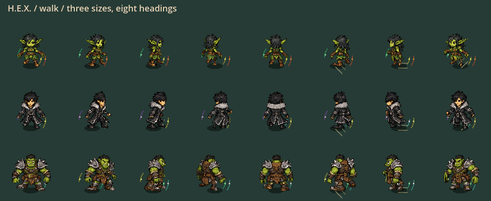

# Fluid character motion — bounded visual refinement

September 27, 2026. This follows the separate full-body art candidate; it does
not replace the selected movement checkpoint or change the simulation protocol.

## What changed

| Area | Refinement | Boundary |
|---|---|---|
| Alternating feet | Two-bone leg solve retains front/back foot lift that angle-only retargeting discarded | Fixed limb lengths; displacement bounded to 5 pixels before skinning |
| Pose sampling | 24 cached samples per cycle instead of 12; nearest sample rather than trailing floor | Same 384-mesh cache limit; no new texture pages |
| Between keyframes | Cubic interpolation bounded by the authored coordinate envelope | No overshoot outside source key endpoints |
| Starting/braking | Stride magnitude decreases with actual speed | No input easing, acceleration change or added action lock |
| Wall-running | Clip time follows its own active timer, not the stopped ground gait clock | Wall admission and protection rules unchanged |
| Jump arc | Shared-rig rise/fall poses follow vertical velocity | The three authored key-pose characters still use their supplied discrete poses |
| Casting | Eight preparation samples; arms ease home over the last 90 ms of recovery | Legs keep their phase; actual shot aim and admission unchanged |
| Idle | Uses the clip's declared cadence instead of a hard-coded 1.4 cycles/second | Facing remains immediate and eight-directional |

All 30 identities use the same corrected retargeting pipeline. This is **not** a
claim of 30 complete authored animation sets. Existing low/roll keyframe and
costume-occlusion limitations remain; no new art was generated or resized.

## Visual evidence

These are frames from the actual production presenter, not concept artwork.
The GIFs deliberately run slowly for inspection; they are **not gameplay timing
or performance measurements**. Rows: Small Wa Bidi, Middle Jan Wicked, Large Fluup.
Columns: S, SE, E, NE, N, NW, W, SW. Native source: 72 frames in
`.godot/fluid-motion-frames-v1/`.

[Sprint loop](fluid-motion-evidence/sprint-inspection.gif) ·
[Wall-run loop](fluid-motion-evidence/wallrun-inspection.gif)

## Validation and delivery

Frozen source: **p56-d5924286dbc9**, 2,870 runtime records.

| Fresh check | Result |
|---|---|
| Six focused character/movement/history suites | PASS: 141,767 assertions, zero failures/stderr |
| Import and configured 120 Hz boot | PASS, zero stderr; not a sustained performance measurement |
| Production-presenter motion capture | PASS: 72 frames, three sizes and eight headings |
| Actual bootstrap captures | PASS: four scenes x 64 frames, empty stderr; pose requests are not physical input acceptance |
| Windows portable | PASS: native art admission, build identity and safe close in isolated user data |
| Full suite / multiplayer / installer | NOT_RUN for this slice; no reuse of earlier acceptance |

Receipts: [focused](fluid-motion-evidence/focused-receipt.json),
[import/boot](fluid-motion-evidence/fast-receipt.json),
[Windows export](fluid-motion-evidence/package-receipt.json).
Actual game captures: `.godot/fullbody-game/fluid-motion-v1/`.

**Launch:** `exports/hex-fluid-motion-20260927/windows/PLAY-HEX.cmd`.
Use the wrapper: launching `hex.exe` without `--fullbody-art` retains old visuals.
**Portable:** `exports/hex-fluid-motion-20260927/HEX-p56-d5924286dbc9-Windows-x64.zip`.
Extract the whole ZIP; keep the EXE and PCK together.

Runtime SHA256: `d5924286dbc9f7184edaeb3c945bd81bb541e6cd32bda23b11cf5d149188d552`.
ZIP SHA256: `e8a4f4772300973fa81b5c993da737696fc829599dfb3e0b5b73ad5f92301e89`.
Earlier exports/original art remain preserved; no commit, push or checkpoint
pointer promotion. All owned test/engine processes were closed at handoff.

Intermediate failures are retained: the first preflight detected an identity
change during preparation; the next attempt found a test-script parse error;
the diagnostic then demonstrated all six front/back foot-alternation failures
before the leg solve. The corrected diagnostic passed 129,724 assertions.

## Human test

1. Compare walking, sprinting and releasing movement with Wa Bidi, Jan Wicked
   and Fluup, especially straight toward/away from the camera.
2. Move in a circle while aiming across the circle; cast repeatedly and watch
   whether the arms recover without stopping the feet.
3. Chain jump, air dodge, slide and wall-run. Check that the visible action stays
   readable and that the existing movement timings have not changed in feel.
4. Try other races and costumes; record the character, heading and action for
   any knee, robe, wing or tail artifact. Remaining authored-pose work should
   target those observations rather than generating another full roster blindly.

No multiplayer, human-feel, sustained rendered-120-Hz or installer acceptance is
claimed by this visual slice. Previous builds and original art remain intact.
