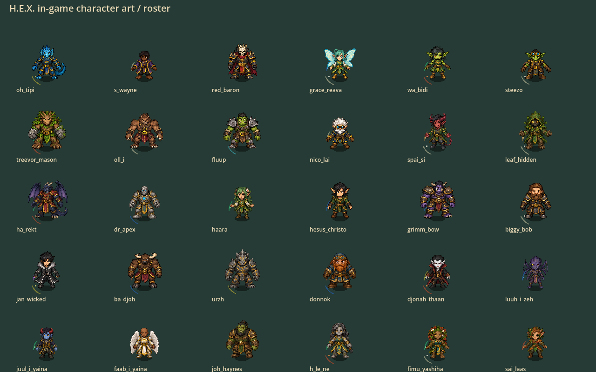
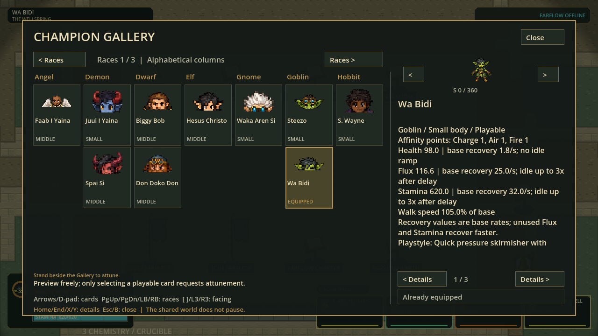

# Full-body artwork in gameplay — September27

## Scope and authority

User requested refinement and in-game implementation after the shared-head art
checkpoint. All30 current character identities now have their compact eight-view
skins in an **opt-in gameplay candidate**, not just an isolated art gallery.

| Area | Candidate implementation |
|---|---|
| Proportions | Fixed18px anatomical skull target;58/63/68px total anatomy; body-led volume differences |
| World bodies | Identity skins, restrained connected shared-rig motion; no per-pose size fitting |
| Authored key poses | Wa Bidi / Jan Wicked / Fluup: slide, roll, anticipation and air keys where supported |
| Aim/travel | Cursor-facing locomotion, travel-facing slide/roll; moving casting retains legs |
| Gallery/HUD | Correct character skins; portrait is top third of actual front body; cache revision changes on admission |
| Visibility | Owned-body post-mask redraw uses identical cached geometry, not a legacy idle body |
| Dodge | Ghosts reuse the same128px registered pose and existing decoration budget |
| Resources |30 compact1024x128 atlases (~15MiB decoded),3 authored1024² pages (~12MiB);384 retained mesh entries maximum |
| Simulation | No edits to stamina, health, hurtboxes, collision, casts, networking or action admission |

### Boundaries

`--fullbody-art` enables the candidate. Default launch remains the old skeleton
presentation; the previous movement build and old exports are untouched. This is not a
multiplayer or sustained120Hz acceptance claim. Shared-rig deformations are still
provisional for costume occlusion, large limb bends, roll transitions and exact
diagonal silhouettes. Three authored sheets are keyposes, not complete cycles.
Low-action casting does not yet have every independently aimed authored hand pose.
The historical `docs/current-checkpoint.json` still names the older p48 delivery;
it is not the launcher for this candidate and is not changed by this integration.
Use the explicit new portable path listed in the final receipt below.

## Reproducible pipeline

1. `art_batches/character_motion_v1/package_runtime.py` losslessly assembles the
   current shared-head full-body images and registered action keys into compact
   production assets. Original layered PNGs and previous builds stay untouched.
2. `src/presentation/fullbody_cast_presenter.gd` admits exactly the live catalog,
   checks decodedRGBA hashes, caches poses, and keeps skull deformation restrained.
3. `CartoonChampionPresenter.enable_fullbody_art()` switches only presentation;
   bootstrap accepts the explicit flag. Sprite size/pivot travel with the pose.
4. `tests/unit/test_fullbody_cast.gd` covers all30/eight headings, aim/travel,
   shared observer meshes, portraits, bounded caches and no simulation mutation.
5. `tests/visual/capture_fullbody_cast.gd` renders five full-roster boards through
   the production presenter. `scripts/capture-fullbody-game.ps1` captures the
   actual bootstrap/Wellspring/Gallery with isolated preferences and no LAN.
6. `scripts/package-hex.ps1 -CharacterArt -RunId FRESH_NAME` makes a separate
   portable whose `PLAY-HEX.cmd` enables the flag and whose smoke test must admit
   all30 skins and close safely. It does not promote checkpoint pointers.

## Verification ledger

**Ready for local art playtest:** `p56-4c48c9f94414`,2,870 canonical runtime records.
Open [`PLAY-HEX.cmd`](../../../exports/hex-character-art-20260927/windows/PLAY-HEX.cmd).
Keep `hex.exe` and `hex.pck` beside it. The wrapper enables the art flag; launching
the EXE directly intentionally retains default skeleton presentation.
Portable ZIP: `exports/hex-character-art-20260927/HEX-p56-4c48c9f94414-Windows-x64.zip`
(101,175,049 bytes). No installer, commit, push or checkpoint-pointer promotion.

| Gate | Fresh result |
|---|---|
| Final runtime source Full gate |165 suites /906,664 assertions; zero failures, zero stderr; import and120Hz default boot passed |
| New character integration suite |71,525 assertions, included above; all30 IDs, eight directions, independent travel/aim, observer mesh, no authority mutation |
| Lossless source assembly |240 source views byte-identical after registration;30 decodedRGBA hashes and binary-alpha checks passed |
| Export-filter follow-up |80 assertions passed after explicitly excluding authoring workbenches and including compact runtime JSON |
| Final native renderer boards |Five boards /all30 characters; actual production presenter; no authority writes |
| Actual bootstrap captures |Four64-frame sessions: Wellspring, movement request, airborne dodge and Gallery;256 frames, empty stderr |
| Windows native package |Export, exact-PCK runtime identity, all30 art admissions and safe close passed with empty stderr |
| Human visual/motion acceptance |PENDING; shared-rig bends, portrait framing and complete cycles remain provisional |
| Multiplayer / sustained120Hz capacity |NOT_ACCEPTED; no new claim from this visual slice |

The Full gate covers final gameplay/rendering source. The subsequent export-filter
change was checked by the focused exporter suite and actual package smoke test.
The original focused run's single failure was a landing fixture retaining upward
velocity; corrected before the successful Full run. Its failed receipt is retained.
The source capture named `jan-slide` contains an early slide request, not independent
proof that the action was admitted; authored slide visuals are demonstrated in the
controlled production-renderer board. Do not turn filenames into gameplay evidence.

Receipts: [Full](runtime-evidence/full-receipt.json),
[package](runtime-evidence/package-receipt.json),
[historical fixture failure](runtime-evidence/focused-failed-fixture-receipt.json).
Complete logs remain in `.godot/windows-tests/9829820307b34a0fb9d9c1db3a68068d`,
`.godot/fullbody-game/fullbody-v2`, `.godot/fullbody-native-v2.log`,
`.godot/fullbody-export-rules.log`, and the export's `logs` directory.

The PCK SHA256 is `65cc6efeb795a554fe405bd7c59e9b2d8d0dc5e8491ac464a3a302fc7b2773b0`.
The ZIP SHA256 is `4a5eec52a0762d512894b0307cc63292194cbef9dcd3d13bad8e087f4c508499`.

### Native evidence (not generated concept art)

Also retained: [moving casts](runtime-evidence/moving-casts.png),
[controlled slide poses](runtime-evidence/slide-poses.png),
[actual airborne dodge](runtime-evidence/air-dodge.png),
[Wellspring](runtime-evidence/wellspring.png).

Visible remaining issues: upper-third portraits crop some chins too tightly;
generic extreme bends and appendage/clothing overlap need authored corrections;
authored low/air keyposes have no separate aiming-hand overlay yet. Keep these
explicit rather than declaring all sprites and cycles finished.

## Next human check

In Wellspring open the Gallery, confirm a character, then compare Small/Middle/
Large. Walk and sprint toward/away from the cursor, slide opposite your aim,
release Jump and air-dodge near a wall. Check that the body remains visible under
the sight mask, feet stay attached, skull size stays stable and the portrait
matches. Start with Wa Bidi, Jan Wicked and Fluup for authored action poses, then
Oh Tipi / S. Wayne / Red Baron to judge the provisional shared-rig actions.
