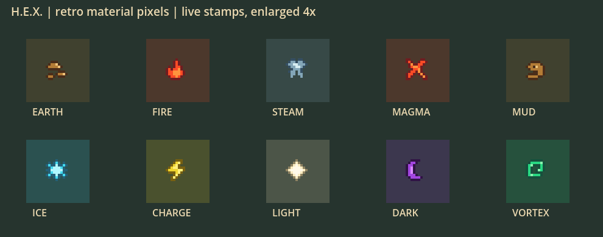
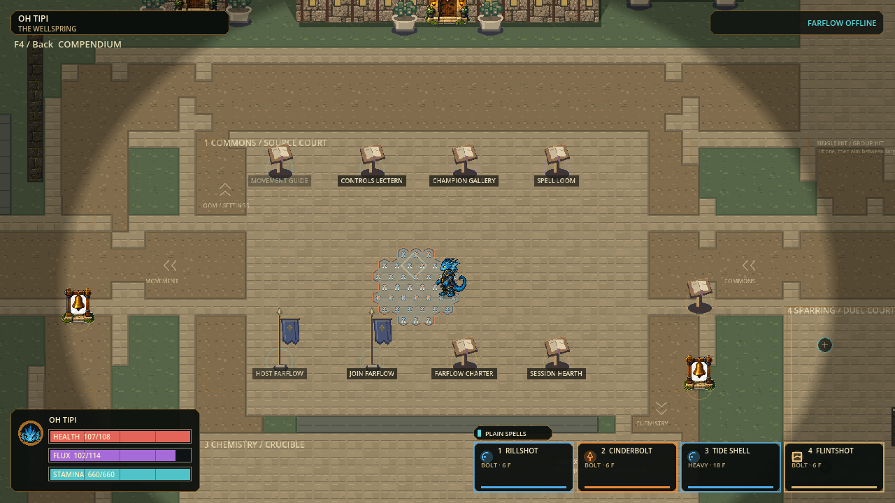

# Retro readability and exact-query checkpoint

September 28, 2026. Bounded follow-up to continuous motion: quieter characters,
pixel-based material identity, accurate indicators and less calculation overhead.
This document supersedes only the current slice summary; earlier receipts/builds
remain historical evidence and preserved fallbacks.

## Design and implementation

| Area | Change | Preserved contract |
|---|---|---|
| Characters | Removed permanent affinity arcs and orbiting sparks | Original 30 identity skins, continuous motion, size proportions; bare-hand casting remains |
| Projectile readability | Removed circular collision halos and opacity shimmer; four static inset pixel ticks show physical extent | Element-colored core, delivery silhouette, strength shrink, fixed collision radius |
| Materials | Cached 9x9 three-color stamps for Earth, Fire, Steam, Mud, Magma, Ice, Charge, Light, Dark and Vortex; slow highlight crawl | Exact whole-hex fills/borders, directional lanes, solid cover, forming/active/decay timing |
| Status hierarchy | Idle is quiet; actual protection, high/low clearance, impact and dangerous surfaces remain visible | No false immunity from a visual glow; no hidden danger in reduced-effects mode |
| Presentation cost | Skip discarded skeleton pose calculation under full-body art; bounded shared material texture cache | No atlas resampling, no per-frame texture creation after warmup, unchanged animation clock |
| Sector queries | Interior witnesses and exact separating planes precede clipping; forward support rejects behind-apex hexes | Same positive-area coverage, strict tangencies and deterministic ordering |
| Large arithmetic | Guarded floating filter resolves only unambiguously separated products; exact integer fallback resolves uncertain cases | Not an admission epsilon; exact equality and near-boundary results retained |

The arithmetic filter bounds integer-to-double conversion and two multiplications
by fewer than eight binary64 unit roundoffs per side; a 1e-12 sum-relative guard
is over 1,000 times larger. Nonfinite or uncertain estimates fall back to the
existing natural-number comparison. Random comparisons use that exact reference;
large equality, adjacent integer witnesses and narrow sectors are also tested.

No movement balance, input bindings, tick rate, damage, mana/stamina, capacity,
spell equip rules, reaction lifetimes, hurtboxes or wall clearance were changed.
Character low/air authored corrections remain incomplete; this does not create
new per-character animation banks or reauthor the entire map.

## Current rendered evidence

Native production material stamps (4x inspection enlargement, not concept art):

Actual paid Water/Fire casts forming Steam in the normal Wellspring, detailed
character mode; no decorative affinity orbit:

The field shot is the default 75% camera. Tiny marks are deliberately secondary
to the continuous occupied-hex border. Water/flow lanes, cover and startup/decay
warnings retain their existing specialized visuals, rather than replacing every
effect with the same icon. Human readability/feel approval remains open.

## Validation and delivery

Frozen runtime: **p56-8ac1fcbd4e8c**, 2,932 records, protocol 56 / snapshot 22.
Source SHA256:
`8ac1fcbd4e8cdd6ce093b469f7d42cf9fbfe8f7f92a2dc2b97aa43a1178f414b`.

Full rerun **PASSED: 166 suites / 1,186,622 assertions**, zero failures, stderr
zero bytes; editor import and configured 120 Hz boot passed. Receipt:
`retro-evidence/full-receipt.json`, logs:
`.godot/windows-tests/55d531d4b0f04b7682b3d78b803d0e11/`.
Windows portable export, native all-30 art admission, matching build identity and
safe close **PASSED**, with empty export/smoke stderr. No checkpoint pointer,
installer, commit or push promotion. Start:

`exports/hex-retro-readability-20260928/windows/PLAY-HEX.cmd`

Keep `hex.exe` and `hex.pck` together. The wrapper enables detailed character art;
the bare executable retains the default skeleton mode. Existing profiles and
saved controls are preserved. This is a local solo candidate; physical two-PC
play and rendered 120 Hz performance remain unaccepted.

PCK SHA256: `195bc246af92ee8e4303a41c4b7fb9ed196f228112084f33a5376ffaaba197dd`.
ZIP SHA256: `635300ee116c602330fbdb4c5a4238db8e15dfc8d8a555a99a1b55e207353627`.
Package receipt: `retro-evidence/package-receipt.json`.
Post-export source identity check also passed for all 2,932 records. Owned engine
helpers exited; saved personal profiles and prior builds were not replaced.

Initial profiling identified moving-field selection as the dominant timed stage.
Diagnostic attempts rejected an invalid output prefix and a misspelled suite ID;
these are retained as harness failures, not passing game evidence. Corrected
focused runs passed. Do not quote their counts as a full-suite result.

The first Full run executed all 166 suites but failed 300 portrait/inspection
assertions in the newly instrumented test: its copied skeleton presenter lacked
its readiness hash. The fixture was repaired without changing production code;
the focused fullbody suite then passed 137,652 assertions. Failed receipt retained
at `.godot/retro-readability-full-v1.json`; the fresh v2 Full rerun passed.

Native evidence: three contact-sheet frames, seven actual paid-cast/movement
frames and 256 normal-bootstrap frames (walk, slide fixture, air-chain fixture,
Gallery). Representative images reviewed; this is not full human animation
acceptance. The first sheet's incorrect test-only reaction palette lookup was
corrected to consume production palette logic; only the corrected sheet is shown.

### Measured simulation cost — still FAILED 120 Hz

Matched eight-paid-caster fixture, 120 warmup and 720 measured ticks per order;
same diagnostic stage instrumentation before and after:

| Metric | Before normal / reverse | After normal / reverse |
|---|---:|---:|
| Median step | 23.656 / 23.500 ms | 16.434 / 16.289 ms |
| p95 step | 50.988 / 53.434 ms | 38.232 / 38.535 ms |
| Maximum step | 268.807 / 273.234 ms | 240.741 / 240.344 ms |
| Ticks over 8.333 ms | 478 / 480 of 720 | 480 / 486 of 720 |

p95 is 25.0% / 27.9% lower in this paired comparison, but deadlines still fail
on roughly two-thirds of these dense workload ticks. Timing variation exists;
this is neither sustained 120 FPS nor rendered/network/capacity acceptance.
Final state hashes remain identical:
`d8a913640453854034d170c79cb259aebd012b9361db1d3e43003370b6cca79d`.
Both orders retain 69 paid admissions, 30 reactions, 41,400 paid matter, 19 peak
flights and 22 peak products. No resource refill or cap override was used.

Eight-actor pose CPU measurement is separate: median 1.835 ms, p95 3.296 ms,
max 5.782 ms, 7,680 pose queries, 384 cached source meshes and 8 stream buffers.
Removing unused skeleton work is verified, but no measured pose-speedup is
claimed (the prior p95 was 3.180 ms). GPU completion, combined native frames,
networking and human input are excluded. Receipts are in `retro-evidence/`.

## Playtest focus

| Check | Expected result |
|---|---|
| Stand, run, strafe and cast | No affinity ornaments circling the body; same aim/leg independence and movement timing |
| Air dodge / low slide / jump | Protection and height cues remain distinct; no universal immunity implied |
| Weaken a projectile | Core shrinks smoothly; quiet stationary pixels still show physical contact extent |
| Fire, Steam, Magma and Mud | Distinct pixel silhouettes and colors; occupied hex edge remains the effect boundary |
| Reduced effects | Less decorative motion, same material identity and harmful/harmless timing |

Next bounded engineering: moving-field selection/occlusion and full-world snapshot
hashing; then combined rendered-frame measurement. Next art: targeted low/air
costume transitions. Return for user feedback rather than starting another loop.
