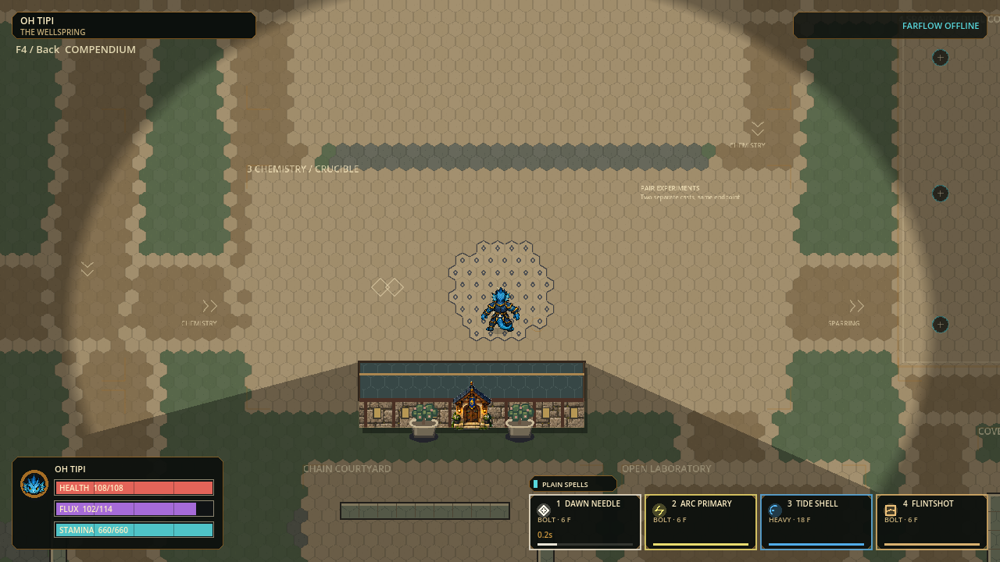

# Combat phase clarity evidence

Status: locally validated playtest checkpoint, 2026-09-28.

Candidate: `p56-0f3f12334cff`, 2,940 production records. Gameplay fallback:
`p56-eefcd94291c1` in `exports/hex-combat-options-20260928/`.
The only gameplay-presenting production source changed in this continuation is
`src/presentation/hex_court_presenter.gd`; no simulation tuning changed.

| Gate | Fresh result |
|---|---|
| Focused presentation / movement / chemistry / compendium | v2 PASS: 7 suites / 77,497 assertions, zero failures/stderr; v1's earlier 77,483 assertions retained separately |
| Native seven pairs, three phases, two effect settings | v2 PASS: 42 frames from 14 paid Bolts; all copied image hashes verified; 12 representative frames visually reviewed. v1 scripted PASS but visual REJECTED because Radiance's formation blended into beige terrain |
| Separate Windows export / native boot / art admission / safe close | PASS: `exports/hex-combat-clarity-20260928/`, source identity matches this candidate; 30 character skins admitted; payload and ZIP hashes verified |
| Full unfiltered suite | NOT_RUN for this presentation-only continuation; preserved gameplay fallback passed 171 suites / 1,531,093 assertions |
| Dense performance, same-export networking, physical two-PC, human feel | NOT_RUN |

These checks do not prove competitive balance, warning recognition while moving,
color-vision accessibility under dense overlap, audio quality, or sustained 120 Hz.
Historical performance and multiplayer failures remain unresolved. No commit,
push, publication, installer promotion or historical checkpoint-pointer change.

The rejected first visual candidate was `p56-90176ccb7d65`; its native receipt,
logs and Radiance warning example remain in this evidence folder. The correction
uses dark ink for the forming outline/mark only, retaining the element fill and
full-sized active mark. It introduces no extra rendering command or damage rule.

## Native review

Final images and their SHA256 receipt are in `native/`. These twelve v2 frames
were visually reviewed at 1280 x 720; this is not a claim to have reviewed all 42:

| Pair | Reviewed phases / settings |
|---|---|
| Thermal Shock | Formation / reduced |
| Plasma Arc | Formation / normal; active / reduced |
| Solar Flare | Formation / normal; active / normal; decay / reduced |
| Superconduct | Formation / normal |
| Arcflash | Formation / normal |
| Radiance | Formation / normal; active / normal; decay / reduced |
| Penumbra | Formation / normal |

The repaired Radiance warning is dark and visible against the beige campus;
its active marks are bright and its harmless decay is subdued. Each revised
material's formation was reviewed. Avatar and HUD remain readable in these
controlled views. Rapid recognition while moving, dense overlap, other terrain,
color-vision accessibility and human timing acceptance remain untested.

`package-receipt.json` and `package-logs/` preserve the export and isolated native
checks. The complete portable build remains outside tracked evidence in
`exports/hex-combat-clarity-20260928/`; historical working builds are preserved.
