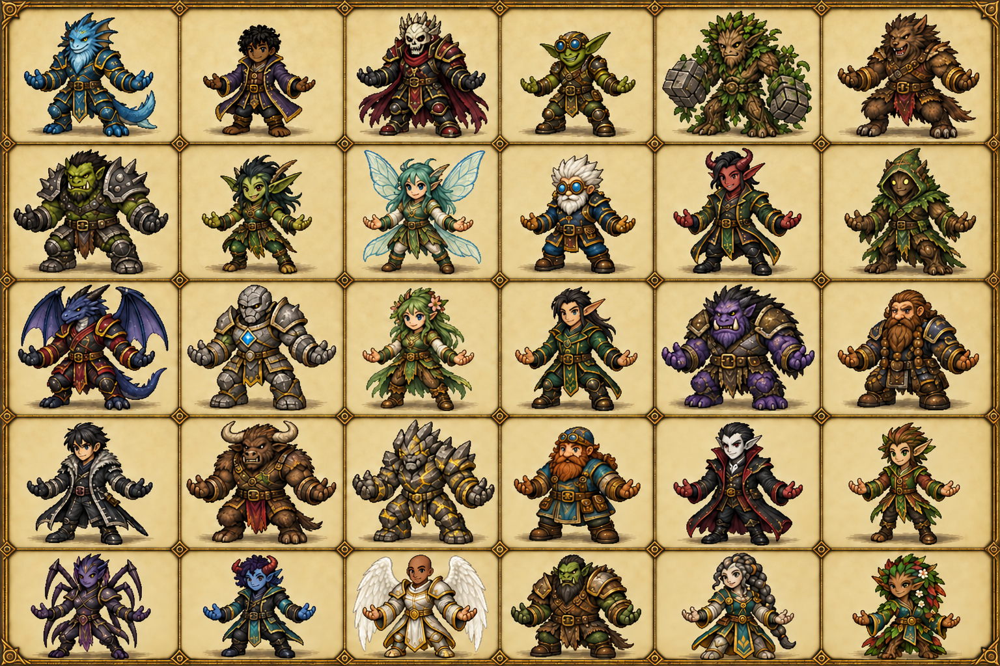

# Current cast / compact fantasy proportions

September 14, 2026 user-directed reference update: **30 playable identities**, ten
per size. Sai Laas replaces the unnamed Angel; Faab I Yaina remains the named
Angel. This is a styling reference, not 30 completed runtime skins or an animation
atlas. Current characters use the matching shared live body template.

## Current authority

| Aspect | Contract |
| --- | --- |
| Anatomy | Sturdy compact fantasy adventurer; approximately 4–4.5 heads tall, short neck, readable torso/limbs, practical clothing |
| Shared live visible heights | Small 58 / Middle 63 / Large 68 px; fixed size scale across actions; 96 px cells, pivot (48,84) |
| Hurtboxes / wall clearance | 17 / 18 / 19 px hurt radii by size; common 18 px wall clearance |
| Stamina maximum | 620 / 660 / 700; existing character recovery rates retained |
| Art separation | Body only; no spells, auras, ground shadows, weapons, labels or element icons baked into character sheets |
| H. Lenee | Existing `h_le_ne`, wire 28; female Stoneborn, Middle; Earth 1 / Air 1 / Fire 1 |
| Mifu | Existing `fimu_yashiha`, wire 29; female Treefolk, Small; Water 1 / Air 1 / Light 1; starter Spray is Squall |
| Sai Laas | New `sai_laas`, wire 30; Small Nymph; Air 2 / Fire 1; gender unspecified |
| Preserved identities | S. Wayne dark-skinned; Biggy Bob brown-haired; Spai Si and Juul I Yaina male Demons; Faab I Yaina bald male Angel; Wa Bidi female Goblin |

The supplied individual portraits retain historical printed names/affinities in
`source-h-lenee.png` and `source-mifu.png`; those labels are not gameplay authority.
`source-cast.png` preserves the original group. Air replaces **Mifu's** Fire;
H. Lenee already has Air and keeps her three elements. Original files are untouched.

## Identity layout (left to right)

| Row | 1 | 2 | 3 | 4 | 5 | 6 |
| --- | --- | --- | --- | --- | --- | --- |
| 1 | Oh Tipi | S. Wayne | The Red Baron | Steezo | Treevor the Mason | Oll' I |
| 2 | Fluup | Wa Bidi | Grace Riva | Waka Aren Si | Spai Si | Leaf the Hidden |
| 3 | Ha Rekt | Dr. Apex | Haara | Hesus Christo | Grimm Bow | Biggy Bob |
| 4 | Jan Wicked | Ba Djoh | Urzh | Don Doko Don | Djonah Thaan | Sai Laas |
| 5 | Luuh I Zeh | Juul I Yaina | Faab I Yaina | Joh Haynes | H. Lenee | Mifu |

Built-in image generation was used with the supplied references. The full
[initial prompt](generation-prompt.txt) and [final targeted edit](final-edit-prompt.txt)
are retained. `flux-current-cast-no-labels.png` is the superseded intermediate,
before Sai Laas and the final S. Wayne skin correction; only `*-final.png` is current.
Visual review found 30 separate full-body figures, no text/elemental effects,
and the requested current identities. Human aesthetic approval remains open.
Exact eight-facing anatomy, pixel scale and motion have separate runtime tests;
do not cut this sheet into live character atlases.
